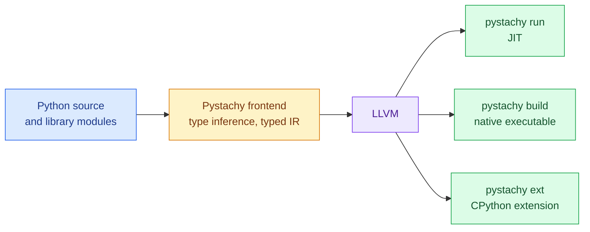

# Pystachy

<!-- PyPI uses this README as its description. Keep repository links absolute. -->

[](https://github.com/den-run-ai/pystachy/actions/workflows/ci.yml?query=branch%3Amain+event%3Apush)
[](https://github.com/den-run-ai/pystachy/actions/workflows/install.yml?query=branch%3Amain+event%3Apush)
[](https://github.com/den-run-ai/pystachy/actions/workflows/lint.yml?query=branch%3Amain+event%3Apush)
[](https://github.com/den-run-ai/pystachy/releases/latest)
[](https://pypi.org/project/pystachy/)
[](https://hub.docker.com/r/dta67/pystachy)
[](https://github.com/den-run-ai/pystachy/blob/main/LICENSE)
[](https://github.com/den-run-ai/pystachy/blob/main/docs/testing.md#compiler-coverage)
[](https://github.com/den-run-ai/pystachy/blob/main/docs/testing.md#native-runtime-coverage)

Pystachy compiles a typed subset of Python to native code through LLVM. One source
file runs three ways: under CPython, under Pystachy's JIT, or as a standalone
executable. Use it for CPU-bound work such as simulation, text processing and
data repair.

- Executables ran 2.4 to 72 times faster than CPython across 13 benchmark programs;
  the Performance table below gives a sample.
- `pystachy build` produces an executable that needs neither Python nor LLVM. The
  example below builds to 138 kB on Linux x86-64.
- Source stays ordinary Python that CPython also runs, with dataclasses, generators,
  closures, generics and [much of the standard library](https://github.com/den-run-ai/pystachy/blob/main/docs/stdlib.md#library-support-at-a-glance).
- More than 2,200 test programs must match CPython 3.13's output in both JIT and AOT
  modes, and more than 1,800 others must be rejected with the expected diagnostic
  ([testing](https://github.com/den-run-ai/pystachy/blob/main/docs/testing.md)).
- The compiler is written in the subset it compiles. Each build checks that
  successive self-compilations emit [identical LLVM IR](https://github.com/den-run-ai/pystachy/blob/main/docs/internals.md#bootstrap-validation).
- The experimental [FFI](https://github.com/den-run-ai/pystachy/blob/main/docs/ffi.md) calls C libraries, builds extension modules that
  CPython imports, and embeds CPython.

## Quick start

Install the [PyPI package](https://pypi.org/project/pystachy/) in a Python 3.11+
virtual environment:

```sh
pip install pystachy
```

The [installation guide](https://github.com/den-run-ai/pystachy/blob/main/docs/install.md) covers LLVM requirements and automatic
toolchain setup. [Native archives](https://github.com/den-run-ai/pystachy/releases/latest) and
[Docker images](https://hub.docker.com/r/dta67/pystachy) run the compiler without Python.
Releases target Linux on x86-64 and ARM64, and macOS on Apple Silicon and Intel.

Save this as `checkout.py`. It simulates two million customers queueing for one
cashier:

```python
"""Simulate a checkout queue with one cashier and report the mean wait."""
from dataclasses import dataclass
from random import Random


@dataclass
class Stats:
    served: int = 0
    waited: float = 0.0


def arrivals(rng: Random, rate: float, count: int):
    clock = 0.0
    for _ in range(count):
        clock += rng.expovariate(rate)
        yield clock


def simulate(customers: int, seed: int) -> Stats:
    rng = Random(seed)
    stats = Stats()
    free_at = 0.0
    for arrival in arrivals(rng, 0.9, customers):
        start = max(arrival, free_at)
        free_at = start + rng.expovariate(1.0)
        stats.served += 1
        stats.waited += start - arrival
    return stats


stats = simulate(2_000_000, seed=7)
print(f"{stats.served:,} customers, mean wait {stats.waited / stats.served:.2f}")
```

```sh
python3 checkout.py                      # CPython reference
pystachy run checkout.py                 # Compile and run with the JIT
pystachy build checkout.py -o checkout   # Build a native executable
./checkout
```

All three executions print `2,000,000 customers, mean wait 9.07`. The compiled
`random` module draws the same sequence as CPython's for this seed. Annotations
appear only on signatures and fields; the compiler infers local types.
The [getting started guide](https://github.com/den-run-ai/pystachy/blob/main/docs/getting-started.md) walks through a diagnostic
and shows how to measure compilation and execution separately.

## Performance

| Program | CPython | JIT | AOT | AOT speedup |
|---|---:|---:|---:|---:|
| [`spectral.py`](https://github.com/den-run-ai/pystachy/blob/main/bench/spectral.py): nested numeric loops | 1.352 s | 0.094 s | 0.019 s | 72× |
| [`nbody.py`](https://github.com/den-run-ai/pystachy/blob/main/bench/nbody.py): floats and objects | 1.859 s | 0.107 s | 0.035 s | 53× |
| [`fib.py`](https://github.com/den-run-ai/pystachy/blob/main/bench/fib.py): recursive calls | 1.008 s | 0.092 s | 0.052 s | 20× |
| `checkout.py` above: dataclass, generator and `random` | 0.700 s | 0.265 s | 0.088 s | 7.9× |
| [`dictcount.py`](https://github.com/den-run-ai/pystachy/blob/main/bench/dictcount.py): dict counting | 0.964 s | 0.216 s | 0.153 s | 6.3× |
| [`memo.py`](https://github.com/den-run-ai/pystachy/blob/main/bench/memo.py): recursion with `functools.cache` | 0.455 s | 0.189 s | 0.095 s | 4.8× |
| [`words.py`](https://github.com/den-run-ai/pystachy/blob/main/bench/words.py): strings and dicts | 0.224 s | 0.141 s | 0.094 s | 2.4× |

These are whole-process wall times for v0.4.0-alpha.3, measured on 11 November 2026:
medians of five runs on one CPU of a shared 4-vCPU Intel Xeon 2.10 GHz VM, with
CPython 3.13.18 and LLVM 18.1.3. JIT times include compilation, AOT times exclude
the build, and every output matched CPython's. The raw samples cover the
[benchmarks](https://github.com/den-run-ai/pystachy/blob/main/bench/results/bench-run-v0.4.0-alpha.3-2026-11-11.json) and
[`checkout.py`](https://github.com/den-run-ai/pystachy/blob/main/bench/results/readme-checkout-v0.4.0-alpha.3-2026-11-11.json).

Typed numeric loops gain the most. String and dict code gains less, and work that
CPython already runs in C, such as regex matching, can be slower. Memory use can
also fall: an executable that builds a list of 4,194,305 integers peaked at 34.2 MiB
RSS, against 171.2 MiB under CPython. The [performance guide](https://github.com/den-run-ai/pystachy/blob/main/docs/performance.md)
has the full table, startup and memory costs, and reproduction commands.

## How it works

Pystachy compiles the whole program before it runs, including the library modules
it imports; there is no interpreter fallback. The frontend checks and infers types,
specializes functions and builds a [typed IR](https://github.com/den-run-ai/pystachy/blob/main/docs/typed-ir.md), where Pystachy's own
optimizations run before LLVM's. `run`, `build` and `ext` share that pipeline and
differ only in the last step. The [compiler internals](https://github.com/den-run-ai/pystachy/blob/main/docs/internals.md#compilation-pipeline)
follow a program through each stage.



## Compatibility

Pystachy is experimental and compiles a subset of Python. It rejects most
unsupported constructs at compile time, naming the file and line; the known
behavioral differences are listed as [deviations from CPython](https://github.com/den-run-ai/pystachy/blob/main/docs/language.md#deviations-from-cpython).

| Area | Supported | Not supported |
|---|---|---|
| Values | `int`, `float`, `bool`, `str`, `bytes`, `list`, `dict`, `set`, `frozenset`, `tuple` | `complex`, `bytearray`, `memoryview` |
| Functions | Closures, lambdas, decorators, `*args` and `**kwargs`, generators, `async def`, `await`, async generators and asynchronous comprehensions, `asyncio` tasks and event loop | `asyncio` I/O, threads and exception groups |
| Classes | Single inheritance, also of generic classes, dataclasses, `NamedTuple`, properties, operator methods | General multiple inheritance, metaclasses, subclasses of builtin types |
| Typing | Inferred locals and returns, generics, closed unions, `T \| None` narrowing | General object unions |
| Syntax | Comprehensions, f-strings, `with`, `try`/`except`/`finally`, `:=`, bounded `match` | Mapping and general sequence/class patterns; `except*` |
| Runtime | Modules and packages, automatic memory management | Native threads, `__del__` finalizers, `eval` and `exec` |

An `int` is a checked 64-bit value: overflow raises `OverflowError`. A module can
opt in to experimental [arbitrary-precision integers](https://github.com/den-run-ai/pystachy/blob/main/docs/python-int.md)
or [runtime-typed `Any` values](https://github.com/den-run-ai/pystachy/blob/main/docs/dynamic-any.md).

Check the [language guide](https://github.com/den-run-ai/pystachy/blob/main/docs/language.md#support-at-a-glance) and
[library support table](https://github.com/den-run-ai/pystachy/blob/main/docs/stdlib.md#library-support-at-a-glance) for the
features and APIs your code uses. Shipped modules include `re`, `json`,
`collections`, `itertools`, `functools`, `datetime`, `random`, `argparse` and
`pathlib`; the table gives each module's limits.

Some third-party packages compile from installed sources, and others need
adaptations like the 14 [maintained ports](https://github.com/den-run-ai/pystachy/blob/main/ports/README.md). The optional
[CPython bridge](https://github.com/den-run-ai/pystachy/blob/main/docs/ffi.md#calling-cpython) lets native code call
packages that need CPython at runtime.

## Examples

| Example | What it shows |
|---|---|
| [Event router](https://github.com/den-run-ai/pystachy/blob/main/examples/route/README.md) | Route logs and traces using pattern matching and memoization. |
| [JSON repair](https://github.com/den-run-ai/pystachy/blob/main/examples/json_repair/README.md) | Repair malformed JSON through a native CLI or a CPython extension. |
| [Byte BPE](https://github.com/den-run-ai/pystachy/blob/main/examples/byte_bpe/README.md) | Train a byte tokenizer and encode/decode Unicode text natively. |
| [Coding agent](https://github.com/den-run-ai/pystachy/blob/main/examples/agent/README.md) | Run a typed tool loop and edit files from a native executable. |
| [nanoGPT](https://github.com/den-run-ai/pystachy/blob/main/examples/nanogpt/README.md) | Run inference and training without CPython, NumPy or PyTorch; BLAS is optional. |

[All examples](https://github.com/den-run-ai/pystachy/blob/main/examples/README.md) lists the smaller tools, such as CSV statistics,
line diffs, maze search and Monte Carlo sampling, with their checks and requirements.

## Roadmap

Pystachy is focused on stronger type inference, broader library support backed by
CPython comparisons, and lower compilation and execution costs.

## Learn more

- [Documentation](https://github.com/den-run-ai/pystachy/blob/main/docs/README.md) covers installation, packaging, interoperability and compiler internals.
- [Testing](https://github.com/den-run-ai/pystachy/blob/main/docs/testing.md) explains CPython comparisons, bootstrap checks and CI.
- [Native pytest-style tests](https://github.com/den-run-ai/pystachy/blob/main/docs/pytest-native.md) use a generated runner for a bounded fixture and parametrization subset, with CPython pytest as the oracle.
- [Contributing](https://github.com/den-run-ai/pystachy/blob/main/CONTRIBUTING.md) covers development setup, focused tests and submissions.

Pystachy is [MIT-licensed](https://github.com/den-run-ai/pystachy/blob/main/LICENSE). See the [third-party notices](https://github.com/den-run-ai/pystachy/blob/main/THIRD_PARTY_NOTICES)
for licenses of adapted code.
