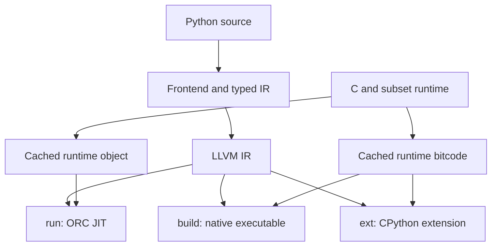

# How Pystachy works

Pystachy's compiler is written in the typed Python subset it compiles. A CPython-hosted
compiler and a native compiler use the same frontend, typed IR and LLVM lowering.
The runtime combines C with functions written in that subset.

For supported syntax and behavior, read the [language guide](language.md). For the IR's
contracts and passes, read [typed IR](typed-ir.md). The [testing guide](testing.md)
explains differential checks and bootstrap validation.

## Repository layout

| Path | Purpose |
|---|---|
| `pystachy.py` | Compatibility entry point for the hosted and self-hosted compiler |
| [`src/pystachy_compiler/`](../src/README.md) | Lexer, parser, scope checks, module loader, type checker, typed IR, LLVM lowering and driver |
| `runtime.c` | Allocation and collection, container storage, files, numeric support and exception unwinding |
| `runtime.py` | Runtime functions written in the subset; see [runtime in the subset](runtime-in-subset.md) |
| `lib/`, `ports/` | Standard-library modules and adapted third-party packages; see [library support](stdlib.md) |
| `mpz/` | Compact arbitrary-precision arithmetic, adapted from MicroPython; see [representation and provenance](../mpz/README.md) |
| `ryu/` | Ryu's float-to-string conversion, with its upstream license; see [Ryu's README](../ryu/README.md) |
| `tests/`, `tools/` | CPython comparisons, rejection cases, IR probes, fuzzers and validation tools |
| `bench/`, `examples/` | Performance workloads and complete applications |
| `pyext.c`, `pyembed.c` | CPython extension and embedding glue; see [foreign functions](ffi.md) |

## Compilation pipeline

The frontend runs these stages before LLVM sees the program:

| Stage | Responsibility |
|---|---|
| `Lexer`, `Parser`, `Symtable` | Decode and parse source; check syntax and scope rules, including code that will not be compiled |
| `Loader` | Find imports, qualify module names, and resolve supported import-time decisions |
| `Flow` | Identify reads that need an assignment check |
| `Gen` | Declare interfaces, check and infer types, specialize templates, and build typed IR |
| IR passes and lowering | Compute effects, optimize eligible operations, lower exception handling, and print LLVM IR |

## Frontend and specialization

Imports become qualified names in one compiled program, rather than runtime module objects.
Each module has an initialization function that runs its body when first imported.
Definition-time checks preserve the relevant annotation, default-value and import behavior;
see the [module reference](language/modules.md).

`Gen` checks each function while building its IR. Expected types flow into expressions;
inferred types flow out. Static branches determine which bodies need checking, and
unannotated function parameters cause specialization at calls. Constructor-inferred class
templates create ordinary compiled classes for their field types. The
[typing reference](language/typing.md) describes the supported forms and limits.

Ordinary single-inheritance hierarchies carry a class tag. Base-typed instance-method calls
select a concrete implementation, then reuse method specialization for that receiver.
A comparison tests both operands' classes (a `switch` on an ordinary tag), but compiles
each distinct call once: pairs of classes that call one method instance, on the same
operand, share its code. A method that takes the other operand as a template's parameter
(`other: object`) takes it as the type the comparison declares, so that it is compiled
once for each receiver's class.
Inherited fields keep the base layout; unrelated classes retain their existing layout.
Explicit base calls and `super()` select a body directly while preserving the receiver.

A known function value can become a direct call. Closures keep captured variables in shared
cells, so `nonlocal` assignments remain visible. A typed `Callable` uses an adapter with a
code pointer and an environment pointer for indirect calls.

The preceding `Flow` pass marks reads it cannot prove initialized. Generated checks then
raise the appropriate error; LLVM can remove checks it proves redundant. Optional-value
narrowing is a separate typing concern. In `__init__` of a class outside a hierarchy, the
branch where `hasattr(self, "f")` is true has field `f` assigned: a field made only where
it is false (`if not hasattr(self, "f"): self.f = ...`) keeps a flag for `hasattr`, and its
reads have no check unless `self` escapes before it is assigned: to a call, a bound method,
or a def or lambda that uses `self` other than as `self.f` of its fields. A def or lambda
that uses it only that way may run later and reads only those fields: the ones not assigned
where it is defined keep their checks.

## Typed IR and LLVM

The IR contains one `IFn` per compiled function, with basic blocks, instructions, loop
metadata and exception-handler metadata. Runtime signatures and effects come from the
`RUNTIME` table. Whole-program effect summaries support list-read and dictionary-lookup
optimizations and identify calls that need exceptional edges.

JIT and AOT share this IR. Every function instruction is a registered typed operation,
including loads, stores and arithmetic; there is no `raw` instruction containing LLVM text.
The frontend still resolves, types and specializes code while building IR, and LLVM lowering
owns module layouts and ABI wrappers. Further frontend/backend separation and a second
backend remain future work. See [typed IR](typed-ir.md) for the implemented boundary.

Locals start in entry-block `alloca` slots. LLVM's `mem2reg` builds SSA form; expression joins
also use explicit `phi` instructions. Each function's typed IR is released after lowering,
while its effect summary remains available.

## Values and runtime

Scalars use LLVM's `i64`, `double` and `i1`; strings, containers and objects use pointers.
Container elements occupy uniform eight-byte slots, allowing one runtime implementation to
serve multiple static element types. Optional reference values use null for `None`; optional
numbers use boxes. Integers use checked 64-bit arithmetic rather than CPython's arbitrary
precision.

Strings retain UTF-8 storage: their header holds the byte length, cached dictionary hash,
and cached code-point count plus one (zero means unknown), followed by the bytes at offset
24. ASCII literals start with the character count cached. `bytes` shares the storage layout
but keeps byte-based semantics. Compiler literals, FFI adapters and the CPython glue must
agree with this layout; cache writes do not change the immutable string value.

A bounded, 64-entry weak position cache records byte/code-point offsets outside the string
header. Nearby indexed reads and bounded searches reuse a hint instead of rescanning the
prefix; this keeps the native lexer's sequential indexing practical for Unicode source.
Collection clears all hints before reclaiming memory, and in-place append invalidates the
changed string's hint. The cache retains no strings and adds no header fields; uncached or
widely separated non-ASCII indexing remains O(n).

Generic operations such as comparison, hashing, representation and sorting receive a compact
type descriptor. The runtime interprets nested container descriptors and calls generated helpers
for supported object methods. A dict's or set's descriptor of its keys tells objects hashed by
identity (their addresses, which the non-moving collector keeps stable) from those hashed by
their class's `__hash__`; a dict of the latter keeps CPython's hashes and an index of CPython's
size (other dicts' have twice the slots), so that its lookups probe CPython's slots in CPython's
order and call `__eq__` as often. Dynamic-`Any` programs also mark native dictionaries for
that hash/probe scheme (`!` before their key descriptor), since a comparison can look up a
key from a different static type. Their `str`/`bytes` dictionaries use immediate kind `3`
(`1 | KTAG`), with the same hashes, table size and probes as `!s`; string hashing and equality
skip generic descriptor dispatch. The cached string hash normalizes zero to one and minus
one to minus two, so native strings and boxed strings share stored hashes. `bytes` uses
string storage here but has no dynamic-`Any` box. Specialized code still has static types; these descriptors
do not by themselves make storage dynamic. Experimental opt-in `Any` uses the
[separate boxes and dispatchers](dynamic-any.md#representation) described below.

The collector is conservative, non-moving mark-and-sweep. It scans stack/register roots and
registered program globals; buffers that cannot contain pointers are not scanned. Marking
prefetches each object a few objects before it scans it (`MQ`), so the cache misses of a big
heap overlap; the objects it marks do not depend on that order. Unreachable
files close during collection or at program exit. Supported Python operations are checked
against CPython; the [compatibility reference](language/compatibility.md) lists deviations.

Runtime static pointer storage is classified beside its declaration with `GC_ROOT`,
`GC_ROOT_RANGE` or `GC_NO_ROOT` and a reason. `GC_ROOT` scans the storage's address;
`GC_ROOT_RANGE` scans the contents of a malloc-backed pointer table. The distinction
prevents scanning a managed object's contents instead of marking its holding pointer.
`make lint` and `make check-runtime` compare these annotations
with clang's complete static-storage inventory, including defined external-linkage globals,
unused definitions, aggregate fields
and function-local statics. Each root must reach a real `scan` in `mark_roots`; comments
or dead calls do not count. Static roots require constant offsets covering the exact
complete storage interval, including all array elements and aggregate padding. Root ranges
reject provably empty, reversed, negative or unaligned bounds, including equivalent symbolic endpoints, while
allowing intentional active subranges. Packed static roots and aggregate declarations
classified as root ranges are unsupported and fail closed. Range offsets support constants,
integer globals used only by direct loads in `mark_roots`, and their additions/subtractions;
each endpoint must have nonnegative coefficients, and the end-minus-start expression must
contain a positive term. This screens the coefficient form without proving nonnegative
counter values or relative ordering of dynamic bounds; active ranges such as
`wr_head` to `wr_nfired` still require review. Unsupported arithmetic or untracked local
loads fail closed. Root-range backing pointers
must also be used only by direct loads in `mark_roots`. To keep those loads stable without alias analysis,
`mark_roots` may store only into its local allocations and call only `scan` or the frame-address
intrinsic; other stores, atomic writes or calls fail closed for root ranges. Static holding-root
addresses remain valid when their pointer contents change. The check does not prove
dynamic bounds or backing allocation sizes, non-root lifetime arguments, or pointers hidden
in integers; those still require review and GC stress coverage. Weak registries and allocator metadata deliberately
are not strong roots.

`Str`'s named header offsets and size have C static assertions in the runtime and both
CPython adapters. The compiler uses `STR_HEADER_SIZE` for byte offsets and allocations.
The `rt-abi` contract compares clang's `offsetof`/`sizeof` probes with that constant and
checks literal header values against their bytes, so exchanging same-typed cache fields
cannot pass merely because their LLVM types match.

`runtime.py` is compiled in a restricted runtime mode using `_rt` primitives, then linked with
`runtime.c`. This reuses the compiler for string methods, formatting and numeric helpers.
The [runtime guide](runtime-in-subset.md) covers those primitives and their constraints.

## Reflection

Reflection (`reflection.py`; the language rules are in [reflection](language/semantics.md#reflection))
is decided at compile time wherever the static types decide it, and costs nothing where it is not
used. `getattr`, `setattr` and `hasattr` with a literal name become the attribute access they name;
a loop over a constant set of names (a display, a variable bound once and only iterated, `dir(x)`,
`dataclasses.fields(X)`, `vars(x).items()`) is unrolled, its body compiled once per name with the
name substituted as a literal, under a budget of 256 copies; `dataclasses.asdict()`/`astuple()`
are synthesized per class; `type(x).__name__` of a value whose class is fixed is a constant. A
program that uses none of these constructs compiles to the IR it compiled to before.

Where a run-time choice remains, the code dispatches on the value's exact type, the way method
calls already do: None first (where it may be), then a union's member tag, then an object's class
tag (`refl_split`). Each concrete class's arm then reads the class's **reflection record**, an
internal constant global that is emitted only for classes that reach such a site:

| Word | Contents |
|---|---|
| 0, 1, 2 | the class's `__name__`, `__qualname__` and `__module__` (string constants) |
| 3 | flags: has an instance `__dict__`, dataclass, frozen, in a hierarchy, builtin type |
| 4, 5 | the number of names and the **name table**: `{name, kind}` pairs sorted by their bytes, every name `dir()` lists (a field, a field that may be unassigned, a class attribute, a property, a method, a static or class method, an attribute of the object or its type, a slot never assigned) |
| 6, 7 | the number of fields and the **field table**: `{name, type descriptor, byte offset, offset of the "is assigned" flag or -1}` in the order CPython inserts them into the instance `__dict__` |

`@pys.refl.c.<Class>` is a class's record and `@pys.refl.b.<type>` a builtin type's
(`int`, `list`, `NoneType`, ...); a specialization of a class template has its own record for its
layout, while its identity is its template's (the class CPython has). The tables are separate
internal constants (`<record>.names`, `<record>.fields`), null until a site needs them: a record
made for `type(x).__name__` carries only its names. They are `Data` records (`classrec`,
`classnames`, `classfields`) that `lower_module.py` alone lays out, and the field table's offsets
are LLVM constant expressions over the class's `%C.<Class>` layout, so the compiler holds no
layout arithmetic. No new IR operation is needed: a site uses `phi`/`select` of record addresses
(`%ptr`), `mach.load` of a word, `scalar.cmp` of two addresses and two runtime calls.

| Construct | Lowering |
|---|---|
| `type(x).__name__` in a hierarchy or union | the dispatch's `phi` of record addresses, then a load of word 0, 1 or 2 |
| `type(a) == type(b)`, `type(a) is C` | a comparison of record addresses: the record is the class's identity |
| `str(vars(x))` | `pys_refl_vars(record, object)`: the runtime walks the field table, formatting each assigned field by its descriptor through the generic `repr` |
| `hasattr(o, name)`, the text of `getattr(o, name)`, `setattr(o, name, v)` with a run-time name | `pys_refl_find(record, name)`, a binary search of the name table, then a switch on the index at the site, whose arms do what CPython's lookup does for that name |

LLVM does the rest: `simplifycfg` turns the tag and index chains into `switch` instructions and,
where every arm yields a constant (most of `hasattr()`'s, the names of `type(x)`), into lookup
tables; a load from a record selected among constants folds into a select of the strings; string
constants are shared (`sconst`); and since records and tables are internal, `globaldce` (JIT) and
`llvm-link --only-needed` with `-O2` (AOT) drop those no code references, so a binary holds records
only for classes that reach a reflective site. `RUNTIME` declares `refl.find` without effects
and `refl.vars` with `A I rO rL rD U` (a field's `__repr__` may run user code).

**Dynamic values.** Opt-in `Any` values use immutable `{DynType *, payload}` boxes.
The `DynType` identifies the Python type and payload layout; compiler-generated helpers
dispatch operations on boxed values. See [dynamic `Any`](dynamic-any.md#representation)
for the implemented representation and its limits.

Type-erased `Protocol` and iterator storage with shared method tables remains a
[separate proposal](https://github.com/den-run-ai/pystachy/issues/488).

## Errors and cleanup

Overflow, invalid receivers and uninitialized reads branch to shared cold error blocks.
For programs that use `try` or `with`, exception lowering gives may-raise calls explicit
unwind edges to LLVM landing pads. The runtime unwinds through native frames using its own
personality routine; local raises can branch directly to their handler.

Handlers match exception classes and rethrow unmatched exceptions. `finally` and `with`
cleanup run on the relevant normal and exceptional exits. Nested `finally` handling avoids
exponential duplication. The C runtime is compiled with exception support in both tiers.

A `with` statement over a file registers the file's close as an unwind action. Over an object
of a class that defines `__enter__` and `__exit__`, `statements.with_cm` builds a `try`
statement of its own and compiles it as any other: the block (after the `as` target, assigned
from `__enter__()`) is its body, its one except clause calls `__exit__` with the exception's
class and the exception (`excinfo` nodes, which read the clause's exception) and raises it again
unless the call returns a true value, and its else block calls `__exit__(None, None, None)`, as
an exit pushed for the block (like a finally block's) does for a `break`, `continue` or
`return`. The items after the first such manager, and the block, are its body (they nest). The
exception's class is its class object (`exctype`, below); an exception that may be `None` is
`opt[exc]`, both null for `None`. `__enter__` and `__exit__` are method templates
(`utils.template_ok`), so an unannotated `__exit__` is compiled once for the exception's
arguments and once for three `None`s. A program with such a class lets flow analysis end a
`with` block anywhere (`Gen.cm_exits`), unless each of its items is a call of the builtin
`open()`. `contextlib.suppress(A, B)` as an item is the except
clause `except (A, B): pass` (`statements.suppress_item`), and the loader makes a method decorated
`@contextmanager` the generator method `_pys_cm_NAME` and a method `NAME` that calls
`contextmanager()` on it bound (`loader.cm_methods`): it makes the `_GeneratorContextManager`
itself, of the generator `C._pys_cm_NAME(self, ...)` of its own class `C` (so `super().NAME()`
runs the base class's; `self._pys_cm_NAME(...)` where no class of the module derives from `C` or
is a base of it) and of `_pys_cm_NAME` bound to `self` taken as an object of the class that
first defines `NAME` so (`loader.cm_root`): `NAME` returns one type for every subclass. A program that reads `__cause__`
(`Gen.causeread`) records it, `pys_exc_setcause`, for `raise ... from c` and PEP 479's
`RuntimeError`.

An exception class as a value is its class object (`exctype`): runtime.c's one `Exc` per class
(`pys_exc_proto`, kept in a table the collector scans), never raised, whose kind (and, for a class
of the program, an `obj` word holding its `ExcClass`) is read as an exception's is, so names,
`str()` and `repr()` need nothing new; `type(e)` is `pys_exc_canon(e)`. `is`, `==`, `hash()` and
container keys (descriptor `C`) take its address. `issubclass()` and `isinstance()` against a
class object pass `pys_exc_sub` the program's classes with their bases, one string
(`exceptions.exc_tree`). A call of a class object looks its class up in the table of functions
for the call's argument type (`@x.mk.N`: `exceptions.exc_call`, `pys_exc_ctor`) and calls the one
found, which makes an object of a class of the program as a call of the class does; it finds none
for a builtin class, which `pys_exc_make` makes. The program's last pass compiles a function for
each class used as a value, or whose objects are made where `type()` of an exception that may be
one became a class object, and each form of call (`exceptions.exc_ctors`), until no more come;
then it writes the tables (`exc_tables`).

Iterator objects are ordinary class objects. A loop, `in`, unpacking or `next(it, default)`
over one calls its `__next__` in a block whose landing pad catches only `StopIteration`
(and its subclasses), restores the exception being handled and leaves the loop; the loop
body itself stays outside that handler. Such a handler turns exception handling on for a
program that defines `__next__` and also `__iter__` or reads the builtin `next`; a `__next__`
only called directly needs none. `iter()` of a builtin container makes an object of a
class template in `lib/_pystachy_iterators.py`, which the loader adds to a program that reads
the builtin `iter` (not a name a scope binds) and whose classes compile only when specialized.

## Generators

A generator function compiles to an LLVM switched-resume coroutine (`presplitcoroutine`), and
LLVM's coroutine passes do the work a hand-written state machine would: CoroSplit finds the
values live across each `yield`, lays out the frame and outlines the resume and destroy
functions, and CoroElide puts the frame of a generator a loop owns into the loop's own frame
(HALO) once the generator's ramp is inlined. The typed IR marks the coroutine's structure
with closed operations (`docs/typed-ir.md`): `gen.start` ends the entry block (`coro.id`,
`coro.alloc`, a frame from `pys_alloc` that the collector scans, the promise, and the initial
suspend that makes a call run none of the body), `gen.yield` and `gen.ret` suspend it (all
returns share the one final suspend), `gen.promise` addresses a promise, `gen.resume` resumes
a handle (an `invoke` in a `try`), and `gen.drop` closes and destroys a generator a loop owns.
`coro.free` frees nothing: the collector reclaims an unreachable frame, and an elided frame
lives in a scanned stack frame.

A generator object is the coroutine's handle, so every generator that yields `Y` has the type
`gen[Y]` (shown as `Generator[Y]`), whatever function made it; one whose function takes `S` from
`send()` (`Generator[Y, S, R]`, `S` not `None`) has the type `gen[Y,S]`, which widens to `gen[Y]`.
The promise holds five words: the value yielded last, the value returned (`r = yield from g()`),
the state (suspended, suspended where closing it runs its code, finished, running), the
consumer's command (close by a loop, `close()`, `throw()`) and the generator's `__qualname__`. A consumer checks the state before it resumes (a finished generator
is never resumed; a running one raises `ValueError`) and after (finished: the loop ends).
`for_seq` takes a generator as one more kind of sequence, so `for`, `enumerate()`, `zip()` and
comprehensions iterate generators; consumers that take all items read them into a list, and
`sum()`, `min()`, `max()`, `any()` and `all()` take them as a generator expression would.

With exceptions on (a program with `try` or `with`), a landing block covers a generator's body:
an exception that leaves it marks the generator finished and goes on (a `StopIteration` as PEP
479's `RuntimeError`). A loop over a generator its iterable has just made (a call of a generator
function) owns it: `gen.drop` runs where the loop is left, and when closing may run code of the
generator (a `yield` in `try`, `with`, `yield from` or a loop of its own), the loop is the body
of a `try` whose finally block drops it, so an exception in the body closes it too. Closing
resumes the generator with the close command, and the `yield` raises `GeneratorExit` there,
which its `finally`, `with` and `except GeneratorExit` see; the generator's landing block ends
it, and reports anything else, as `pys.gen.drop` reports a `yield` after `GeneratorExit`. A
suspended generator keeps none of its exception state among its consumer's: it sets its `with`
blocks' unwind actions aside (`pys_gen_leave`, `pys_gen_enter`), its `try` statements' marks
(and those of the `StopIteration` catches of its loops over iterator objects) are relative to the
depth where it was last resumed, and the exception it handles in an
`except` clause or a `finally` block is its own again when it resumes. In a program that reads
`sys.exception()` (`Gen.excread`), a try statement in a generator notes the exception being
handled as it starts as null where it is the resumer's (`exc_mark`), and the end of its clauses
restores the resumer's of the current resume for null (`exc_back`), as CPython's generator
falls back on its caller's exception state.

`close()` resumes a generator suspended where closing it runs its code with the `close()`
command, under which its landing block leaves what it raises for `close()` (`pys_gen_unraisable`
keeps it, `pys_gen_closed` takes it) instead of reporting it; any other generator is just marked
finished. A `yield from` suspended so closes the generator it delegates to the same way before it
raises `GeneratorExit` (PEP 380), so what that raises is raised at the `yield from`. A program
that calls a method named `send` or `throw` (`Gen.gproto`, decided from the source before
anything is compiled) gives its generators two more promise words, the value sent and the
exception thrown, and a state for a generator that has not started (a `send()` of a value and a
`throw()` tell it from one suspended at a `yield`). `send(v)` stores `v` and resumes, and a
`yield` whose value is used reads it (in a program without `send()`, a `yield`'s value is
`None`); `throw(e)` stores `e` and resumes with the `throw()` command, which the `yield` raises,
where a `try`, `with` or `yield from` may handle it, and raises it in the thrower elsewhere (a
`StopIteration` as PEP 479's `RuntimeError` where it leaves a suspended generator). A `yield from`
there sends what it is sent on to its generator, throws what is thrown into it into its generator
(closing it for `GeneratorExit`) and suspends again with what that yields, or finishes with its
value. Programs without `send` and `throw` keep five words and the code they had; only a
`yield from` whose closing may run code closes its generator as above. A program where a module
opts in to [promoting ints](python-int.md) gives its generators nine words: also the pointers of
the promoting ints yielded last and returned (`specs.GENVALP`, `GENRETP`), which every `yield` of
an int writes, null where the value fits.

A generator expression that no consumer takes directly becomes an anonymous generator
function, called with its first iterable (evaluated where it is written) and the values of
the enclosing function's variables it reads. Programs without `yield` and without such
generator expressions emit the same typed IR and LLVM IR as before.

## JIT, AOT and runtime caching

`run` favors startup latency. LLVM removes unused internal functions, inlines the small
recursion-accounting helpers, optionally inlines the program's own functions, performs SSA
cleanup, and runs `early-cse` and `adce` to remove
redundant computations and unused loop feedback before ORC JIT runs with the cached runtime.
On Linux, `lli` loads the runtime as a shared library (`-dlopen`), which the driver links once
from the cached runtime object and caches beside it; elsewhere `lli` links the object into each
run (`-extra-object`), which cost about 35 ms a run
([#704](https://github.com/den-run-ai/pystachy/issues/704)). The runtime calls back into the
program for objects' `==`, ordering and `repr` (`pys_obj_eq`, `pys_obj_cmp`, `pys_obj_repr`),
which no shared library can name: the library holds stand-ins that call through pointers, which a
constructor the driver adds to the program's IR sets before `main` (`RTSO` in the driver).
Where the library cannot be linked or cached, or a run may not execute it (a cache on a file
system mounted `noexec`, also one mounted so after the library was cached), `lli` links the object.
A module that holds generators (coroutines, which `lli` cannot run before they are
lowered) gets LLVM's coroutine passes around that pipeline:
`coro-early`, `coro-split` in the bottom-up walk that inlines (with `coro-elide` after each
function's cleanup), and `coro-cleanup`. The final `early-cse`/`adce` cleanup runs after
those passes as well, so dead identity-generation loops do not reach code generation.
The default user-function inlining threshold is 20,000 lines of generated IR; larger programs
skip that pass. Recursion-accounting helpers remain inlined, including with
`PYSTACHY_JIT_INLINE=0`; they access the same mutable depth/limit state as the runtime's
`sys.setrecursionlimit()` implementation and call the checked runtime entry only on the
overflow path. The precompiled runtime is not inlined into JIT code.

Before LLVM lowering, `recursionleaf` replaces entry bookkeeping with a check alone
for functions whose active depth cannot be observed by any normal, exceptional or
cleanup path. Where all observers occur in a region that cannot return, functions
without local handlers can instead publish depth on entry to that region. Recursive
calls, callbacks and limit changes see the full active depth; generators keep their
original accounting. The check can still raise before the body executes; its ordinary
raising/state effects remain intact. State accesses carry separate depth/limit TBAA
tags under the existing object-field root, so field stores cannot alias that state.
The overflow edge has cold branch weights. These metadata facts support LLVM's own
optimization; they do not authorize moving an error before source side effects.
See the [IR pass contract](typed-ir.md#optimizations) and use
`PYSTACHY_OPT=-recursionleaf` to retain the original bookkeeping for comparisons.

`PYSTACHY_JIT_CODEGEN=0` selects MCJIT with `-O0` code generation. This can reduce
startup for large programs, but the generated code can run slower. The default (`2`)
keeps ORC and its normal code generation. This choice does not change the IR cleanup
or inlining pipeline, and does not affect `build` or `ext`.

`build` links the runtime bitcode with the program and applies clang's `-O2` optimization
pipeline, allowing optimization across that boundary. The program's module also defines
`pys_plain`: 1 when no module opts in to dynamic `Any` or promoting ints, else 0. The runtime
tests it (`opt_in()` in `runtime.c`) only on paths that values of those opt-ins lead to: ints
past 64 bits in containers, promoting ints and list identity companions. For a plain program
those paths become traps, and `-O2` drops static helpers that have no remaining caller from
the executable. Explicit `mpz` users retain the helpers they need. The reusable runtime cache
still contains all features. `make aotprobe` checks retained symbols and output for plain programs, direct
opt-ins and imported opt-ins. The JIT tier's precompiled runtime and `ext` keep the runtime's
weak definition, 0. `ext` builds a shared CPython module with its boundary wrappers; see the
[FFI guide](ffi.md).

Cached runtime artifacts depend on the runtime sources, included Ryu files, compiler,
LLVM tools and compilation flags. Changes invalidate the relevant cache. Builds use private
temporary files and publish reusable artifacts only after checking their inputs stayed stable.

## Bootstrap validation

CPython runs the compiler as stage 0. That compiler builds stage 1, and stage 1 builds stage 2.
The bootstrap checks that all three emit identical LLVM IR for the compiler and `runtime.py`.
This fixed point catches disagreements that affect self-compilation; differential tests
provide the broader behavior check. See [testing](testing.md) for the commands.

## Environment variables

| Variable | Effect |
|---|---|
| `PYSTACHY_LLVM` | Override the LLVM tool directory (Linux 18, macOS 20); standard apt/Homebrew locations are discovered before falling back to `PATH` |
| `PYSTACHY_HOME` | Directory holding the runtime and `lib/`; set by the installed launcher |
| `PYSTACHY_CACHE` | Runtime cache directory; checkout default is `build/`, installed default is `${XDG_CACHE_HOME:-$HOME/.cache}/pystachy` |
| `PYSTACHY_PATH` | Additional import directories, separated by `:` |
| `PYSTACHY_CFLAGS` | Extra clang flags for runtime compilation and AOT linking; part of the cache key |
| `PYSTACHY_IRCHECK=1` | Verify typed IR before lowering and after transforming passes |
| `PYSTACHY_IRFX=1` | Print function effect summaries to stderr |
| `PYSTACHY_OPT` | Disable named optimizations with `-name`, comma-separated, or all with `-all`; see [IR passes](typed-ir.md#optimizations) |
| `PYSTACHY_JIT_INLINE=N` | IR-line threshold for JIT user-function inlining; `0` disables it (recursion-accounting helpers remain inlined) |
| `PYSTACHY_JIT_CODEGEN=0\|2` | `0` selects MCJIT `-O0`; `2` (default) keeps ORC code generation |
| `PYSTACHY_GC_STRESS=N` | Collect every N allocations |
| `PYSTACHY_GC_STRESS_PROGRAM=N` | Apply the stress interval to the program run by JIT or the test runner, separately from its compiler |
| `PYSTACHY_GC` | `off` disables collection; `stats` prints a summary at exit |
| `PYSTACHY_JOBS` | Parallelism for the test runner and IR tools |
| `PYSTACHY_CASE_TIMES=FILE` | The test runner appends each case's milliseconds to `FILE`, from which `tools/case_weights.py` balances verification's shards; `tests/verify.sh` sets its own |

For AddressSanitizer builds, set `ASAN_OPTIONS=detect_stack_use_after_return=0`: its fake stack
is outside the collector's scanned stack. `PYSTACHY_CFLAGS=-fsanitize=address` instruments
the C runtime and generated `runtime.py` code before caching; the final link adds the sanitizer
runtime. For Linux JIT, preload the matching ASan shared runtime into `lli`, for example
`LD_PRELOAD=$(clang -print-file-name=libclang_rt.asan-x86_64.so)` on x86-64. The compiler's
LLVM toolchain must match that library. Small managed objects still share allocator arenas,
so this is not complete managed-object bounds or reclaimed-memory coverage. UBSan continues
to instrument C only.
