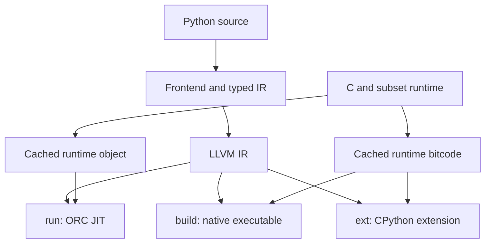

# How Pystachy works

Pystachy's compiler is written in the typed Python subset it compiles. A CPython-hosted
compiler and a native compiler use the same frontend, typed IR and LLVM lowering.
The runtime combines C with functions written in that subset.

For supported syntax and behavior, read the [language guide](language.md). For the IR's
contracts and passes, read [typed IR](typed-ir.md). The [testing guide](testing.md)
explains differential checks and bootstrap validation.

## Repository layout

| Path | Purpose |
|---|---|
| `pystachy.py` | Compatibility entry point for the hosted and self-hosted compiler |
| [`src/pystachy_compiler/`](../src/README.md) | Lexer, parser, scope checks, module loader, type checker, typed IR, LLVM lowering and driver |
| `runtime.c` | Allocation and collection, container storage, files, numeric support and exception unwinding |
| `runtime.py` | Runtime functions written in the subset; see [runtime in the subset](runtime-in-subset.md) |
| `lib/`, `ports/` | Standard-library modules and adapted third-party packages; see [library support](stdlib.md) |
| `mpz/` | Compact arbitrary-precision arithmetic, adapted from MicroPython; see [representation and provenance](../mpz/README.md) |
| `ryu/` | Ryu's float-to-string conversion, with its upstream license; see [Ryu's README](../ryu/README.md) |
| `tests/`, `tools/` | CPython comparisons, rejection cases, IR probes, fuzzers and validation tools |
| `bench/`, `examples/` | Performance workloads and complete applications |
| `pyext.c`, `pyembed.c` | CPython extension and embedding glue; see [foreign functions](ffi.md) |
| `lljit.c` | The [JIT runner](#the-jit-runner) that `pystachy run` builds at first use and runs programs with on Linux |

<a id="design-piece-by-piece"></a>

## Compilation pipeline

The frontend runs these stages before LLVM sees the program:

| Stage | Responsibility |
|---|---|
| `Lexer`, `Parser`, `Symtable` | Decode and parse source; check syntax and scope rules, including code that will not be compiled |
| `Loader` | Find imports, qualify module names, and resolve supported import-time decisions |
| `Flow` | Identify reads that need an assignment check |
| `Gen` | Declare interfaces, check and infer types, specialize templates, and build typed IR |
| IR passes and lowering | Compute effects, optimize eligible operations, lower exception handling, and print LLVM IR |



<a id="modules-by-renaming"></a>
<a id="syntax-first"></a>
<a id="one-pass-from-ast-to-ir"></a>
<a id="templates"></a>
<a id="functions-as-values-and-closures"></a>
<a id="definite-assignment"></a>

## Frontend and specialization

Imports become qualified names in one compiled program, rather than runtime module objects.
Each module has an initialization function that runs its body when first imported.
Definition-time checks preserve the relevant annotation, default-value and import behavior;
see the [module reference](language/modules.md).

`Gen` checks each function while building its IR. Expected types flow into expressions;
inferred types flow out. Static branches determine which bodies need checking, and
unannotated function parameters cause specialization at calls. Constructor-inferred class
templates create ordinary compiled classes for their field types. The
[typing reference](language/typing.md) describes the supported forms and limits.

Class declarations own their prepared field metadata; specializations share those
class attributes and infer their instance fields separately. Preparation waits until
all own methods are registered, including properties and unsupported hooks. Earlier
self-signature requests keep their provisional path. Explicit generics reserve
a canonical request before scanning recursive members, using the constructor parameter
types, bound type variables and literal arguments. Equal type-variable bindings alone
do not prove equal storage. Signatures that still reference a pending specialization,
or create another specialization while resolving, retain the existing inference path.

Each specialization request owns its in-progress keys and borrows `selfcls`, source
location, library mode and diagnostic context. These unwind on success, error and
`Rejoin`. Completed semantic tables remain owned by the current `Gen`; an interrupted
pass is discarded, not rolled back for reuse. Retries still create a fresh `Gen`, and
inspection still uses fresh workers. Captured diagnostics belong to the observer and
retain a copy of their context across internal retries.

Ordinary single-inheritance hierarchies carry a class tag. Base-typed instance-method calls
select a concrete implementation, then reuse method specialization for that receiver.
A comparison tests both operands' classes (a `switch` on an ordinary tag), but compiles
each distinct call once: pairs of classes that call one method instance, on the same
operand, share its code. A method that takes the other operand as a template's parameter
(`other: object`) takes it as the type the comparison declares, so that it is compiled
once for each receiver's class.
Inherited fields keep the base layout; unrelated classes retain their existing layout.
Explicit base calls and `super()` select a body directly while preserving the receiver.

A known function value can become a direct call. Closures keep captured variables in shared
cells, so `nonlocal` assignments remain visible. A typed `Callable` uses an adapter with a
code pointer and an environment pointer for indirect calls.

The preceding `Flow` pass marks reads it cannot prove initialized. Generated checks then
raise the appropriate error; LLVM can remove checks it proves redundant. Optional-value
narrowing is a separate typing concern. In `__init__` of a class outside a hierarchy, the
branch where `hasattr(self, "f")` is true has field `f` assigned: a field made only where
it is false (`if not hasattr(self, "f"): self.f = ...`) keeps a flag for `hasattr`, and its
reads have no check unless `self` escapes before it is assigned: to a call, a bound method,
or a def or lambda that uses `self` other than as `self.f` of its fields. A def or lambda
that uses it only that way may run later and reads only those fields: the ones not assigned
where it is defined keep their checks.

<a id="the-typed-ir"></a>
<a id="ssa-by-delegation"></a>

## Typed IR and LLVM

The IR contains one `IFn` per compiled function, with basic blocks, instructions, loop
metadata and exception-handler metadata. Runtime signatures and effects come from the
`RUNTIME` table. Whole-program effect summaries support list-read and dictionary-lookup
optimizations and identify calls that need exceptional edges.

JIT and AOT share this IR. Every function instruction is a registered typed operation,
including loads, stores and arithmetic; there is no `raw` instruction containing LLVM text.
The frontend still resolves, types and specializes code while building IR, and LLVM lowering
owns module layouts and ABI wrappers. Further frontend/backend separation and a second
backend remain future work. See [typed IR](typed-ir.md) for the implemented boundary.

Locals start in entry-block `alloca` slots. LLVM's `mem2reg` builds SSA form; expression joins
also use explicit `phi` instructions. Each function's typed IR is released after lowering,
while its effect summary remains available.

The emitted LLVM text does not depend on the LLVM release, which the compiler never asks:
LLVM 18 through 23 read it alike. A float constant is its shortest decimal, which reads back
as the same bits, or the `bitcast` of its bits for an infinity or a NaN. LLVM 23 deprecates
the hexadecimal form, and releases before 23 cannot read its `f0x` replacement. A generator's
`llvm.coro.end` uses the older two-argument form, which each release upgrades to its own
signature as it reads it: returning `i1` through LLVM 21 and `void` from LLVM 22. An LLVM 22
or 23 built with assertions would stop at that upgrade; release builds complete it.

<a id="one-value-model"></a>
<a id="type-descriptors"></a>
<a id="memory"></a>
<a id="python-semantics-in-the-runtime"></a>
<a id="a-runtime-partly-written-in-the-subset"></a>

## Values and runtime

Scalars use LLVM's `i64`, `double` and `i1`; strings, containers and objects use pointers.
Container elements occupy uniform eight-byte slots, allowing one runtime implementation to
serve multiple static element types. Optional reference values use null for `None`; optional
numbers use boxes. Integers use checked 64-bit arithmetic rather than CPython's arbitrary
precision.

Strings retain UTF-8 storage: their header holds the byte length, cached dictionary hash,
and cached code-point count plus one (zero means unknown), followed by the bytes at offset
24. ASCII literals start with the character count cached. `bytes` shares the storage layout
but keeps byte-based semantics. Compiler literals, FFI adapters and the CPython glue must
agree with this layout; cache writes do not change the immutable string value.

A bounded, 64-entry weak position cache records byte/code-point offsets outside the string
header. Nearby indexed reads and bounded searches reuse a hint instead of rescanning the
prefix; this keeps the native lexer's sequential indexing practical for Unicode source.
Collection clears all hints before reclaiming memory, and in-place append invalidates the
changed string's hint. The cache retains no strings and adds no header fields; uncached or
widely separated non-ASCII indexing remains O(n). `startswith()` and `endswith()` with start 0
and an end at or past the byte length, as their defaults are, compare the whole string's bytes
and count no code points ([#1301](https://github.com/den-run-ai/pystachy/issues/1301)).

Generic operations such as comparison, hashing, representation and sorting receive a compact
type descriptor. The runtime interprets nested container descriptors and calls generated helpers
for supported object methods. A dict's or set's descriptor of its keys tells objects hashed by
identity (their addresses, which the non-moving collector keeps stable) from those hashed by
their class's `__hash__`; a dict of the latter keeps CPython's hashes and an index of CPython's
size (other dicts' have twice the slots), so that its lookups probe CPython's slots in CPython's
order and call `__eq__` as often. Dynamic-`Any` programs also mark native dictionaries for
that hash/probe scheme (`!` before their key descriptor), since a comparison can look up a
key from a different static type. Their `str`/`bytes` dictionaries use immediate kind `3`
(`1 | KTAG`), with the same hashes, table size and probes as `!s`; string hashing and equality
skip generic descriptor dispatch. The cached string hash normalizes zero to one and minus
one to minus two, so native strings and boxed strings share stored hashes. `bytes` uses
string storage here but has no dynamic-`Any` box. Specialized code still has static types; these descriptors
do not by themselves make storage dynamic. Experimental opt-in `Any` uses the
[separate boxes and dispatchers](dynamic-any.md#representation) described below.

The collector is conservative, non-moving mark-and-sweep. It scans stack/register roots and
registered program globals; buffers that cannot contain pointers are not scanned. Marking
prefetches each object a few objects before it scans it (`MQ`), so the cache misses of a big
heap overlap; the objects it marks do not depend on that order. A list made for at most four
items that may be pointers keeps them in its header's object, until it grows past them: one
allocation, and one object to mark, rather than two. The collector's 64 KiB chunks of small
objects and its large objects take whole pages from a page heap that the runtime maps itself
in 2 MiB regions, not from `malloc`. A region's bitmaps record which pages are used and which
may be dirty, so a zeroed allocation clears only dirty pages, and a new string's bytes, which
its maker writes in full, are not cleared at all. Each sweep keeps as many free pages as the
next cycle may take (up to half as much again as its allocation window, which grows with the
live bytes), reused before clean ones without page faults, and returns the rest to the system. Pointer-free slots of more than 136 bytes are cleared when they are handed out rather
than when they die. `PYSTACHY_GC_MIN` sets the 32 MiB allocation window between collections
([#650](https://github.com/den-run-ai/pystachy/issues/650)). The
[2 November 2026 allocator evaluation](https://github.com/den-run-ai/pystachy/blob/a2cb8a3638d715577a7ab1cd1e4a0d6b01b6cdf2/docs/reports/allocator-prototype.md)
records the measurements. Unreachable files close during collection or at program exit. Supported Python operations are checked
against CPython; the [compatibility reference](language/compatibility.md) lists deviations.

Runtime static pointer storage is classified beside its declaration with `GC_ROOT`,
`GC_ROOT_RANGE` or `GC_NO_ROOT` and a reason. `GC_ROOT` scans the storage's address;
`GC_ROOT_RANGE` scans the contents of a malloc-backed pointer table. The distinction
prevents scanning a managed object's contents instead of marking its holding pointer.
`make lint` and `make check-runtime` compare these annotations
with clang's complete static-storage inventory, including defined external-linkage globals,
unused definitions, aggregate fields
and function-local statics. Each root must reach a real `scan` in `mark_roots`; comments
or dead calls do not count. Static roots require constant offsets covering the exact
complete storage interval, including all array elements and aggregate padding. Root ranges
reject provably empty, reversed, negative or unaligned bounds, including equivalent symbolic endpoints, while
allowing intentional active subranges. Packed static roots and aggregate declarations
classified as root ranges are unsupported and fail closed. Range offsets support constants,
integer globals used only by direct loads in `mark_roots`, and their additions/subtractions;
each endpoint must have nonnegative coefficients, and the end-minus-start expression must
contain a positive term. This screens the coefficient form without proving nonnegative
counter values or relative ordering of dynamic bounds; active ranges such as
`wr_head` to `wr_nfired` still require review. Unsupported arithmetic or untracked local
loads fail closed. Root-range backing pointers
must also be used only by direct loads in `mark_roots`. To keep those loads stable without alias analysis,
`mark_roots` may store only into its local allocations and call only `scan` or the frame-address
intrinsic; other stores, atomic writes or calls fail closed for root ranges. Static holding-root
addresses remain valid when their pointer contents change. The check does not prove
dynamic bounds or backing allocation sizes, non-root lifetime arguments, or pointers hidden
in integers; those still require review and GC stress coverage. Weak registries and allocator metadata deliberately
are not strong roots.

`Str`'s named header offsets and size have C static assertions in the runtime and both
CPython adapters. The compiler uses `STR_HEADER_SIZE` for byte offsets and allocations.
The `rt-abi` contract compares clang's `offsetof`/`sizeof` probes with that constant and
checks literal header values against their bytes, so exchanging same-typed cache fields
cannot pass merely because their LLVM types match.

`runtime.py` is compiled in a restricted runtime mode using `_rt` primitives, then linked with
`runtime.c`. This reuses the compiler for string methods, formatting and numeric helpers.
The [runtime guide](runtime-in-subset.md) covers those primitives and their constraints.

<a id="reflection"></a>

## Reflection

Reflection (`reflection.py`; the language rules are in [reflection](language/semantics.md#reflection))
is decided at compile time wherever the static types decide it, and costs nothing where it is not
used. `getattr`, `setattr` and `hasattr` with a literal name become the attribute access they name;
a loop over a constant set of names (a display, a variable bound once and only iterated, `dir(x)`,
`dataclasses.fields(X)`, `vars(x).items()`) is unrolled, its body compiled once per name with the
name substituted as a literal, under a budget of 256 copies; `dataclasses.asdict()`/`astuple()`
are synthesized per class; `type(x).__name__` of a value whose class is fixed is a constant. A
program that uses none of these constructs compiles to the IR it compiled to before.

Where a run-time choice remains, the code dispatches on the value's exact type, the way method
calls already do: None first (where it may be), then a union's member tag, then an object's class
tag (`refl_split`). Each concrete class's arm then reads the class's **reflection record**, an
internal constant global that is emitted only for classes that reach such a site:

| Word | Contents |
|---|---|
| 0, 1, 2 | the class's `__name__`, `__qualname__` and `__module__` (string constants) |
| 3 | flags: has an instance `__dict__`, dataclass, frozen, in a hierarchy, builtin type |
| 4, 5 | the number of names and the **name table**: `{name, kind}` pairs sorted by their bytes, every name `dir()` lists (a field, a field that may be unassigned, a class attribute, a property, a method, a static or class method, an attribute of the object or its type, a slot never assigned) |
| 6, 7 | the number of fields and the **field table**: `{name, type descriptor, byte offset, offset of the "is assigned" flag or -1}` in the order CPython inserts them into the instance `__dict__` |

`@pys.refl.c.<Class>` is a class's record and `@pys.refl.b.<type>` a builtin type's
(`int`, `list`, `NoneType`, ...); a specialization of a class template has its own record for its
layout, while its identity is its template's (the class CPython has). The tables are separate
internal constants (`<record>.names`, `<record>.fields`), null until a site needs them: a record
made for `type(x).__name__` carries only its names. They are `Data` records (`classrec`,
`classnames`, `classfields`) that `lower_module.py` alone lays out, and the field table's offsets
are LLVM constant expressions over the class's `%C.<Class>` layout, so the compiler holds no
layout arithmetic. No new IR operation is needed: a site uses `phi`/`select` of record addresses
(`%ptr`), `mach.load` of a word, `scalar.cmp` of two addresses and two runtime calls.

| Construct | Lowering |
|---|---|
| `type(x).__name__` in a hierarchy or union | the dispatch's `phi` of record addresses, then a load of word 0, 1 or 2 |
| `type(a) == type(b)`, `type(a) is C` | a comparison of record addresses: the record is the class's identity |
| `str(vars(x))` | `pys_refl_vars(record, object)`: the runtime walks the field table, formatting each assigned field by its descriptor through the generic `repr` |
| `hasattr(o, name)`, the text of `getattr(o, name)`, `setattr(o, name, v)` with a run-time name | `pys_refl_find(record, name)`, a binary search of the name table, then a switch on the index at the site, whose arms do what CPython's lookup does for that name |

LLVM does the rest: `simplifycfg` turns the tag and index chains into `switch` instructions and,
where every arm yields a constant (most of `hasattr()`'s, the names of `type(x)`), into lookup
tables; a load from a record selected among constants folds into a select of the strings; string
constants are shared (`sconst`); and since records and tables are internal, `globaldce` (JIT) and
`llvm-link --only-needed` with `-O2` (AOT) drop those no code references, so a binary holds records
only for classes that reach a reflective site. `RUNTIME` declares `refl.find` without effects
and `refl.vars` with `A I rO rL rD U` (a field's `__repr__` may run user code).

**Dynamic values.** Opt-in `Any` values use immutable `{DynType *, payload}` boxes.
The `DynType` identifies the Python type and payload layout; compiler-generated helpers
dispatch operations on boxed values. See [dynamic `Any`](dynamic-any.md#representation)
for the implemented representation and its limits.

Type-erased `Protocol` and iterator storage with shared method tables remains a
[separate proposal](https://github.com/den-run-ai/pystachy/issues/488).

<a id="checked-arithmetic-cheap-errors"></a>
<a id="exceptions-by-table-driven-unwinding"></a>

## Errors and cleanup

Overflow, invalid receivers and uninitialized reads branch to shared cold error blocks.
For programs that use `try` or `with`, exception lowering gives may-raise calls explicit
unwind edges to LLVM landing pads. The runtime unwinds through native frames using its own
personality routine; local raises can branch directly to their handler.

Handlers match exception classes and rethrow unmatched exceptions. `finally` and `with`
cleanup run on the relevant normal and exceptional exits. Nested `finally` handling avoids
exponential duplication. The C runtime is compiled with exception support in both tiers.

A `with` statement over a file registers the file's close as an unwind action. Over an object
of a class that defines `__enter__` and `__exit__`, `statements.with_cm` builds a `try`
statement of its own and compiles it as any other: the block (after the `as` target, assigned
from `__enter__()`) is its body, its one except clause calls `__exit__` with the exception's
class and the exception (`excinfo` nodes, which read the clause's exception) and raises it again
unless the call returns a true value, and its else block calls `__exit__(None, None, None)`, as
an exit pushed for the block (like a finally block's) does for a `break`, `continue` or
`return`. The items after the first such manager, and the block, are its body (they nest). The
exception's class is its class object (`exctype`, below); an exception that may be `None` is
`opt[exc]`, both null for `None`. `__enter__` and `__exit__` are method templates
(`utils.template_ok`), so an unannotated `__exit__` is compiled once for the exception's
arguments and once for three `None`s. A program with such a class lets flow analysis end a
`with` block anywhere (`Gen.cm_exits`), unless each of its items is a call of the builtin
`open()`. `contextlib.suppress(A, B)` as an item is the except
clause `except (A, B): pass` (`statements.suppress_item`), and the loader makes a method decorated
`@contextmanager` the generator method `_pys_cm_NAME` and a method `NAME` that calls
`contextmanager()` on it bound (`loader.cm_methods`): it makes the `_GeneratorContextManager`
itself, of the generator `C._pys_cm_NAME(self, ...)` of its own class `C` (so `super().NAME()`
runs the base class's, also where a subclass in another module overrides it) and of
`_pys_cm_NAME` bound to `self` taken as an object of the class that
first defines `NAME` so (`loader.cm_root`): `NAME` returns one type for every subclass. A program that reads `__cause__`
(`Gen.causeread`) records it, `pys_exc_setcause`, for `raise ... from c` and PEP 479's
`RuntimeError`.

An exception class as a value is its class object (`exctype`): runtime.c's one `Exc` per class
(`pys_exc_proto`, kept in a table the collector scans), never raised, whose kind (and, for a class
of the program, an `obj` word holding its `ExcClass`) is read as an exception's is, so names,
`str()` and `repr()` need nothing new; `type(e)` is `pys_exc_canon(e)`. `is`, `==`, `hash()` and
container keys (descriptor `C`) take its address. `issubclass()` and `isinstance()` against a
class object pass `pys_exc_sub` the program's classes with their bases, one string
(`exceptions.exc_tree`). A call of a class object looks its class up in the table of functions
for the call's argument type (`@x.mk.N`: `exceptions.exc_call`, `pys_exc_ctor`) and calls the one
found, which makes an object of a class of the program as a call of the class does; it finds none
for a builtin class, which `pys_exc_make` makes. The program's last pass compiles a function for
each class used as a value, or whose objects are made where `type()` of an exception that may be
one became a class object, and each form of call (`exceptions.exc_ctors`), until no more come;
then it writes the tables (`exc_tables`).

Iterator objects are ordinary class objects. A loop, `in`, unpacking or `next(it, default)`
over one calls its `__next__` in a block whose landing pad catches only `StopIteration`
(and its subclasses), restores the exception being handled and leaves the loop; the loop
body itself stays outside that handler. Such a handler turns exception handling on for a
program that defines `__next__` and also `__iter__` or reads the builtin `next`; a `__next__`
only called directly needs none. `iter()` of a builtin container makes an object of a
class template in `lib/_pystachy_iterators.py`, which the loader adds to a program that reads
the builtin `iter` (not a name a scope binds) and whose classes compile only when specialized.

<a id="generators"></a>

## Generators

A generator function compiles to an LLVM switched-resume coroutine (`presplitcoroutine`), and
LLVM's coroutine passes do the work a hand-written state machine would: CoroSplit finds the
values live across each `yield`, lays out the frame and outlines the resume and destroy
functions, and CoroElide puts the frame of a generator a loop owns into the loop's own frame
(HALO) once the generator's ramp is inlined. The typed IR marks the coroutine's structure
with closed operations (`docs/typed-ir.md`): `gen.start` ends the entry block (`coro.id`,
`coro.alloc`, a frame from `pys_alloc` that the collector scans, the promise, and the initial
suspend that makes a call run none of the body), `gen.yield` and `gen.ret` suspend it (all
returns share the one final suspend), `gen.promise` addresses a promise, `gen.resume` resumes
a handle (an `invoke` in a `try`), and `gen.drop` closes and destroys a generator a loop owns.
`coro.free` frees nothing: the collector reclaims an unreachable frame, and an elided frame
lives in a scanned stack frame.

A generator object is the coroutine's handle, so every generator that yields `Y` has the type
`gen[Y]` (shown as `Generator[Y]`), whatever function made it; one whose function takes `S` from
`send()` (`Generator[Y, S, R]`, `S` not `None`) has the type `gen[Y,S]`, which widens to `gen[Y]`.
The promise holds five words: the value yielded last, the value returned (`r = yield from g()`),
the state (suspended, suspended where closing it runs its code, finished, running), the
consumer's command (close by a loop, `close()`, `throw()`) and the generator's `__qualname__`. A consumer checks the state before it resumes (a finished generator
is never resumed; a running one raises `ValueError`) and after (finished: the loop ends).
`for_seq` takes a generator as one more kind of sequence, so `for`, `enumerate()`, `zip()` and
comprehensions iterate generators; consumers that take all items read them into a list, and
`sum()`, `min()`, `max()`, `any()` and `all()` take them as a generator expression would.

With exceptions on (a program with `try` or `with`), a landing block covers a generator's body:
an exception that leaves it marks the generator finished and goes on (a `StopIteration` as PEP
479's `RuntimeError`). A loop over a generator its iterable has just made (a call of a generator
function) owns it: `gen.drop` runs where the loop is left, and when closing may run code of the
generator (a `yield` in `try`, `with`, `yield from` or a loop of its own), the loop is the body
of a `try` whose finally block drops it, so an exception in the body closes it too. Closing
resumes the generator with the close command, and the `yield` raises `GeneratorExit` there,
which its `finally`, `with` and `except GeneratorExit` see; the generator's landing block ends
it, and reports anything else, as `pys.gen.drop` reports a `yield` after `GeneratorExit`. A
suspended generator keeps none of its exception state among its consumer's: it sets its `with`
blocks' unwind actions aside (`pys_gen_leave`, `pys_gen_enter`), its `try` statements' marks
(and those of the `StopIteration` catches of its loops over iterator objects) are relative to the
depth where it was last resumed, and the exception it handles in an
`except` clause or a `finally` block is its own again when it resumes. In a program that reads
`sys.exception()` (`Gen.excread`), a try statement in a generator notes the exception being
handled as it starts as null where it is the resumer's (`exc_mark`), and the end of its clauses
restores the resumer's of the current resume for null (`exc_back`), as CPython's generator
falls back on its caller's exception state.

`close()` resumes a generator suspended where closing it runs its code with the `close()`
command, under which its landing block leaves what it raises for `close()` (`pys_gen_unraisable`
keeps it, `pys_gen_closed` takes it) instead of reporting it; any other generator is just marked
finished. A `yield from` suspended so closes the generator it delegates to the same way before it
raises `GeneratorExit` (PEP 380), so what that raises is raised at the `yield from`. A program
that calls a method named `send` or `throw` (`Gen.gproto`, decided from the source before
anything is compiled) gives its generators two more promise words, the value sent and the
exception thrown, and a state for a generator that has not started (a `send()` of a value and a
`throw()` tell it from one suspended at a `yield`). `send(v)` stores `v` and resumes, and a
`yield` whose value is used reads it (in a program without `send()`, a `yield`'s value is
`None`); `throw(e)` stores `e` and resumes with the `throw()` command, which the `yield` raises,
where a `try`, `with` or `yield from` may handle it, and raises it in the thrower elsewhere (a
`StopIteration` as PEP 479's `RuntimeError` where it leaves a suspended generator). A `yield from`
there sends what it is sent on to its generator, throws what is thrown into it into its generator
(closing it for `GeneratorExit`) and suspends again with what that yields, or finishes with its
value. Programs without `send` and `throw` keep five words and the code they had; only a
`yield from` whose closing may run code closes its generator as above. A program where a module
opts in to [promoting ints](python-int.md) gives its generators nine words: also the pointers of
the promoting ints yielded last and returned (`specs.GENVALP`, `GENRETP`), which every `yield` of
an int writes, null where the value fits.

A generator expression that no consumer takes directly becomes an anonymous generator
function, called with its first iterable (evaluated where it is written) and the values of
the enclosing function's variables it reads. Programs without `yield` and without such
generator expressions emit the same typed IR and LLVM IR as before.

<a id="whole-program-optimization"></a>
<a id="two-tiers"></a>

## JIT, AOT and runtime caching

`run` favors startup latency. LLVM removes unused internal functions, inlines the scalar
recursion-accounting helpers, optionally inlines the program's
own functions, performs SSA cleanup, and runs `early-cse` and `adce` to remove
redundant computations and unused loop feedback before ORC JIT runs with the cached runtime,
in Pystachy's [JIT runner](#the-jit-runner) where it can be built, else in `lli`.
On Linux, the JIT loads the runtime as a shared library (`-dlopen`), which the driver links once
from the cached runtime object and caches beside it; elsewhere it links the object into each
run (`-extra-object`), which cost about 35 ms a run
([#704](https://github.com/den-run-ai/pystachy/issues/704)). The runtime calls back into the
program for objects' `==`, ordering and `repr` (`pys_obj_eq`, `pys_obj_cmp`, `pys_obj_repr`),
which no shared library can name: the library holds stand-ins that call through pointers, which a
constructor the driver adds to the program's IR sets before `main` (`RTSO` in the driver).
Where the library cannot be linked or cached, or a run may not execute it (a cache on a file
system mounted `noexec`, also one mounted so after the library was cached), the JIT links the object.
The driver becomes the runner or `lli` in the same process, which gets the program's bitcode (or
`llc`'s object and a main module, below), the runtime and the embedding's object as descriptors of
files the driver has already removed; `/dev/null` holds each standard stream that the caller
closed, so that neither these nor `lli`'s own files take one. `lli`'s start-up also replaces the
dispositions of the signals LLVM handles, an inherited ignored SIGINT among them, with handlers of
its own; the runner sets none. Before any of the program's code runs, the runtime closes those
descriptors and restores each signal that LLVM caught to the disposition the driver had (ignored
or default). It reads this from `PYSTACHY_JIT_HANDOFF`, which it then removes from the environment
(`jit_handoff` in `runtime.c`).
The paired `PYSTACHY_ARGV0` supplies the source spelling for `sys.argv[0]` and is consumed too.
Without the JIT handoff, an inherited `PYSTACHY_ARGV0` is ordinary environment data: it cannot
replace the native compiler's, a cached program's or an AOT executable's argument zero.
The program and its children see the caller's descriptors and
dispositions, as cached and built programs do; [`tools/jitfdprobe.py`](../tools/jitfdprobe.py)
compares both with CPython's, under the runner and under `lli`.
A module that holds generators (coroutines, which ORC cannot run before they are
lowered) gets LLVM's coroutine passes around that pipeline:
`coro-early`, `coro-split` in the bottom-up walk that inlines (with `coro-elide` after each
function's cleanup), and `coro-cleanup`. The final `early-cse`/`adce` cleanup runs after
those passes as well, so dead identity-generation loops do not reach code generation.
The default user-function inlining threshold is 20,000 lines of generated IR; larger programs
skip that pass. The scalar recursion-accounting helpers remain inlined, including with
`PYSTACHY_JIT_INLINE=0`; the recursion entry follows the user-function threshold (see
below). The precompiled runtime is not inlined into JIT code.

### The JIT runner

On Linux, `pystachy run` executes programs with Pystachy's JIT runner, [`lljit.c`](../lljit.c):
an in-process LLJIT (ORC) launcher on LLVM's C API, which replaces `lli` where it can be built.
It takes the part of `lli`'s command line that the driver uses (`-dlopen`, `-extra-object`,
`-extra-archive`, LLVM options such as `-profile-guided-section-prefix=false`, the input and the
program's arguments) and runs the program as `lli`'s default ORC JIT does: JITLink, the
process's symbols, the module's constructors in priority order before `main` and its destructors
after it, `argv[0]` the input's name and `main`'s result as the exit status. Errors go to stderr
as `lli`'s do, behind `lljit:`, with status 1. Code with debug information
(`PYSTACHY_DEBUG_LINES=1`) is registered with debuggers and profilers through the GDB JIT
interface, as `lli` registers it. The runner differs in four ways: `-O0` to `-O3` select the
level of code generation (`lli`'s ORC generates code at `-O2` whatever `-O` says), so
`PYSTACHY_JIT_CODEGEN=0` needs no `llc`; it installs none of LLVM's signal handlers, stack
printer or perf listener; the process exits with the JIT's code still mapped; and an LLVM option
that LLVM does not know is ignored rather than an error (the C API's parser reports none), so the
driver passes only `-profile-guided-section-prefix=false`, which LLVM 18 to 23 know.

The driver builds the runner at first use, as it builds the runtime: the selected toolchain's
`clang` compiles `lljit.c`, which declares the part of the C API it calls, so no LLVM headers are
needed, and links it to the `libLLVM` that the toolchain's `lli` loads (`ldd lli`; `lli --version`
gives the version, which selects the C API's variants for LLVM 18 to 20 or 21 and later). It
then runs a module of its own at `-O0` and at `-O2` (`-self-check`): constructors in priority
order, `argv`, a C library call, the exit status and a destructor. This takes about half a second.
The runner is cached beside the runtime as `lljit-<L>-<K>`, keyed by the bytes of `lljit.c` and
the files of `lli`, `clang` and that `libLLVM` (path, size and times), which `lljit-<L>-<K0>.llvm`
names with its version; a newer entry replaces the old. The driver runs the runner from a
descriptor it opens just before, so that a concurrent run that publishes another runner cannot
remove it then; one removed earlier leaves the same bitcode to `lli`. LLVM 18 to 23 on x86-64
and AArch64 Linux get the runner. Otherwise `lli` runs the program, silently: on macOS, whose
LLVM the runner is untested with; for a toolchain without a shared `libLLVM` or of another
version (and while `ldd` cannot be run); after a failed build or self-check, which is cached as
`lljit-<L>-<K>.fail` with its log, so later runs go to `lli` at once; for a cache that cannot be
written, tools that have not settled, or a runner that the run may not execute (a cache mounted
`noexec`); and with `PYSTACHY_JIT_LAUNCHER=lli`. `PYSTACHY_TIMING=1` names the outcome
(`program.jit_runner.lljit` or `program.jit_runner.lli.REASON`). Program-cache hits and misses run
no JIT; the cache's fallback uses a runner only if one was built before.

<a id="native-recursion-depth"></a>

### Native recursion depth

`sys.setrecursionlimit()` bounds the native depth: one for module execution, plus each
active call of a source function that recursion can repeat, plus each running generator
body that it can repeat ([compatibility](language/compatibility.md#errors-and-control-flow)).
The state is runtime.c's `pys_recursion_state`, three mutable words (active depth, limit,
then the native stack's floor, below) that the program's guards and the runtime's
`sys.setrecursionlimit()` share; the program module defines the guard helpers itself, even
when the JIT runs the runtime as a shared library.

Every non-generator function starts with a snapshot of the depth it was entered at
(`recursion.depth`), which its exception landings restore: callees that raised may have
left the depth higher, since the unwinder skipped their returns. Once the whole program is
built and `Gen.effects` has summarized it, `Gen.recursionscope` (`optimizations.py`)
decides which functions count. Its graph has the summaries' direct calls (`call` and
`init`, through uncounted adapters too), and from each resume or drop of a `gen[Y]`
handle an edge to every generator body that makes such handles (generators of all
functions that yield `Y` share the type). A function can be entered again while it is
active if it lies on a cycle of that graph (Tarjan's algorithm, iteratively) or reaches
`U`: code the graph does not show, such as an `icall` of a function value or a runtime
operation that calls `__eq__`, `__hash__` or `__repr__`. A body's own yields, which
suspend it, and resumes, which are edges, do not count as `U` there. Nor does a body's report
of what closing it raised (`gen.unraisable`) unless the program defines exception classes: a
built-in exception's message is rendered when it is made, and only a class of the program's
own runs code (its `__str__`) to report it. Any other function
is at most once on any native stack: counting it could change only at which call a
bounded recursion fails, never whether an unbounded one is caught, because every cycle of
calls passes through a counted function or a counted resume. A source function or lambda
that can be entered again counts; any other neither checks nor counts, and keeps its
snapshot only when one of its handlers restores it. A Callable's adapter (`@cv.N`) only
forwards to its target and never counts: a cycle through it also passes through the
function that makes the indirect call, which reaches `U`.

A counted function's snapshot becomes its entry, `recursion.enter`: it raises
`RecursionError` if the depth has reached the limit (before any local handler or body
code, so a failed entry belongs to the caller) and otherwise counts the frame. Each
normal return restores the caller's depth (the entry's result minus one), and its
landings restore its own active depth. Restoring after the last call also keeps LLVM's
tail-call elimination from discarding the activation. The summaries gain exactly the
entry's and the returns' effects (`R I`) instead of another walk over every operation;
`gen_effects` leaves a function's entry snapshot out of its own mask, since an
uncounted function either drops it or keeps it only beside the restorations that its
handlers already contribute. A generator body counts while it runs: its consumer enters
(`recursion.resume`, given the generator's state word) before each resume and restores the
depth it entered from after a normal resume. A failed entry raises in the consumer and
finishes the generator first (`GENDONE`, on the entry's cold path), as CPython clears a frame
whose entry exceeds the limit: its handlers do not run, and it never resumes. The pass removes that
accounting where no body of the handle's type can be entered again, and computes the
summaries afresh there. Closing a loop's generator (`gen.drop`) uses `pys.gen.drop`
unchanged, or `pys.gen.drop.counted`, which counts the cleanup as a frame and reports a
failed entry as an exception raised by closing, where a body of its type can recur. Main's
small `pys.gen.drop` keeps LLVM's coroutine elision able to inline a loop's generator. In a
program with exception handling the body saves the depth at each resume for its
handlers, since a resumed generator may have another consumer. This is the depth policy,
not an optimization, so `PYSTACHY_OPT` does not change it.

Closed recursion keeps the depth in a register. A cycle of counted source functions that
reaches no `U`, no function outside it that can be entered again (a counted function, a
body of a generator type that can recur) and no `sys.setrecursionlimit`, which compares the
depth word with the new limit, finds the word as its outermost call found it until that call
returns: nothing it runs changes the word or counts from it (an uncounted function's handlers
restore the value they read). `Gen.recursionscope` records such cycles (`Gen.rdpass`). Their typed IR keeps its entries, but neither base nor restorations, and
lowering emits each member's body as `@r.<symbol>`, whose last argument is its caller's
depth: the entry calls `pys.recursion.check`, which raises at the limit as
`pys.recursion.enter` does and otherwise returns the frame's own depth, without a store, and
calls within the cycle pass that depth to the callee's body; landings restore nothing. The
member's own symbol becomes a wrapper that loads the word and calls the body, for every
caller outside the cycle and for its uses as a value. The wrapper is `noinline`, a load and
a jump to the body: inlined, it would add a load and an argument to each caller, which in
`bench/pyperformance/regex_effbot.py` was enough for clang `-O2` to keep `Pattern._search` out
of `re.search`. Each frame counts at the same call as
with the word, tail calls included, since the depth is an argument. A function returning a
fixed tuple stays out, since `tupleret` may return its slots instead. Passing the depth
removes the repeated stores and loads of the shared word within the cycle; see the
[1 November 2026 measurements](https://github.com/den-run-ai/pystachy/blob/a2cb8a3638d715577a7ab1cd1e4a0d6b01b6cdf2/docs/reports/recursion-guard-policy.md).

For operations without exceptional successors, lowering emits `recursion.depth` and
`recursion.restore` directly as a load and a store of the depth word. `recursion.enter`
calls the module's `pys.recursion.enter`, or in closed recursion `pys.recursion.check`, and a
resume's `recursion.resume` calls `pys.recursion.resume`, whose overflow edge first marks the
generator finished; the module defines each only where something calls it. Each checks the
limit, then the stack's floor; their failure edges call the runtime's `pys_recursion_error`
or `pys_recursion_stack_error` and have cold branch weights. LLVM's ordinary inliners take those
helpers: clang `-O2` for `build`, and the JIT's inliner below its line threshold. They are
not marked `alwaysinline`, because LLVM 18's mandatory inliner computes block frequencies
for every caller it changes, which cost a large program's JIT start-up more than the call
saves (24 counted functions of `bench/smoke/text.py` added 13.8% to `opt`). The scalar
helpers, which only `pys.gen.drop.counted` and extension entries call by name, are
`alwaysinline`. The state's accesses carry depth, limit and floor TBAA tags under the
object-field root, so object field stores cannot alias it. Runtime compilation (`runtime.py`)
has no recursion accounting.

The native stack's floor ([#1015](https://github.com/den-run-ai/pystachy/issues/1015)) keeps a
recursion that the thread's stack cannot hold, under a raised limit, from overflowing it: a
counted entry or resume whose stack pointer lies below the state's third word raises
`RecursionError` as one past the limit does (`maximum recursion depth exceeded (the native
stack is nearly full)`), with the same unwinding, so `except` and `finally` run and buffered
output survives. The check reads the stack pointer with `llvm.stacksave`: `llvm.frameaddress`
would make every counted function set up a frame pointer, and an alloca's address would escape
and so keep LLVM from marking the function's calls as tail calls, which tail-recursion
elimination needs; on x86-64 the check is `cmp %rsp, floor(%rip)` and a branch to the cold
block. That is 11% more instructions for `bench/fib.py`, whose calls are all counted and tiny, 4%
for `bench/pyperformance/generators.py` and 0.2% for `regex_effbot.py` (callgrind, AOT, against
c3aaa068); uncounted calls pay nothing. `stack_floor` (runtime.c) sets the word from the thread's
stack bounds. On Linux, exec
copies the program's file name (`AT_EXECFN`) to the top of the main thread's stack mapping, just
below its last word, and `RLIMIT_STACK` bounds the mapping's size: the bottom glibc's
`pthread_getattr_np` reports too, without its parse of `/proc/self/maps` (about 20 µs and
100,000 instructions at every start, where this takes 0.2 µs). Where that does not hold (another
thread, such as an extension module's importer; a loader run as a program, `ld.so ./prog`, which
points `AT_EXECFN` at an argument; an unlimited stack, whose main thread's reaches the next
mapping below), glibc's `pthread_getattr_np` reports the bounds; macOS's come from
`pthread_get_stackaddr_np` and `pthread_get_stacksize_np`. `pys_init` calls it on the program's
thread (`@main`'s: lli's main thread under the JIT) and `pys_init_lib` on the thread that imports
an extension module, the only one that may call it. The floor lies 256 KiB above the lowest
address (512 KiB under ASan), or an eighth of the way up a stack smaller than 2 MiB. Bounds that
are unknown (musl's `pthread_getattr_np` reports only the main thread's mapped part, so only
glibc's is used) or that do not contain the current frame leave the word 0, which no stack
pointer is below; a frame that they contain but that already lies within the margin (an
extension imported deep in its thread's stack) gets the floor, so that the next counted entry
there raises and entries from higher frames are checked as usual. Extension initialization and
glibc's fallback also read `/proc/self/maps` once to locate the mapping containing the current
frame and its predecessor ([#1032](https://github.com/den-run-ai/pystachy/issues/1032)). They raise
the lower bound to the preceding mapping's end, plus Linux's default 256-page `stack_guard_gap`
when that mapping is accessible (read, write or execute). A `PROT_NONE` predecessor requires no
additional gap. This is 1 MiB with 4 KiB pages and 16 MiB with 64 KiB pages; the already mapped
stack remains usable even if the gap extends into it. Thus a host's raised stack limit or a
mapping placed before extension import cannot make the floor assume growth through that barrier.
Ordinary finite-limit program startup retains the `AT_EXECFN` path without reading maps. Failed
mapping inspection retains the platform bounds. Custom kernel guard gaps, unavailable `/proc`,
and mappings or stack-limit changes after initialization remain outside this protection. The
margin is what the deepest counted frame may still use without an entry
of its own: on Linux x86-64, raising the error and unwinding to a handler used under 5 KiB
below the floor (JIT and AOT, also with handlers or `finally` in every frame and through
generator resumes), and a `repr()` of 510 nested lists from the deepest frame (the runtime
stops at 512) about 150 KiB; the rest covers non-recursive callees and a signal handler's
frame. No signal handler is involved ([#988](https://github.com/den-run-ai/pystachy/issues/988)).
`tools/test_stack_floor.py` checks the floor's policy against simulated bounds and mappings,
including 4 KiB and 64 KiB pages, and runs deep recursion in JIT and AOT under a fixed
`RLIMIT_STACK`. Its extension probe also maps an obstacle before import and verifies catchable
errors and recovery under finite and unlimited host limits, with program GC stress.

`PYSTACHY_JIT_CODEGEN=0` selects `-O0` code generation. This can reduce startup for large
programs, but the generated code can run slower. The default (`2`) keeps ORC's own level of code
generation, `-O2`. The [JIT runner](#the-jit-runner) generates the code at the level selected
(`-O0`). `lli`'s ORC ignores `-O` and generates code at LLVM's default level, so for `0` with
`lli` the driver runs the selected toolchain's `llc -O0` on the cleaned-up module, in
position-independent code for ORC's JITLink, and `lli` links that object (`-extra-object`) as it
links the runtime's. Neither the runner nor these tools are given a CPU, and no function names
one: all generate code for the default CPU of the runtime's target triple, which the module
carries. ORC runs only an IR module's constructors, so `lli`'s main module then holds the
program's target and, with the shared runtime library, the constructor that hands it the
program's callbacks (`OBJHOOKS_MAIN` in `lower_module.py`). `llc` is one more process, which tiny
programs notice (`program.jit_codegen` in the [stage timings](#compiler-stage-timings)). This
choice keeps the IR cleanup and inlining pipeline, except that it splits critical edges last, for
the runner's `-O0` and `llc`'s alike: LLVM's `-O0` PHI elimination (seen in 18, 20 and 23)
otherwise lowers a landing pad's PHI with the copies of an identical PHI in the call's normal
successor, which follow the call, so an `except` clause read values that its loop never set or
had changed since. `make jitprobe` runs `tests/programs/exceptions/exc_handler_loop_values.py` in
both modes, under the runner and under `lli`. The choice bypasses the
[program cache](program-cache.md) and does not affect `build` or `ext`.

The [native program cache](program-cache.md) is enabled by default for supported
native Linux CLI runs. Validated hits execute a previously linked JIT-tier
program without rerunning the frontend or LLVM. `PYSTACHY_PROGRAM_CACHE=0`
disables it; unsupported configurations use ordinary compilation.

`build` links the runtime bitcode with the program and applies clang's `-O2` optimization
pipeline, allowing optimization across that boundary. The program's module also defines
`pys_plain`: 1 when no module opts in to dynamic `Any` or promoting ints, else 0. The runtime
tests it (`opt_in()` in `runtime.c`) only on paths that values of those opt-ins lead to: ints
past 64 bits in containers, promoting ints and list identity companions, which only those
opt-ins create (every list operation that keeps a companion in step tests it first). For a
plain program those paths become traps, and `-O2` drops static helpers that have no remaining
caller from the executable. Explicit `mpz` users retain the helpers they need. The reusable
runtime cache still contains all features. `make aotprobe` checks retained symbols and output
for plain programs, direct opt-ins and imported opt-ins, and that a plain program's list store
writes no companion. The JIT tier's precompiled runtime and `ext` keep the runtime's weak
definition, 0. `ext` builds a shared CPython module with its boundary wrappers; see the
[FFI guide](ffi.md).

Compiled code gets its objects and fixed tuples that hold no reference from `pys_new` (the
`allocelide` optimization, [#1017](https://github.com/den-run-ai/pystachy/issues/1017)): those
whose every word is a 64-bit `int`, a `float` or a `bool` by the compiler's types (a class's
fields, inherited and hidden ones included, and a tuple's items; lowering's `alloc_call`). A
class attribute that the class body declares takes a slot of its type in each object, so
`ZERO: "Vector" = None` makes a vector of floats hold a reference.
Each call is marked `allockind("alloc,zeroed") allocsize(0)`, so LLVM deletes an allocation
whose object nothing keeps, after inlining has shown that. Every other object and tuple comes
from `pys_alloc`, as without `allocelide`: one that holds a reference, a promoting int's `Mpz`
word or a numeric identity companion. The marked call's object is `noalias`, so LLVM forwards
the loads of its fields across calls, and can then delete it, or leave its address dead, while
the program still reads those fields. The conservative collector would then miss what it
holds: a weakly referenced object it held could be cleared, a file it held closed, an
`ffi.track` reference released. An object that holds no reference keeps nothing alive, so
deleting it changes no other object's lifetime. A deleted allocation starts no collection,
though: it counts toward neither the collector's threshold nor `PYSTACHY_GC_STRESS`'s, so the
collections that clear weak references, close dropped files and release `ffi.track` references
can come later than without `allocelide`. `runtime.c` keeps `pys_new` out of line so that
`-O2` still sees those calls. Each surviving allocation then gets the allocator's fast path
back: `build` optimizes the linked module to bitcode, and one `opt` run then inlines `pys_new`
into the calls that are left. Its `forceattrs` passes first swap `pys_new`'s `noinline` (and the
`optnone` of a runtime compiled at `-O0`) for `alwaysinline` (the driver's `LATE_INLINE`), then
`always-inline` inlines it. There are two (`LATE_PASSES`): LLVM 23 adds a forced attribute before
it removes one and no longer adds `alwaysinline` beside `noinline` or `optnone`, so its first
pass only removes them. Clang then compiles the module without optimizing it again.
`ext` does the same between its `opt -O2` and its compilation. A module without `pys_new`
keeps the single `clang -O2 -c` step. The JIT tier, which never inlines the shared runtime,
puts its own copy of the fast path in the program's module (`lower_module.py`'s `JITFAST`): calls of
`pys_new` and `pys_alloc` stay calls (`noinline`) through its cleanup pipeline, which deletes
what instcombine can prove unused, and the same last `forceattrs` and `always-inline` passes
then inline the calls left. Each pops the runtime's free list of its class (`pys_fl`, a
constant slot once inlined) and calls `pys_gc_slow` for everything else. The runtime's own code
(`runtime.py`) and generator frames call `pys_alloc`. `make aotprobe` checks that
objects that never escape compile to no allocation, that objects a list keeps do,
that a build with `PYSTACHY_CFLAGS=-O0` still takes the late step, and that an object and
a tuple that hold objects come from `pys_alloc` and keep those alive through collections.

The optional-local part of `unionslots` also recognizes a plain scalar dictionary
`get(key)` whose default is `None` and whose result goes into one private local.
The local must only be checked for presence and read as a number. The lookup
runs once, including its key's hash/equality callbacks; the payload is captured
immediately by `pys_dict_val_or_zero`, which avoids reading the miss index.
Presence and scalar bits then stay in local slots, removing the temporary box.
The bounded prototype retains boxing for copied, returned, identity-observed,
phi-produced and generator values, non-`None` defaults, and every program with a
dynamic-`Any` or promoting-int opt-in. `PYSTACHY_OPT=-unionslots` retains the old
path. Eliminating an allocation can delay a threshold-triggered collection, as
with `allocelide`; this does not establish a general lifetime analysis.

Cached runtime artifacts depend on the runtime sources, included Ryu files, compiler,
LLVM tools and compilation flags. Changes invalidate the relevant cache. Builds use private
temporary files and publish reusable artifacts only after checking their inputs stayed stable.

On Linux, `PYSTACHY_RUNTIME_C_CACHE=1` additionally caches default-flag C runtime
bitcode across compiler producers (for example, bootstrap stages). On a combined
runtime miss, clang preprocesses the captured runtime sources and headers; those
exact bytes, resolved clang/assembler identities and recipe determine the C entry.
Changes in `runtime.py` or compiler identity still rebuild the combined runtime.
Custom C flags, preprocessing warnings and temporary paths in expanded C strings
use the ordinary build. Readers validate private copies; incomplete or malformed
entries rebuild. Publication is atomic and best effort, retaining one C entry per
tool pair. This opt-in does not change the existing combined-cache hit contract or
cache headers independently on those hits. Cache directories must remain trusted
local storage; no shared-cache trust or additional platform support is implied.

### Compiler stage timings

Set `PYSTACHY_TIMING=1` to emit tab-separated stderr records with a monotonic
elapsed duration in seconds:

```text
pystachy-timing<TAB>stage<TAB>elapsed-seconds
```

Frontend phases are `load`, `prepare`, `discover`, `analysis`, `optimize`,
`finalize` and `lower`, prefixed with `program.` or `runtime.`. `program.attempt`
includes one inference attempt; retries repeat phase names. `program.frontend`
contains all attempts. Runtime lookup, frontend, LLVM build, code generation and
shared linking are separate records. AOT also reports LLVM linking, optimization,
late allocator inlining, code generation and executable linking; a program without
allocator calls combines optimization and code generation. Extension backend work
is one record. Failed commands retain their status and report elapsed time;
a frontend failure can omit unfinished phases.

`driver.total` ends when compilation finishes. For `run`, `driver.prepare_run`
ends before execution and excludes application execution and ORC's code generation in
the JIT runner or `lli`. `program.jit_runner.lljit` or `program.jit_runner.lli.REASON`
names what runs the program (the [JIT runner](#the-jit-runner), or `lli` and why), and
`runtime.jit_launcher_build` the runner's first-use build. The runner adds its own records
after `driver.prepare_run`: `program.jit_load` (reading the bitcode) and `program.jit_codegen`
(ORC's code generation and linking). With `lli` and `PYSTACHY_JIT_CODEGEN=0`,
`program.jit_codegen` is `llc`'s, within `driver.prepare_run`. A program-cache hit reports
lookup and preparation only. Set
`PYSTACHY_PROGRAM_CACHE=0` to measure ordinary JIT preparation. Totals contain
smaller intervals: do not add nested records together. Timing leaves stdout IR
unchanged and reads no clock when disabled.

<a id="bootstrap"></a>

## Bootstrap validation

CPython runs the compiler as stage 0. That compiler builds stage 1, and stage 1 builds stage 2.
The bootstrap checks that all three emit identical LLVM IR for the compiler and `runtime.py`.
This fixed point catches disagreements that affect self-compilation; differential tests
provide the broader behavior check. See [testing](testing.md) for the commands.

`pystachy build FILE.py -o EXE --emit-ir RAW.ll` retains the same raw module that
`pystachy ir FILE.py` emits, without another frontend invocation. It excludes the
AOT-only `pys_plain` marker and subsequent LLVM optimization. The IR file is replaced
only after a successful native build; a failed build preserves an earlier IR file.
The IR path must differ from the source and executable, including symbolic and hard
links. The executable and IR are separate outputs: a later IR publication failure
reports an error but does not roll back the executable. They are not an atomic pair.
`make` uses these retained modules for its first two compiler witnesses; the final
compiler and all three runtime witnesses still run separately.

Experimental `make BOOTSTRAP_AOT_OPT=1` selects `-O1` for the temporary stage-1
compiler's ordinary AOT program optimization and code generation. `0` also selects
an experimental tier; the default is `2`. Stage 1 always builds the final compiler
with `PYSTACHY_AOT_OPT=2`, and both compiler and runtime fixed-point comparisons
remain required. This setting does not change runtime compilation, JIT or extension
tiers. `PYSTACHY_CFLAGS` retains its existing precedence, including an explicit
`-O0` override. Use a clean build when changing the Make setting; Make does not
track variable values as dependencies. Lower tiers are not yet qualified for
general application use; full tier coverage and final-compiler performance evidence
are required before promotion. `make verify` keeps the standard tier.

## Environment variables

| Variable | Effect |
|---|---|
| `PYSTACHY_LLVM` | Override the LLVM tool directory (defaults: Linux 18, macOS 20; Linux also [19 to 23](install.md#other-llvm-releases)); standard apt/Homebrew locations are discovered before falling back to `PATH` |
| `PYSTACHY_COMPILER=auto\|hosted\|native` | Package launcher only: `auto` uses a bundled native compiler when present, otherwise Python; `hosted` forces Python, `native` requires the optional native payload. The ordinary source wheel contains no native payload. |
| `PYSTACHY_HOME` | Directory holding the runtime and `lib/`; set by the installed launcher |
| `PYSTACHY_CACHE` | Runtime and program cache directory; checkout default is `build/`, installed default is `${XDG_CACHE_HOME:-$HOME/.cache}/pystachy` |
| `PYSTACHY_PATH` | Additional import directories, separated by `:` |
| `PYSTACHY_LIBPYTHON` | The CPython 3.12+ shared library that a program importing `pyobj` [embeds](ffi.md#calling-cpython) |
| `PYSTACHY_RUNTIME_C_CACHE=1` | Opt in to Linux default-flag C-runtime bitcode reuse across compiler producers; `0` (default) disables it |
| `PYSTACHY_CFLAGS` | Extra clang flags for runtime compilation and AOT linking; part of the cache key |
| `PYSTACHY_AOT_OPT=0\|1\|2` | Experimental ordinary `build` program optimization/codegen tier; `2` is the default. Runtime compilation, raw IR, JIT and extensions keep their existing tiers. Use `make BOOTSTRAP_AOT_OPT=1` for the temporary bootstrap stage only. |
| `PYSTACHY_DEBUG_LINES=1` | Emit deterministic Python file, function and instruction line metadata in LLVM IR; AOT retains DWARF line tables. No local variable descriptions; part of the runtime and program cache keys. See [source attribution](../bench/source_attribution/README.md) for JIT and profiler limits. |
| `PYSTACHY_TIMING=1` | Print monotonic compiler [stage durations](#compiler-stage-timings) to stderr; nested totals overlap |
| `PYSTACHY_IRCHECK=1` | Verify typed IR before lowering and after transforming passes |
| `PYSTACHY_IRFX=1` | Print function effect summaries to stderr |
| `PYSTACHY_UNICODE_AUDIT=1` | Compile the [Unicode audit](language/compatibility.md#unicode-audit) checks into the program and its imported library code |
| `PYSTACHY_OPT` | Disable named optimizations with `-name`, comma-separated, or all with `-all`; see [IR passes](typed-ir.md#optimizations) |
| `PYSTACHY_JIT_INLINE=N` | IR-line threshold for JIT user-function inlining, including the recursion entry helper; `0` disables it (the scalar recursion helpers remain inlined) |
| `PYSTACHY_JIT_CODEGEN=0\|2` | `0` generates the program's code at `-O0`: the JIT runner's `-O0`, or `llc -O0` for `lli`'s ORC to link; `2` (default) keeps ORC's level |
| `PYSTACHY_JIT_LAUNCHER=auto\|lli` | What runs `pystachy run`'s programs: `auto` (default), Pystachy's [JIT runner](#the-jit-runner) where it can be built, else `lli`; `lli` always `lli` |
| `PYSTACHY_PROGRAM_CACHE=0` | Disable the default Linux native [program cache](program-cache.md); unset, empty or `1` enables it where supported. Its [settings](program-cache.md#settings) section lists the variables that key or bypass it |
| `PYSTACHY_PROGRAM_CACHE_TRACE=1` | Print cache decisions and frontend entry to stderr |
| `PYSTACHY_PROGRAM_CACHE_INPUTS` | Additional files whose changes invalidate the program cache, separated by `:` |
| `PYSTACHY_GC_STRESS=N` | Collect every N allocations |
| `PYSTACHY_GC_STRESS_PROGRAM=N` | Apply the stress interval to the program run by JIT or the test runner, separately from its compiler |
| `PYSTACHY_GC` | `off` disables collection; `stats` prints a summary at exit |
| `PYSTACHY_GC_MIN=N` | Make the allocation window between collections at least N MiB (1 to 2<sup>20</sup>) instead of 32: more memory for fewer collections, or the reverse ([#650](https://github.com/den-run-ai/pystachy/issues/650)). Pointer-free large objects can still start a collection sooner (see [start-up and memory](performance.md#start-up-and-memory)) |
| `PYSTACHY_JOBS` | Parallelism for the test runner and IR tools |
| `PYSTACHY_CASE_TIMES=FILE` | The test runner appends each case's milliseconds to `FILE`, from which `tools/case_weights.py` balances verification's shards; `tests/verify.sh` sets its own |

For AddressSanitizer builds, set `ASAN_OPTIONS=detect_stack_use_after_return=0`: its fake stack
is outside the collector's scanned stack. `PYSTACHY_CFLAGS=-fsanitize=address` instruments
the C runtime and generated `runtime.py` code before caching. AOT builds and extension modules
also instrument generated user functions, separately before linking the already-instrumented
runtime; the final link adds the sanitizer runtime. `ir` and `build --emit-ir` still emit the
original frontend IR, before sanitizer attributes and instrumentation. JIT currently instruments
the runtime only. For Linux JIT, preload the matching ASan shared runtime into the JIT runner or `lli`, for example
`LD_PRELOAD=$(clang -print-file-name=libclang_rt.asan-x86_64.so)` on x86-64. The compiler's
LLVM toolchain must match that library. Small managed objects still share allocator arenas,
so this is not complete managed-object bounds or reclaimed-memory coverage. UBSan continues
to instrument C only.
