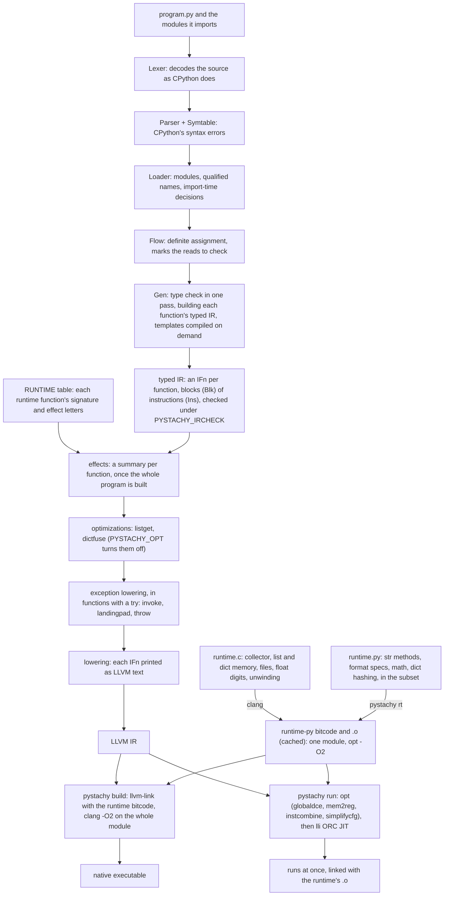

# How Pystachy works

This page walks through the compiler (`pystachy.py`) and its runtime (`runtime.c`): how a
program becomes LLVM IR, how the runtime reproduces CPython's behaviour, and how the compiler
builds itself. For what the language accepts, see [language.md](language.md); for how all of
this is tested, see [testing.md](testing.md).

## Repository layout

| file | lines | contents |
|---|---:|---|
| `pystachy.py` | 16,682 | lexer 611 · parser 1,724 · scopes (CPython's symbol-table errors) 685 · module loader 2,014 · types and tables (the `RUNTIME` table among them) 1,455 · the IR's classes and the definite-assignment pass 352 · type checker + IR generator, the IR's passes and its lowering 9,577 · driver 210 |
| `runtime.c` | 3,340 | garbage collector, string, list and dict memory, timsort, dict and set tables, generic repr/compare, float digits, files and I/O, clocks, exceptions and their unwinding |
| `runtime.py` | 1,366 | the runtime's part written in the subset: str methods, the format-spec mini-language, `math`'s integer functions, `fsum` and `prod`, dict hashing ([runtime-in-subset.md](runtime-in-subset.md)) |
| `lib/` | 9 modules | unmodified CPython 3.13 standard library modules that compile as they are ([`lib/README.md`](../lib/README.md)) |
| `tests/` | 539 programs, 634 rejection cases, 16 deviation cases, 12 IR probes | each program must print exactly what CPython prints, JIT and AOT ([testing.md](testing.md)) |
| `bench/` | 9 programs | the benchmarks of [performance.md](performance.md) |
| `tools/` | | the IR oracle, the IR check over the corpus, the check of the `RUNTIME` table against `runtime.c` and `runtime.py`, `runtime.py`'s fuzzer against CPython, `lib/re`'s fuzzer against CPython's `re`, ABI check and microbenchmarks, the syntax and import sweeps, the scaling check, the dict probe counter, the stdlib census, and the count of a port's edits by cause |
| `ports/` | 15 packages | PyPI packages with the few edits each needs to compile, marked "Pystachy port:" and listed in its `PORT.md`: convertdate 2.5.1's calendar conversions and holidays ([`ports/convertdate/PORT.md`](../ports/convertdate/PORT.md)); iniconfig 2.3.1, pytest's INI parser ([`ports/iniconfig/PORT.md`](../ports/iniconfig/PORT.md)); jdcal 1.4.1, Julian date conversions ([`ports/jdcal/PORT.md`](../ports/jdcal/PORT.md)); ordered-set 4.1.0's OrderedSet, of str ([`ports/ordered_set/PORT.md`](../ports/ordered_set/PORT.md)); pyaes 1.6.1's AES block cipher ([`ports/pyaes/PORT.md`](../ports/pyaes/PORT.md)); pyfiglet 1.0.4, FIGlet's text banners in its standard, slant and small fonts ([`ports/pyfiglet/PORT.md`](../ports/pyfiglet/PORT.md)); pylev 1.4.0, Levenshtein distances ([`ports/pylev/PORT.md`](../ports/pylev/PORT.md)); qrcode 8.2's encoder and text output ([`ports/qrcode/PORT.md`](../ports/qrcode/PORT.md)); roman 5.2, the Roman numeral converter ([`ports/roman/PORT.md`](../ports/roman/PORT.md)); sgp4 2.27, the SGP4/SDP4 satellite propagator under Skyfield ([`ports/sgp4/PORT.md`](../ports/sgp4/PORT.md)); snowballstemmer 3.1.1's English (Porter2) and Porter stemmers, Sphinx's search-index stemmers ([`ports/snowballstemmer/PORT.md`](../ports/snowballstemmer/PORT.md)); sortedcontainers 2.4.0's SortedList, of ints ([`ports/sortedcontainers/PORT.md`](../ports/sortedcontainers/PORT.md)); sqids 0.5.2, short unique ids from numbers ([`ports/sqids/PORT.md`](../ports/sqids/PORT.md)); tomli-w 1.2.0's TOML writer, `dumps()` ([`ports/tomli_w/PORT.md`](../ports/tomli_w/PORT.md)); and wcwidth 0.9.2's `wcwidth()` and `wcswidth()`, the columns a terminal gives text ([`ports/wcwidth/PORT.md`](../ports/wcwidth/PORT.md)); `tests/port_*.py` run their test cases, and `tools/port_edits.py` sorts the markers by cause and, given the upstream package, lists the census blockers the edits removed |

## Environment variables

| variable | effect |
|---|---|
| `PYSTACHY_LLVM` | directory of the LLVM 18 tools (`clang`, `llvm-link`, `opt`, `lli`, `llvm-as`) when they are not on `PATH` under those names, e.g. `/usr/lib/llvm-18/bin`; the cached runtime is keyed by the tools' files, wherever they are found |
| `PYSTACHY_HOME` | the checkout that holds `runtime.c`, `lib/` and the `build/` cache, for a compiler installed elsewhere (by default the compiler looks next to itself, or in its parent directory) |
| `PYSTACHY_PATH` | extra directories, separated by `:`, to search for imported modules |
| `PYSTACHY_CFLAGS` | extra clang flags (such as sanitizers) for the runtime and the AOT build, with a runtime cache per flag set |
| `PYSTACHY_GC_STRESS=N` | collect garbage every N allocations |
| `PYSTACHY_GC_STRESS_PROGRAM=N` | the program that `pystachy run` runs collects every N allocations, whatever `PYSTACHY_GC_STRESS` gives the compiler; `tests/run.sh` gives it to the AOT executables it builds too |
| `PYSTACHY_GC` | `off` turns collection off, `stats` prints a summary at exit |
| `PYSTACHY_IRCHECK=1` | the compiler checks the typed IR it built before lowering it, and again after each pass that changed it (`tests/run.sh` sets it unless it is set otherwise) |
| `PYSTACHY_IRFX=1` | the compiler prints each function's effect summary on stderr, as `tests/ir/*.fx` record them |
| `PYSTACHY_OPT` | turns optimizations off: `-listget`, `-dictfuse` (passes on the typed IR), `-tupleiter` (a for loop over a tuple reads the tuple's slots, not a list of its items), comma-separated, or `-all` |
| `PYSTACHY_JOBS` | how many test cases `tests/run.sh` and the IR tools run at once (default: one per CPU) |

## Design, piece by piece

The parts below follow a program through the compiler (`Lexer`, `Symtable`, the `Loader`, `Flow`
and `Gen` in `pystachy.py`), then through the runtime and the driver.

### Modules by renaming

The loader parses each imported module once, decides what CPython
would decide at import time ([language reference](language.md#decided-at-compile-time-as-cpython-decides-it-at-import-time)), and qualifies every module-level name with its
module's (`heapq$heappush`: `$` cannot occur in an identifier); references through a
module (`heapq.heappush`, or `heappush` after `from heapq import heappush`) become that
name. Before that, once every module is loaded, the loader walks each module's statements
once, in order, with the names surely bound and those bound on some path so far
(`Loader.deftime`): it checks there what each `def` and `class` statement evaluates
(annotations and bases everywhere; decorators, default values and class bodies in imported
modules), reporting what CPython would raise then. Code generation then sees one program
without module objects. A module's top-level code is the function `@init.<module>`, which
runs its body the first time an import calls it. Line numbers carry their file
(`k * 10,000,000 + line` for the k-th file), so errors anywhere name the right file. A
module whose code surely raises `ImportError` at its top level gets a guard flag: an
optional import sets it, and the raise then returns from `@init.<module>`, marked as not
run, so that the handler runs.

### Syntax first

`Lexer.file()` decodes each source file as CPython does (a coding
declaration; an imported module as bytes). As each module is parsed, `Symtable` walks its
scopes the way CPython's symbol table and compiler do, so a file CPython would refuse to
start is rejected even where Pystachy compiles nothing. A lexer error is a token that the
parser reports when it reaches it, as CPython's tokenizer runs only as far as its parser
reads. The parser counts its own recursion and the depth of the chains it builds, so
neither compiler runs out of stack (`MAXNEST`; the CPython-hosted compiler raises its
recursion limit to match), and the levels CPython's parser would use for the same code, to
reject what would overflow CPython's parser stack (`CPYSTACK`).

### One pass from AST to IR

After a declaration pass collects classes, fields and
function signatures, `Gen` walks each function once, inferring expression types
bottom-up while emitting IR. An expected type (`want`) flows top-down to type empty
literals and `None`. Types are canonical strings (`dict[str,list[int]]`, `opt[str]` for
`str | None`), so the compiler needs no type objects.

Narrowing follows the code as it is compiled: the set of optional locals known not to be `None`
grows with the tests of an `if`, `while`, `assert`, `and`/`or` or conditional expression for the
code they guard, an `if` keeps what holds at the end of each branch that goes on, and a loop
drops what its body binds, then keeps what holds at each of its exits (each `break` records it).

### The typed IR

The typed IR that [typed-ir.md](typed-ir.md) designs was introduced step by step, each step
leaving every program's LLVM IR byte for byte as it was (`make irsame` checks it).

Its first steps have landed: `Gen`'s one walk over the AST builds an `IFn` per compiled
function, blocks of instructions whose control flow, checks, calls, runtime calls and
empty-container holes are ops, and the LLVM text is printed from them once the whole program is
built (`PYSTACHY_IRCHECK=1` checks the IR first).

A `RUNTIME` table gives every runtime function its signature and effects, from which each
function gets an effect summary. The first language-level optimizations read them (§7.1): a for
loop reads the items of a list it steps through without a bounds check, and a dict lookup that a
membership test or a read of the same key made is reused (`if k in d: d[k] += 1` hashes `k`
once; a dict-counting benchmark, `bench/dictcount.py`, runs in 0.11 s instead of 0.16 s AOT).

Loads, stores and arithmetic are still LLVM text; converting them, then a second lowering, would
allow more of them (None checks, bounds-check hoisting) and further backends.

### Templates

A call to a template evaluates its arguments, then looks up the function
compiled for their types, compiling it on the spot if there is none yet: `Gen` saves its
state for the function it is in, compiles the template's body for the argument types (its
first `return` with a value fixes the return type, so a recursive call after it works), and
resumes. A `None` argument is not passed at all: in that instance the parameter is a
constant `None`. Errors in an instance name the call that compiled it. A function compiled
in the middle of module code (a template's, or one compiled early because a read needs the
type of a global it assigns or fills) may read globals that this code assigns later: their
first binding in the branches that run gives them their type, compiled in the module's
frame into code that is dropped. A call compiled before the `def` or `class` statement of
the function it calls loads that function's non-constant default values from the global
the statement fills when it runs, so they are still evaluated once.

A method is a template the same way (`template_ok` says which may be): its object is the
first argument, whose type is its class, and an instance is a method of that class
(`@m.C.name.N`), so `self` reads its fields as the method's own code does. The calls that
reach it all go through `call_fn` (a method call, a bound method's value, the operators, the
comparisons that sorting and containers make, which `cmp_method` and the object descriptor
accept for any operand), and `instance` checks the return type a special method must have
(`SPECIAL`) once the instance is compiled. The methods of a class are compiled when the program
is (or, in an imported module, when called), but for its templates: only their instances are.

A class template (`Gen.tmpl`: its `__init__` has a parameter without an annotation, or names a
class template in one, or makes an object of one) has no objects of its own: `C(args)` reaches
`call_fn` with a placeholder for the object, and once the arguments are evaluated (their
annotated ones coerced), `specialize` picks the class the object belongs to. It types the fields
that `__init__` assigns as `scan_fields` would for parameters annotated with the arguments'
types, and the list of those types is the key of the specialization (`C-1`, `C-2`, ... in
`ClassInfo.specs`; `ClassInfo.origin` leads back to `C`). A field that holds the specialization
itself (`self.next: "Node | None"`, where `C` in an annotation of its methods and fields names it,
see `ann`) is written `@` in the key, so each call of the recursion finds the same one. A new
specialization is an ordinary class: its methods are declared from the template's `def` nodes,
`__init__` and those `template_ok` allows as templates (compiled where called), the other
special methods compiled when it is made (`Gen` saved and restored as for an instance), and
`fl_fields` decides its flags. It shares the template's class attributes (`fdefault`,
`fglob`). `isinst` takes it for `C`; `short()` and `shown()`, which give CPython's names, drop
its number, and `typestr()` shows its fields' types (`SPECSHOW`: `Box[int]`), so that messages
can tell two specializations apart. Each specialization counts towards `TEMPLATE_INSTANCES`.
A parameter annotated `Callable[[A, B], C]`, `C` a class template, is a template's (`FnInfo.pats`),
but `pat_arg` gives a function argument the Callable type of what it returns: `adapter_ret`
compiles the adapter of `to_callable` with its return type left to its return statement, and
that adapter then serves the Callable `callable[S,A,B]` of the specialization `S` it returns, so a
field that holds such functions specializes its class by `S` alone.

### Functions as values and closures

A function used as a value has a type of its own, the function it is: `fn[f:NAME]` for a def of a
module, `fn[b:NAME]` for a builtin, `fn[c:N:...]` for a lambda or a def inside a function,
`fn[m:C.NAME]` for a method bound to an object of class C, `fn[d:NAME:T]` for a method bound to a
value of builtin type T (`"".join`), and `fn[u:T.NAME]` for that method read through its type
(`str.lower`). A call
through such a value is compiled as a call of that function by name, so a template given a
function is compiled for it, as for any other argument type, and the call is direct. A value of a
module's def or a builtin holds nothing (null), a bound method's is its object (a call through it is
the method's call on it: `Gen.method_value`, `Gen.call_value`). A closure's points to its env, which `Gen.closure`
allocates each time the def or lambda runs: the cells of the variables it takes from the functions
around it, then its default values that are no constants. Each variable that a closure takes lives
in a cell that the function binding it allocates as it begins (`Gen.cellvars`); its loads and
stores go through the cell as they would through an `alloca`, and a closure's code, a template
whose hidden first parameter is the env (`.env`, passed as a method's object is), loads the cells
from it as it begins, so that both see each other's assignments (`nonlocal`). `Flow` checks where a
closure is defined that the variables it takes are assigned (`Gen.fl_nested`), and analyses its
body as a function's. Where a `Callable[[A, B], R]` is expected (`callable[R,A,B]`), a function
value becomes a pointer to an object `{code, env}`: the code is an adapter compiled for each
function and `Callable` type, `R(ptr env, A, B)`, which calls the function as a call of the value
would (`Gen.adapter`), and a call of a `Callable` is an `icall` op, LLVM's indirect call of the code
with the env. A function of a module and a builtin need no env: one constant object serves them.
A def with decorators that CPython calls (all but `typing`'s, and in a class body, those it leaves
out) is compiled as an assignment of its name (`Gen.decorate`): the decorator expressions are
evaluated top first, then the closure is made and each decorator called on it, bottom first, so
the def's name, also at a module's top level, is a variable of the result's type. `Flow` reads
each decorator as a call where the def is (`Gen.deco_callee`), and module code that applies one
counts as a call into user code.

### Definite assignment

Before code generation, `Flow` walks every scope with the set
of variables assigned on every path (merging `if` branches, a `try` statement's body with
its except clauses, which start from the state before it, and a loop's `else` block with
the state before the loop, leaving `while True` only through what its breaks have in
common). Reads it cannot prove are marked, and only those test an "is
assigned" flag that LLVM removes again where it can; fields that `__init__` may leave
unassigned get a hidden flag in the object. Globals read in functions are safe when
module code assigned them before its first call into user code (a statement that reads a
function as a value or makes a lambda counts, since what holds it may call it, but not
`name = f` or `name = lambda ...`, which makes `name` such a value in turn, nor a function's
default value), and calls to a
function before its `def` has run raise `NameError`. The compiler itself needs none of
these checks. The pass costs what the code contains: a function is analysed over the names
its body mentions, not over every global of its module; a branch is undone from a log of
the changes it made rather than by copying the set, and an `if` leaves in that log only the
names whose state it changed, so the `if`s around it (an `elif` chain) do not look at the
rest again. Whether an import may run the importing module again (a circular import) is
read from the strongly connected components of the import graph. The same pass
marks what an imported module's `def` and `class` statements read in code that Pystachy
leaves uncompiled, and those reads are checked where the statement runs.

### Checked arithmetic, cheap errors

`+`, `-` and `*` use LLVM's `*.with.overflow`
intrinsics; every failure (overflow, `None` receiver, unassigned variable) branches to
one cold block per function and message (and `try` statement around it). `self` is marked
`nonnull`, so the `None` checks vanish inside methods.

### Exceptions by table-driven unwinding

A program whose modules hold `try` or `with` (decided before code generation; any other keeps its code)
calls `pys_eh_on` as it starts. From then on the runtime's error funnels (`pys_fail`,
`pys_raise`, `sys.exit`) build an exception and unwind with the Itanium ABI's
`_Unwind_ForcedUnwind`, in one phase (every landing pad catches everything, so the first one
found is the handler; C++'s `_Unwind_RaiseException` walks the frames twice); if nothing catches
it, the stack is untouched and the program ends as before.

Each IR block names the landing block of the innermost `try` around it in its function. Once the
whole program is built, a pass reads the effect summaries: a call that may raise in a covered
block becomes an LLVM `invoke` whose unwind edge goes to that block's `landingpad`, a `raise`
there becomes a branch carrying the exception (no unwinder), and a landing block that no invoke
reaches is dropped. Every landing pad catches everything; the code after it tests the clauses'
classes and throws again what none catches, and `runtime.c`'s own personality routine,
`pys_personality`, reads the call-site tables LLVM emits. Code that does not raise pays nothing
for a `try` (under the JIT, two runtime calls as it is entered); a raise in the `try`'s own
function costs tens of nanoseconds, one from a call about a microsecond, and half a microsecond
more for each frame with a `try` it passes through.

`finally` is compiled once for each way out, as in CPython, but one that holds a `try` with a
`finally` of its own is compiled once, where each way out stores its index and jumps, so that
nested ones grow linearly, not as 3^depth. What a raise leaves half done in the runtime (a list
being sorted, a `with` block's open file) is put right by unwind actions that the landing pad
runs, or that run before reporting an uncaught exception. A `with` needs no `try` to close its
files on an exceptional exit; cleanup runs innermost first. No action raises: a `with` block's
file whose close fails notes its `OSError`, which then takes the place of the exception being
propagated, including `SystemExit` (CPython's `__exit__` raises it inside the `try`, if any).

A module's code runs in the region of a landing block that marks the module not run and throws
again. A name that an import in a `try` statement binds has a flag of its own, which every import
that binds the name sets where it binds it (a plain import once its own modules' code has run, a
from-import once all of them has), and which every read through the name checks: a global in
module code, in a function a slot, or a cell that the lambdas in it that read the name share. A
read through a package's attribute for a submodule that an import in a `try` statement runs checks
the submodule's mark, as CPython sets that attribute once the submodule's code has run to its end.
`runtime.c` is compiled with `-fexceptions` in both tiers.

An object of an exception class begins with a pointer to its class's `ExcClass`, a constant the
compiler generates for each class whose objects the program makes: the name an `except` clause
matches (the class's qualified name, in the sets of names each clause catches, which the closed
world makes complete), the name an uncaught exception's line shows, and functions for `str()`,
`repr()` and, for a `SystemExit`, the exit; `str(e)` of any exception goes through it. Then come
what it keeps of its arguments, its base's fields with their "is assigned" flags (so the base's
methods work on it), and its own.

### SSA by delegation

Locals live in `alloca` slots; LLVM's `mem2reg` turns them into
SSA registers. Short-circuit operators, conditional expressions and comparison chains
use `phi` nodes directly.

### One value model

Scalars map to `i64`, `double` and `i1`; strings, containers,
tuples and objects are pointers. Container elements are uniform 8-byte slots, so one C
implementation of `list`/`dict`/`tuple` serves every element type.

### Type descriptors

Generic operations (`repr`, `==`, ordering, `sort`, `in`) receive a
tiny string describing the static type — `LDsi` is `list[dict[str,int]]`, `?s` is
`str | None`, `Si` and `Fi` are `set[int]` and `frozenset[int]` — and the
runtime interprets it recursively, comparing sequences the way CPython does (first
unequal pair, identity first). Objects appear as `O<id>`: the runtime calls back into
`pys_obj_eq/cmp/repr`, a switch the compiler emits over the classes that occur in
containers, with small per-class helpers built from each class's `__eq__`, rich
comparisons and `__repr__`. Dataclass `__repr__` (cycle-safe) and `__eq__` are written
by the compiler and generated only if used, and so are a NamedTuple's; the generic repr
prints a list or dict that it meets again while printing it as `[...]` or `{...}`.

### Memory

`runtime.c` includes a conservative, non-moving mark-and-sweep collector
that needs nothing beyond the C library. Small objects come from 64 KiB chunks in 40
size classes, carved from 1 MiB arenas; larger objects get blocks of their own. A
two-level page map finds the object behind any word, interior pointers included, in
O(1). Strings, buffers and dict index arrays are allocated pointer-free and never
scanned. The roots are the C stack and callee-saved registers, the runtime's statics,
and the program's pointer-typed globals: the generated `@main` passes `pys_init` its
frame address and a table of those globals, because under the JIT they live in memory
no scanner would find. A collection runs once max(32 MiB, live bytes) have been
allocated since the last one, so the heap stays near twice the live set.
Open files that become unreachable are closed after marking, before the sweep. A
collection also runs when `open()` runs out of file descriptors. The buffers of a file open
for writing are malloc'd, but count as heap bytes (allocated, live and in the heap), and
`open()` allocates them as a large object is allocated, so files dropped without `close()`
start collections too; a close takes back exactly what was counted. `sys.stdout`'s, which no
collection frees, are not counted.
`PYSTACHY_GC_STRESS=N` collects every N allocations; `PYSTACHY_GC=off` and
`PYSTACHY_GC=stats` turn collection off or print a summary at exit.

### Python semantics in the runtime

Floor division and modulo, float `repr` (shortest
round-trip digits), `round` with exact half-even rounding, Neumaier-compensated `sum`,
`int()`/`float()` string grammar (with the 4,300-digit limit), `str.split`, string `repr`
quoting and escapes (a table of the code points `str.isprintable()` rejects), modular
`pow` with inverses, and the format-spec mini-language are implemented to match CPython's
output, error messages included. `sort` is a function-by-function port of CPython 3.13's timsort that makes the
same `<` comparisons in the same order, which decides where NaNs end up and what an
`__lt__` with side effects sees: `tests/sort_order.py` checks 260 generated cases (a
one-off run over 4,200 lists found every `__lt__` call of the 2,517 object lists in
CPython's order, and the int and float lists sorted alike).
Dicts use CPython 3.13's compact layout (deleted entries stay as holes until
the table is rebuilt, with its sizes and growth, and `dict(d)` merges as CPython's does),
so deletion is O(1) and a loop that changes its dict, `reversed(d)` included, sees what
CPython's would. The index follows CPython's probe sequence (each step mixes in five more
bits of the hash), over a hash that costs one multiply: one round of SplitMix64's mixer
for an int, FNV-1a with the high half folded into the low for a str. Each string caches its
dictionary-normalized hash lazily in an eight-byte header field (zero means uncomputed,
a raw zero hash is stored as one). Reusing that object hashes its bytes once, including
when it is a tuple component; newly constructed equal strings still need hashing and
may need a byte comparison. String bytes stay immutable, but literals occupy writable
LLVM globals for the cache. The header grows from eight to sixteen bytes, before allocator
rounding. This internal cache does not change the compiler's semantic effects or the raw
hash function in `runtime.py`. A dict of tuple keys
holds their type descriptor, by which a key's hash mixes its items' hashes and keys compare
as `==` compares the tuples (a `None` item hashes and compares as `None` also where the
descriptor says `str`, which is how a looked-up tuple whose item may be `None` finds no
key). Keys that differ only
in their high bits (`i << 46`, which used to form one cluster) probe as random keys do; the
price is about 2 ns per lookup in tables larger than the cache, whose second slot is in
another cache line. Sets and frozensets are CPython 3.13's own tables (`setobject.c`), since no
entry array keeps their insertion order: a loop sees the elements in slot order, which the
hashes, the probes (ten adjacent slots, then the perturbed step), the dummy an insertion reuses
(the last one its probes passed), the resizes and the way each operation builds its result (a
copy merges the table, `s & t` walks the smaller set, `s - t` copies `s` where it is more than
four times larger, `s ^ t` starts from `t`) all decide, as they do in CPython. The hashes are
CPython's for ints, bools, `None` and tuples of them (xxHash's rounds over the items'), so a set
of those iterates in CPython's order; a str's is the dict's hash of it, as CPython's own changes
from run to run. A display of more than two constants is the frozenset constant CPython's
compiler makes (made a second time from its own elements, as `merge_consts_recursive` makes
it) merged into a new set, and a `for` loop over a display of constants, or `x in` one,
uses that frozenset. The constant is made where the display first runs and kept in a global
(`@fs.N`, among the collector's roots), as CPython's code object keeps it: later runs copy it,
or use it, and do not make it again.
Files wrap C stdio with CPython's open() rules: argument checks in its
order, errno-based `OSError` subclasses, newline translation, `"+"` mode positioning
(including its 8 KiB read-ahead), and closed/readable/writable checks. Writes reach the
OS when CPython's do: 8 KiB of pending text in front of a `st_blksize` buffer, line
buffering for `buffering=1` and terminals, so another handle on the file or a command run
by `os.system` sees what it would under CPython. Errors on stdout and in flushes and
closes (a broken pipe, a full disk) are reported with CPython's messages and statuses, an
implicit close that fails as CPython's finalizer reports it ("Exception ignored in"), and
Ctrl-C raises `KeyboardInterrupt`: output is flushed and the program dies by `SIGINT`.

### Whole-program optimization

For `build`, the runtime is linked into each program as
bitcode and optimized together with it, so `xs[i]` inlines to a bounds check and a
load. clang tags the runtime with `target-cpu`/`target-features`, which makes LLVM
refuse to inline it into attribute-less generated code; the driver strips those
attributes when building the cached runtime.

### A runtime partly written in the subset

`runtime.py` holds runtime functions written in the subset itself. `pystachy rt runtime.py`
compiles it in a runtime mode: its `pys_*` functions keep runtime.c's C names and types,
`def f(...) -> T: ...` declares a C function, and `import _rt` gives a few primitives (byte
reads, an in-place string builder, `memchr`, `memcmp` and `memmem`, wrapping and unsigned
arithmetic), each a few checked LLVM instructions. The driver links it to runtime.c's bitcode
and optimizes the two as one module (`build/runtime-py-<L>-<K>.bc` and its `.o`) when it
builds the cached runtime. The name is a hash of all the runtime is built from: the bytes of
`runtime.c`, `runtime.py` and the running compiler, the flags and the LLVM tools' files, so an
edit of any of them, also one made while the runtime is built, makes a run build it again
([runtime-in-subset.md](runtime-in-subset.md) §1.4; `tests/cache.sh` tests the rules).
Programs' IR does not change (but for an `invoke` inside a `try` where a moved function can
raise). A raise in a `runtime.py` function unwinds to
a program's handler like one in runtime.c. `tools/rtcheck.py` runs `runtime.py` on CPython
against CPython's own str methods, `math` and `format()`.
[runtime-in-subset.md](runtime-in-subset.md) evaluates the approach.

### Two tiers

`run` favors latency: `globaldce` removes unused internal functions before the three
function cleanup passes, then ORC JIT compilation links against a cached, precompiled
runtime `.o`. Frontend checks and definition-time effects still run; the external
object-dispatch callbacks remain available to the runtime. `build` favors
throughput: the full `-O2` pipeline over program and runtime together. The driver
works in a private `tempfile.mkdtemp()` directory; `PYSTACHY_CFLAGS` adds clang flags
(such as sanitizers) to the runtime and the AOT build, with a runtime cache per flag set (and per
set of optimizations that `PYSTACHY_OPT` turns off, since `runtime.py` goes through them too).
Sanitizer flags reach only the runtime's compilation and the final link, so runtime.c is
instrumented once (`runtime.py`'s code is not: its primitives check its accesses, and ASan's
interceptors still see the `memchr`/`memcmp`/`memmove` calls they make); `pystachy run` then
needs the sanitizer's runtime library in
`LD_PRELOAD` (as `make verify` does for UBSan). Run AddressSanitizer builds with
`ASAN_OPTIONS=detect_stack_use_after_return=0`: LLVM 18 enables that check by default,
and it moves address-taken locals to a "fake stack" that the collector does not scan.

### Bootstrap

The compiler is written in the subset, so CPython executes it directly
(stage 0). `make` then checks the fixed point: the stage-1 binary (built by
CPython-hosted Pystachy) and the stage-2 binary (built by stage 1) must emit IR
identical to CPython-hosted Pystachy's, byte for byte. Any semantic divergence between
Pystachy and CPython inside the compiler shows up as a diff. The three stages must also
emit the same IR for `runtime.py` (`pystachy rt`), which each compiles into the runtime it
links.
