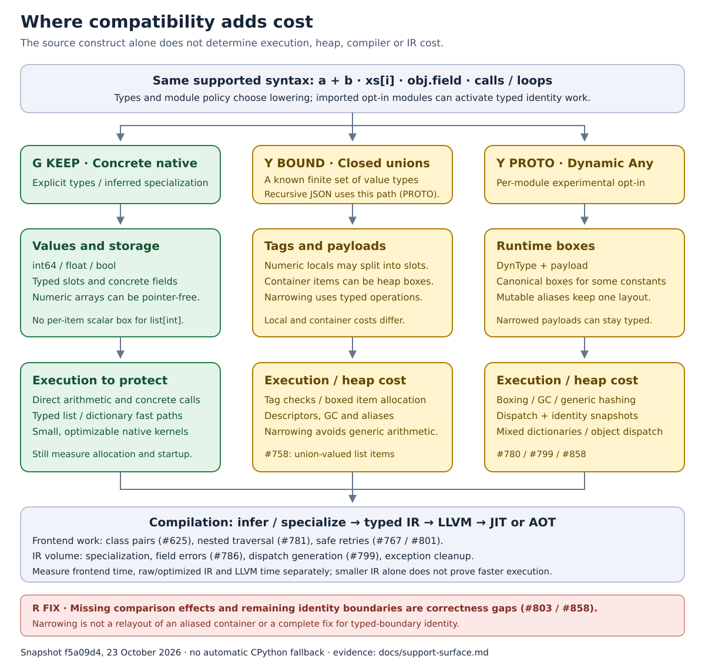

# CPython support surface

Pystachy's fast core is concrete values, predictable storage and typed operations. More
Python compatibility can build on that core, but the same syntax can also select boxed
storage, dynamic dispatch, suspended frames or exception unwinding. These diagrams show
what to preserve, where to measure costs, and which CPython behaviors remain gaps.

**Snapshot:** 23 October 2026, main
[`f5a09d4`](https://github.com/den-run-ai/pystachy/commit/f5a09d4223139d7255e31051be97fc509e1ca1fe).
This is an engineering guide to the existing surface, not a new language mode or a change
to the support policy. The [language reference](language.md),
[compatibility reference](language/compatibility.md) and [dynamic `Any` contract](dynamic-any.md)
define the exact supported forms. Issue status below was checked for this snapshot;
measurements linked below retain their own revisions. No new timings were collected.

## Reading the colors

| Label | Meaning | Engineering guidance |
|---|---|---|
| **G / green — KEEP** | Supported paths with concrete native representations or direct lowering | Preserve these paths and their performance when extending compatibility. |
| **Y / yellow — BOUND** | Supported features with restrictions or workload-dependent costs | Keep the feature; measure execution, memory, compilation and IR separately. **PROTO** explicitly identifies experimental features. |
| **R / red — GAP** | **OUT:** no native contract for the named behavior. **FIX:** an accepted program can still differ from CPython. | Do not rely on the named behavior. Fix correctness gaps; consider unsupported extensions against a real consumer. |

Green is a design target, **not a promise that every program beats CPython**. Yellow does
not mean a feature is experimental unless it says **PROTO**, and red does not mean its
entire enclosing feature should be removed. The areas are schematic, not coverage percentages.

## 1. The native subset to preserve

The green region includes the compiler's own style of code: typed functions, inferred
specializations, concrete fields, numeric loops and homogeneous containers. Strings,
dictionaries, classes, generators and exceptions are useful parts of the supported language;
their broader contracts need more machinery than a scalar loop.

The core classification follows the [typed-IR fast paths](typed-ir.md#optimizations)
and concrete storage layouts. The [microGPT snapshot](../bench/microgpt/README.md#measured-snapshot)
and [integer-list memory measurement](performance.md#start-up-and-memory) are examples
of measured consumers of those paths, at the revisions recorded in their reports.

Dynamic `Any` is an additional, per-module **experimental opt-in** surface. A module without
the opt-in comment uses `Any` for concrete inference/specialization. A program importing an
opt-in module can still incur identity bookkeeping in typed code; the boundary is not
simply whether the hot function contains an `Any` annotation.

Preserve programs that already compile correctly. This map does not propose removing
generators, exceptions, unions or other accepted features to make the compiler smaller;
see the compatibility rule in [AGENTS.md](../AGENTS.md#start-with-the-current-tree).

## 2. Syntax is only the first layer

| Python syntax or construct | Label | Current native surface and the important boundary |
|---|---|---|
| Arithmetic, boolean expressions, `if`, `while`, `for`, `break`, `continue`, `return` | **G KEEP** for concrete operands | Checked 64-bit integers and native floats/bools; changing operands to unions or `Any` changes lowering. Arbitrary-precision integers are **R OUT**. |
| `def`, direct calls, keyword/default arguments, templates | **G KEEP** for known signatures | Inference specializes supported unannotated functions. Unrestricted runtime argument expansion and arbitrary builtin function values are outside this contract; see [calls and templates](language/typing.md#function-and-method-templates). |
| List/dict/set displays, comprehensions, indexing and slicing | **G KEEP** for concrete supported types; **Y BOUND** for mixed storage | Syntax is supported; element/key types determine layout, hashing, boxing and callbacks. Scalar-union locals and containers have different costs. |
| Assignment, unpacking, `:=`, closures, `global`, `nonlocal` | **G KEEP** within the static contract; **Y PROTO** for dynamic identity tracking | These forms are supported. Dynamic numeric identity can add box slots/snapshots; remaining boundary and late-storage-inference cases are **R FIX**, not reasons to remove assignment syntax. |
| Strings, bytes, f-strings, formatting | **Y BOUND** | Supported operations have different copying, Unicode and formatting limits. A read of an accumulating string can force a later append to copy; use the [performance contract](performance.md#costs-to-watch). `bytearray`, `memoryview` and binary files are **R OUT**. |
| Classes, dataclasses, properties, single inheritance | **G KEEP** for concrete fields/direct methods; **Y BOUND** for broader dispatch | Supported hierarchy and reflection forms have explicit limits. Multiple inheritance, general metaclasses and runtime-named attribute-value lookup remain **R OUT**. |
| Generator expressions and `yield` / `yield from` | **G KEEP** for direct consumer lowering; **Y BOUND** for suspended generators | A direct reduction can avoid a general generator object. A stored generator, delegation, `send`, `throw` and `close` need frames and cleanup; see the [semantic paths](#3-generators-exceptions-and-the-object-model). |
| `try` / `except` / `else` / `finally`, `raise`, `with` | **Y BOUND**, supported | Local handlers and cross-function unwinding have different costs. `except*`, exception groups and full traceback APIs remain **R OUT**. |
| `match`, native `async def` / `await` / `async for` / `async with` | **R OUT** | Not part of the supported native language. Concurrency hosted by CPython through an extension is a separate [interop path](concurrency.md). |

The [execution reference](language/semantics.md) describes the supported statements,
expressions, generators and object protocols. A recognized or unused piece of syntax
does not establish that a program needing it can execute natively.

## 3. Generators, exceptions and the object model

Arrows mean **additional semantic obligations**, not a migration or a recommendation to
replace working code. In particular:

- **Generators:** functions and methods that yield, delegation, and the documented
  `send` / `throw` / `close` forms already work. Real generators use LLVM coroutine
  operations in the [typed IR](typed-ir.md#instructions-and-control-flow). Their frames,
  live references, resumption and cleanup need validation. Some consumers materialize
  inputs; dropped suspended generators are not generally closed. These are different
  concerns from the [dynamic object-iteration gap](dynamic-any.md#deviations).
- **Exceptions:** keep ordinary exceptions and cleanup. Local raises can branch to a
  handler; covered calls that may raise lower to LLVM `invoke` and native unwinding.
  Repeated cross-function throws are a runtime cost, not an unsupported construct.
  See [exception lowering](typed-ir.md#exception-lowering) and
  [runtime deviations](language/compatibility.md#errors-and-control-flow).
- **Objects:** known fields and direct calls retain typed layouts. Single inheritance,
  overrides, properties and supported reflection are implemented, with class analysis
  and dispatch costs. Arbitrary runtime attribute names returning arbitrary values,
  dynamic attribute hooks and general metaclasses require a larger object model than
  the shipped one; see [reflection](language/semantics.md#reflection).

## 4. Where compatibility adds cost

All three paths compile through typed IR and LLVM in both JIT and AOT. Dynamic `Any` is
not an interpreter fallback or a tracing JIT. Narrowing can recover a typed payload
operation, but does not transparently change an aliased container's layout, remove its
boxes, or solve identity across every typed boundary.

| Added surface | Label and cost dimension | Current mechanism, evidence and boundary |
|---|---|---|
| Closed scalar/value unions | **Y BOUND — execution / heap** | Numeric locals can use split tag/payload slots, while union-valued container items can still allocate boxes. [Union costs](union-value-costs.md), [typed-IR optimizations](typed-ir.md#optimizations), [#758](https://github.com/den-run-ai/pystachy/issues/758). Keep concrete containers for homogeneous hot data where the program's semantics permit it. |
| Dynamic `Any` values, heterogeneous records and JSON/TOML | **Y PROTO — execution / heap** | Runtime type/payload boxes, boxed collection items, hashing, dispatch and GC enable useful mixed data. Narrowed payload operations can avoid generic arithmetic; this does not make every dynamic pipeline fast. [Representation and measurements](dynamic-any.md#representation), [#780](https://github.com/den-run-ai/pystachy/issues/780). |
| Numeric identity across dynamic and typed code | **Y PROTO — execution / IR; R FIX — parity** | Box provenance, snapshots and joins preserve many copies, globals, closure cells and known-dynamic displays. Scalar-only proofs avoid some boxing. Typed parameter/return/field/container boundaries, folded constants and some inferred display cases remain gaps. [Identity contract](dynamic-any.md#representation), [#858](https://github.com/den-run-ai/pystachy/issues/858). |
| Cross-type comparisons through `Any` | **R FIX — parity; Y PROTO — compiler work** | Guarded concrete adapters now execute many previously skipped bodies, including differently typed builtin container fields. An unsupported body/field shape can still fall back without executing the method. [Deviations](dynamic-any.md#deviations), [#803](https://github.com/den-run-ai/pystachy/issues/803). Fix the missing semantics before treating this as stable. |
| Typed container ↔ `Any` crossings and generator channels | **Y PROTO — compatibility; R FIX for documented accepted deviations** | Incompatible mutable layouts are rejected rather than copied or reinterpreted. The opt-in corpus still has five explicit exceptions, and object iteration through `Any` can raise where CPython iterates. [Exact exception manifest](../tools/dynany_optin_exceptions.json), [#777](https://github.com/den-run-ai/pystachy/issues/777), [#773](https://github.com/den-run-ai/pystachy/issues/773), [#782](https://github.com/den-run-ai/pystachy/issues/782). |
| Larger class hierarchies | **Y BOUND — compiler work / IR** | Comparison emission and specialization have already been reduced; residual class-pair analysis remains separate from field-error-message IR growth. [#625](https://github.com/den-run-ai/pystachy/issues/625), [#786](https://github.com/den-run-ai/pystachy/issues/786). Do not describe the old quadratic emitted dispatcher as the current implementation. |
| More dynamic classes and operation keys | **Y PROTO — compiler work / IR / execution** | Class-id switches have replaced the old linear field-dispatch chain. Duplicate method lookup, classes × attributes IR, dispatcher regeneration and deterministic cost guards remain. [#799](https://github.com/den-run-ai/pystachy/issues/799). |
| Speculation, widening and retries | **Y PROTO — compiler work / state safety** | Fresh compiler restarts preserve isolation; the unsound catch-and-continue experiment was not merged. State checks and concrete leak fixes have landed, but full rollback and cheaper safe retries remain work. [#801](https://github.com/den-run-ai/pystachy/issues/801), [#767](https://github.com/den-run-ai/pystachy/issues/767). |
| Deep dynamic list/dict displays | **Y PROTO — compiler work** | Memoized dry traversal removed the exponential timeout. Residual superlinear work and deterministic scaling bounds remain; the historical timeout is not today's behavior. [#781](https://github.com/den-run-ai/pystachy/issues/781). |
| Text, regex and JSON scanning | **Y BOUND / PROTO per API — execution / heap** | Prefix copying, per-character scanning and regex miss paths can dominate even with static types. These are independent of type-dispatch optimization. [String costs](performance.md#costs-to-watch), [JSON prototype](json-prototype.md), [#861](https://github.com/den-run-ai/pystachy/issues/861), [#862](https://github.com/den-run-ai/pystachy/issues/862), [#345](https://github.com/den-run-ai/pystachy/issues/345). The `json_repair` port stack is not merged at this snapshot. |
| Long-lived allocation and caches | **Y BOUND — retained heap / RSS** | Conservative, batched collection can retain more memory despite fast scalar execution. A short checksum/timing run does not prove service-lifetime acceptance. [Memory behavior](performance.md#start-up-and-memory), [#202](https://github.com/den-run-ai/pystachy/issues/202), [#615](https://github.com/den-run-ai/pystachy/issues/615). |

The sharpest boundaries are **concrete versus boxed storage**, **known versus dynamic
dispatch**, **direct iteration versus suspended state**, and **ordinary control flow
versus repeated unwinding**. The last two are supported capabilities to retain; the
red comparison/identity cases are correctness work, not performance trade-offs to accept.

## Using the map

For a performance-sensitive component, start with the concrete representation that fits
its data. Keep mixed records or dynamic dispatch where needed, then cross into concrete
numeric kernels only where conversions, aliases and identity satisfy the documented
contract. Removing Python semantics or silently copying mutable values is not a fast path.

Before calling a larger surface fast enough, establish CPython output/effects first,
then measure warmed execution, allocations/retention, frontend time, LLVM time and IR/binary
size separately. Check typed-mode controls as well as the extension. The maintained
[performance guide](performance.md), [extended benchmark guide](extended-performance.md)
and [verification guide](testing.md) describe those checks. Published compute and
application results are workload evidence, not a universal green/yellow threshold.

The `Any` promotion tracker [#108](https://github.com/den-run-ai/pystachy/issues/108)
keeps **stable bounded opt-in** separate from **default-on**. This map makes neither
promotion: correctness gaps, corpus exceptions, whole-import-graph behavior and
application/retained-memory acceptance still matter.

When updating this page, change the affected SVG labels and tables together, recheck the
linked issue's remaining scope, and retain the distinction between an unavailable feature,
an intentional restriction, a known accepted deviation and a measured cost. The SVGs are
editable vector sources in [images/](images/); labels and the tables carry the meaning
without relying on color alone.
