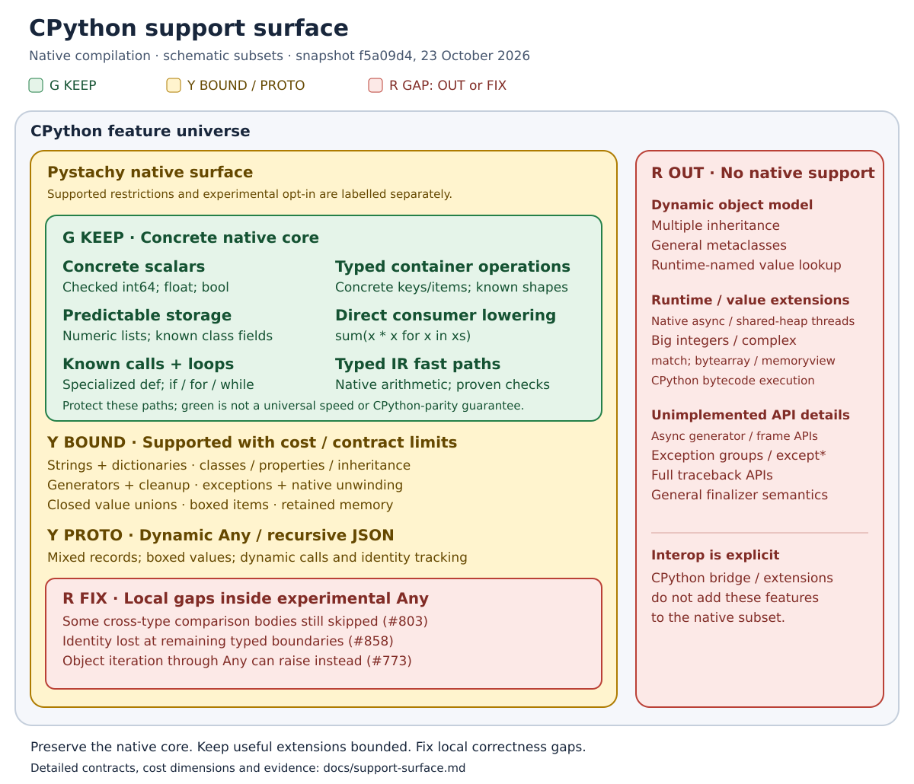

# CPython support surface

Pystachy's fast core is concrete values, predictable storage and typed operations. More
Python compatibility can build on that core, but the same syntax can also select boxed
storage, dynamic dispatch, suspended frames or exception unwinding. These diagrams show
what to preserve, where to measure costs, and which CPython behaviors remain gaps.

**Recommendation:** preserve concrete typed execution as the performance baseline. Keep
supported generators, exceptions and class features; reduce the machinery they require.
Keep dynamic `Any` experimental and opt-in while its correctness and application-cost
gates remain open. The useful boundary is the representation and operation, not a blanket
ban on a Python syntax family.

**Snapshot:** 23 October 2026, main
[`f5a09d4`](https://github.com/den-run-ai/pystachy/commit/f5a09d4223139d7255e31051be97fc509e1ca1fe).
This is an engineering guide to the existing surface, not a new language mode or a change
to the support policy. The [language reference](language.md),
[compatibility reference](language/compatibility.md) and [dynamic `Any` contract](dynamic-any.md)
define the exact supported forms. Issue status below was checked for this snapshot;
measurements linked below retain their own revisions. No new timings were collected.

## Reading the colors

| Label | Meaning | Engineering guidance |
|---|---|---|
| **G / green — KEEP** | Supported paths with concrete native representations or direct lowering | Preserve these paths and their performance when extending compatibility. |
| **Y / yellow — BOUND** | Supported features with restrictions or workload-dependent costs | Keep the feature; measure execution, memory, compilation and IR separately. |
| **Y / yellow — PROTO** | Experimental implementation with its own bounded contract | Evaluate the named APIs and consumers; support and cost gates are still open. |
| **R / red — OUT** | The named behavior has no native implementation/contract | Use a supported form or explicit interop; assess an extension against a real consumer. This is not a correctness-bug or removal label. |
| **R / red — FIX** | A known accepted-program correctness gap | Repair the result, effects or first exception before relying on that behavior. A compile-time rejection is a different boundary. |

Green is a design target, **not a promise that every program beats CPython**. Yellow does
not mean a feature is experimental unless it says **PROTO**, and red does not mean its
entire enclosing feature should be removed. The areas are schematic, not coverage percentages.
Read **support status**, **representation** and **measured cost** separately. A yellow
operation can outperform CPython; a green operation can still have high algorithmic cost.
The red examples are not an exhaustive inventory of deviations.

## 1. The native subset to preserve

The green region includes the compiler's own style of code: typed functions, inferred
specializations, concrete fields, numeric loops and homogeneous containers. Strings,
dictionaries, classes, generators and exceptions are useful parts of the supported language;
their broader contracts need more machinery than a scalar loop.

The core classification follows the [typed-IR fast paths](typed-ir.md#optimizations)
and concrete storage layouts. The [microGPT snapshot](../bench/microgpt/README.md#measured-snapshot)
and [integer-list memory measurement](performance.md#start-up-and-memory) are examples
of measured consumers of those paths, at the revisions recorded in their reports.

The core still has [numeric domain limits](language/compatibility.md#numbers): an integer
overflow raises instead of producing CPython's arbitrary-precision result, and unboxed
NaNs lack CPython's object-identity behavior in container membership/comparisons. Green
does not establish CPython equivalence even when every operand has a concrete type.

Dynamic `Any` is an additional, per-module **experimental opt-in** surface. A module without
the opt-in comment uses `Any` for concrete inference/specialization. A program importing an
opt-in module can still incur identity bookkeeping in typed code; the boundary is not
simply whether the hot function contains an `Any` annotation.

Preserve programs that already compile correctly. This map does not propose removing
generators, exceptions, unions or other accepted features to make the compiler smaller;
see the compatibility rule in [AGENTS.md](../AGENTS.md#start-with-the-current-tree).

## 2. Syntax is only the first layer

| Python syntax or construct | Label | Current native surface and the important boundary |
|---|---|---|
| Arithmetic, boolean expressions, `if`, `while`, `for`, `break`, `continue`, `return` | **G KEEP** for concrete operands | Checked 64-bit integers and native floats/bools; changing operands to unions or `Any` changes lowering. Arbitrary-precision integers are **R OUT**. |
| `def`, direct calls, keyword/default arguments, templates | **G KEEP** for known signatures | Inference specializes supported unannotated functions. Unrestricted runtime argument expansion and arbitrary builtin function values are outside this contract; see [calls and templates](language/typing.md#function-and-method-templates). |
| List/dict/set displays, comprehensions, indexing and slicing | **G KEEP** for concrete supported types; **Y BOUND** for mixed storage | Syntax is supported; element/key types determine layout, hashing, boxing and callbacks. Scalar-union locals and containers have different costs. |
| Assignment, unpacking, `:=`, closures, `global`, `nonlocal` | **G KEEP** within the static contract; **Y PROTO** for dynamic identity tracking | These forms are supported. Dynamic numeric identity can add box slots/snapshots; remaining boundary and late-storage-inference cases are **R FIX**, not reasons to remove assignment syntax. |
| Strings, bytes, f-strings, formatting | **Y BOUND** | Supported operations have different copying, Unicode and formatting limits. A read of an accumulating string can force a later append to copy; use the [performance contract](performance.md#costs-to-watch). `bytearray`, `memoryview` and binary files are **R OUT**. |
| Classes, dataclasses, properties, single inheritance | **G KEEP** for concrete fields/direct methods; **Y BOUND** for broader dispatch | Supported hierarchy and reflection forms have explicit limits. Multiple inheritance, general metaclasses and runtime-named attribute-value lookup remain **R OUT**. |
| Generator expressions and `yield` / `yield from` | **G KEEP** for direct consumer lowering; **Y BOUND** for suspended generators | A direct reduction can avoid a general generator object. A stored generator, delegation, `send`, `throw` and `close` need frames and cleanup; see the [semantic paths](#3-generators-exceptions-and-the-object-model). |
| `try` / `except` / `else` / `finally`, `raise`, `with` | **Y BOUND**, supported | Local handlers and cross-function unwinding have different costs. `except*`, exception groups and full traceback APIs remain **R OUT**. |
| `import`, packages and module initialization | **Y BOUND** | Sources are resolved at compilation; supported Python-module initialization runs on first executed import. This does not supply arbitrary runtime module discovery or CPython extension compatibility; see [module rules](language/modules.md). |
| `match`, native `async def` / `await` / `async for` / `async with` | **R OUT** | Not part of the supported native language. Concurrency hosted by CPython through an extension is a separate [interop path](concurrency.md). |

The [execution reference](language/semantics.md) describes the supported statements,
expressions, generators and object protocols. A recognized or unused piece of syntax
does not establish that a program needing it can execute natively.
Likewise, an import count is not an API-coverage score: native library implementations,
adapted ports and calls into embedded CPython are separate support paths. Check the
[library API inventory](../lib/README.md) and [explicit CPython bridge](ffi.md).

## 3. Generators, exceptions and the object model

Arrows connect **supported paths with additional implementation obligations**. The red
column records separate boundaries, not the next stage of execution. In particular:

- **Generators:** functions and methods that yield, delegation, and the documented
  `send` / `throw` / `close` forms already work. Real generators use LLVM coroutine
  operations in the [typed IR](typed-ir.md#instructions-and-control-flow). Their frames,
  live references, resumption and cleanup need validation. Some consumers materialize
  inputs; dropped suspended generators are not generally closed. These are different
  concerns from the [dynamic object-iteration gap](dynamic-any.md#deviations), where
  an accepted program raises instead of iterating. Opt-in generator channels rejected
  for incompatible `list[int]` / `list[Any]` storage are compilation restrictions,
  recorded in the [exception manifest](../tools/dynany_optin_exceptions.json).
- **Exceptions:** keep ordinary exceptions and cleanup. Local raises can branch to a
  handler; covered calls that may raise lower to LLVM `invoke` and native unwinding.
  Repeated cross-function throws are a runtime cost, not an unsupported construct.
  A call that succeeds on a particular run can still need exceptional edges and cleanup
  in its IR. A local raise can still construct an exception; green does not mean zero cost.
  See [exception lowering](typed-ir.md#exception-lowering) and
  [runtime deviations](language/compatibility.md#errors-and-control-flow).
- **Objects:** known fields and direct calls retain typed layouts. Single inheritance,
  overrides, properties and supported reflection are implemented, with class analysis
  and dispatch costs. Arbitrary runtime attribute names returning arbitrary values,
  dynamic attribute hooks and general metaclasses require a larger object model than
  the shipped one; see [reflection](language/semantics.md#reflection).

## 4. Where compatibility adds cost

All three paths compile through typed IR and LLVM in both JIT and AOT. Dynamic `Any` is
not an interpreter fallback or a tracing JIT. Narrowing can recover a typed payload
operation, but does not transparently change an aliased container's layout, remove its
boxes, or solve identity across every typed boundary.

The [recursive JSON prototype](json-prototype.md#values-and-ownership) is a closed recursive
union representation, separate from dynamic `Any`; it does not require the `dynamic-any`
pragma. Their boxes and dispatch contracts differ. JSON scanning/copying costs can affect
both paths, so more dynamic-type specialization is not automatically the remedy.

| Added surface | Label and cost dimension | Current mechanism, evidence and boundary |
|---|---|---|
| Closed scalar/value unions | **Y BOUND — execution / heap** | Numeric locals can use split tag/payload slots, while union-valued container items can still allocate boxes. [Union costs](union-value-costs.md), [typed-IR optimizations](typed-ir.md#optimizations), [#758](https://github.com/den-run-ai/pystachy/issues/758). Keep concrete containers for homogeneous hot data where the program's semantics permit it. |
| Dynamic `Any` values, heterogeneous records and JSON/TOML | **Y PROTO — execution / heap** | Runtime type/payload boxes, boxed collection items, hashing, dispatch and GC enable useful mixed data. Narrowed payload operations can avoid generic arithmetic; this does not make every dynamic pipeline fast. [Representation and measurements](dynamic-any.md#representation), [#780](https://github.com/den-run-ai/pystachy/issues/780). |
| Numeric identity across dynamic and typed code | **Y PROTO — execution / IR; R FIX — parity** | Box provenance, snapshots and joins preserve many copies, globals, closure cells and known-dynamic displays. Scalar-only proofs avoid some boxing. Typed parameter/return/field/container boundaries, folded constants and some inferred display cases remain gaps. [Identity contract](dynamic-any.md#representation), [#858](https://github.com/den-run-ai/pystachy/issues/858). |
| Cross-type comparisons through `Any` | **R FIX — parity; Y PROTO — compiler work** | Guarded concrete adapters now execute many previously skipped bodies, including differently typed builtin container fields. An unsupported body/field shape can still fall back without executing the method. [Deviations](dynamic-any.md#deviations), [#803](https://github.com/den-run-ai/pystachy/issues/803). Fix the missing semantics before treating this as stable. |
| Typed container ↔ `Any` crossings and generator channels | **Y PROTO — compile-time restrictions** | Incompatible mutable layouts are rejected rather than copied or reinterpreted. The opt-in manifest contains five distinct programs, each listed for JIT and AOT (ten entries). [Exact exception manifest](../tools/dynany_optin_exceptions.json), [#777](https://github.com/den-run-ai/pystachy/issues/777), [#773](https://github.com/den-run-ai/pystachy/issues/773), [#782](https://github.com/den-run-ai/pystachy/issues/782). This is separate from accepted object iteration through `Any` raising `TypeError` instead of iterating (**R FIX**). |
| Larger class hierarchies | **Y BOUND — compiler work / IR** | Comparison emission and specialization have already been reduced; residual class-pair analysis remains separate from field-error-message IR growth. [#625](https://github.com/den-run-ai/pystachy/issues/625), [#786](https://github.com/den-run-ai/pystachy/issues/786). Do not describe the old quadratic emitted dispatcher as the current implementation. |
| More dynamic classes and operation keys | **Y PROTO — compiler work / IR / execution** | Class-id switches have replaced the old linear field-dispatch chain. Duplicate method lookup, classes × attributes IR, dispatcher regeneration and deterministic cost guards remain. [#799](https://github.com/den-run-ai/pystachy/issues/799). |
| Speculation, widening and retries | **Y PROTO — compiler work / state safety** | Retries retain fresh compiler instances; the unsound catch-and-continue experiment was not merged. State checks and concrete leak fixes have landed, but complete semantic rollback and cheaper safe retries remain work. [#801](https://github.com/den-run-ai/pystachy/issues/801), [#767](https://github.com/den-run-ai/pystachy/issues/767). |
| Deep dynamic list/dict displays | **Y PROTO — compiler work** | Memoized dry traversal removed the exponential timeout. Residual superlinear work and deterministic scaling bounds remain; the historical timeout is not today's behavior. [#781](https://github.com/den-run-ai/pystachy/issues/781). |
| Text, regex and JSON scanning | **Y BOUND / PROTO per API — execution / heap** | Prefix copying, per-character scanning and regex miss paths can dominate even with static types. These are independent of type-dispatch optimization. [String costs](performance.md#costs-to-watch), [JSON prototype](json-prototype.md), [#861](https://github.com/den-run-ai/pystachy/issues/861), [#862](https://github.com/den-run-ai/pystachy/issues/862), [#345](https://github.com/den-run-ai/pystachy/issues/345). The `json_repair` port stack is not merged at this snapshot. |
| Long-lived allocation and caches | **Y BOUND — retained heap / RSS** | Conservative, batched collection can retain more memory despite fast scalar execution. A short checksum/timing run does not prove service-lifetime acceptance. [Memory behavior](performance.md#start-up-and-memory), [#202](https://github.com/den-run-ai/pystachy/issues/202), [#615](https://github.com/den-run-ai/pystachy/issues/615). |

The sharpest boundaries are **concrete versus boxed storage**, **known versus dynamic
dispatch**, **direct iteration versus suspended state**, and **ordinary control flow
versus repeated unwinding**. The last two are supported capabilities to retain; the
red comparison/identity cases are correctness work, not performance trade-offs to accept.

## 5. Measured examples, with their limits

These are **historical measurements**, not a fresh ranking of the snapshot above. Each row
compares the same workload within its own report; do not combine ratios across rows.
The linked reports give environment and validation details; sampling differs by experiment.

| Boundary | Recorded result | What it establishes |
|---|---|---|
| Useful concrete workload | At `d3fbfc6f`, adapted microGPT's 100-step training phase took **15.220 s in adapted CPython vs 0.896 s in AOT** (17.0×); AOT build was separately **1.802 s**. [Report](../bench/microgpt/README.md#measured-snapshot). | A concrete native consumer is worth protecting. This is an adapted application, a phase timing and a historical compiler, not unrestricted Python or end-to-end compile-plus-run speed. |
| Concrete vs union container | At `2438e7e0`, one million integers in `list[int]` vs `list[int \| str]`: construction **9.197 vs 19.043 ms**, scan **0.775 vs 2.392 ms** (process CPU, excluding startup); peak managed heap **13.0 vs 33.1 MiB** from separate runs. [Report](union-value-costs.md#boxing-measurement). | Identical integer payloads can incur extra allocation and indirection solely from storage. Heap peak is not retained live memory or RSS. |
| Narrowed vs generic dynamic arithmetic | At `bc79f24c`, summing a million items took **1.1 ms typed**, **3.2 ms with narrowed Any items**, **17.8 ms with an Any accumulator** (processing CPU); CPython's generic case took **30.5 ms**. [Report](dynamic-any.md#measurements). | Yellow can beat CPython while remaining much slower than the native core. Payload narrowing avoids arithmetic dispatch without removing the container's boxes. Later boxing/identity changes mean these are not current-main ratios. |
| Compiler work vs emitted IR | At `554f3d1 → 570eb4e`, the ordinary-class comparison with 30 subclasses and `other: object` went from **962 → 62 method instances**, **197,808 → 26,898 IR lines**, and AOT build **32.4 → 1.9 s**. [#792 measurements](https://github.com/den-run-ai/pystachy/pull/792). | Sharing specialization can preserve the feature while reducing compiler/backend cost. Quadratic frontend class-pair analysis remains ([#625](https://github.com/den-run-ai/pystachy/issues/625)); smaller IR alone proves no execution-speed gain. |

No matched measurement here establishes that all generators or exceptions are slow.
Their yellow classification describes machinery and workload sensitivity. Use the maintained
`exception_local` / `exception_unwind` [kernels](extended-performance.md) to compare throw
frequency and call boundaries; measure a real generator consumer before changing its lowering.

## 6. What to preserve, optimize or defer

This is an engineering recommendation within the existing support policy. The linked
trackers own implementation scope and promotion decisions.

| Decision | Surface | Evidence required for a change |
|---|---|---|
| **Preserve** | Concrete storage, typed calls, direct loops and narrowing fast paths | Correctness plus typed controls for execution, allocations and compiler cost, including programs importing opt-in modules. |
| **Keep and optimize** | Supported generators, exceptions, classes and closed unions | A demonstrated consumer cost; retain effects, cleanup, aliasing and first errors. Prefer shared lowering/helpers over removing semantics. |
| **Repair before promotion** | Accepted comparison/identity/iteration gaps inside dynamic `Any` | CPython parity for the affected contract and negative controls; #108 keeps stable opt-in separate from default-on. |
| **Contain implementation cost** | Union-item boxing, Any bookkeeping, dispatch generation, class-pair analysis and speculative retries | Allocation counts, separate frontend/backend timing, raw/optimized IR and scaling bounds. Preserve verified reset/ownership boundaries (#767); the rejected #801 partial-rollback approach is not a safe shortcut. |
| **Defer expansion until justified** | Unavailable general object/runtime facilities | A concrete consumer and an explicit contract/cost evaluation. Red OUT is not a request to remove already-supported features. |

## Using the map

For a performance-sensitive component, start with the concrete representation that fits
its data. Keep mixed records or dynamic dispatch where needed, then cross into concrete
numeric kernels only where conversions, aliases and identity satisfy the documented
contract. Removing Python semantics or silently copying mutable values is not a fast path.

Before calling a larger surface fast enough, establish CPython output/effects first,
then measure warmed execution, allocations/retention, frontend time, LLVM time and IR/binary
size separately. Check typed-mode controls as well as the extension. The maintained
[performance guide](performance.md), [extended benchmark guide](extended-performance.md)
and [verification guide](testing.md) describe those checks. Published compute and
application results are workload evidence, not a universal green/yellow threshold.

The `Any` promotion tracker [#108](https://github.com/den-run-ai/pystachy/issues/108)
keeps **stable bounded opt-in** separate from **default-on**. This map makes neither
promotion: correctness gaps, corpus exceptions, whole-import-graph behavior and
application/retained-memory acceptance still matter.

When updating this page, change the affected SVG labels and tables together, recheck the
linked issue's remaining scope, and retain the distinction between an unavailable feature,
an intentional restriction, a known accepted deviation and a measured cost. The SVGs are
editable vector sources in [images/](images/); labels and the tables carry the meaning
without relying on color alone.
