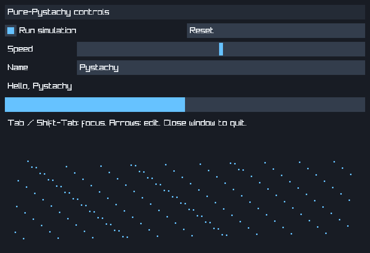

# miniui prototype

An optional immediate-mode UI written in the Pystachy subset. The widget core has
no imports, no FFI, no CPython bridge and no dependency on raylib or raygui. This
is original project code, not a source translation of either upstream library.
Only the optional desktop backend uses raylib's C API (5.5 API surface).



Actual Pystachy AOT output, captured from a 760-by-520 X11 window using raylib
5.5 and Mesa llvmpipe under Xvfb on Linux x86-64. The demo draws rectangles and
text directly; this PNG documents its output and is not loaded by the application.

## Scope

Six controls: label, button, checkbox, slider, progress bar and single-line
textbox. Section headings (`panel`), equal/fixed-width rows, clipping, stable IDs,
mouse capture and Tab/Shift-Tab keyboard focus are included. A rectangle primitive
supports the particle demo. The application owns all control values; no callbacks
or retained widget objects cross FFI.

`miniui.py`, `raylib_backend.py` and `raylib_adapter.c` contain the implementation.
Together with `demo.py`, `build_backend.sh` and `run.sh`, they are under 1,000 physical lines,
including comments/blanks. Tests, this guide and the external raylib library are
excluded; the complete graphics stack is NOT under 1,000 lines.

## Run the desktop demo

Install raylib development files exposing a `raylib` pkg-config entry, version
5.5 or later, and use the normal Pystachy/LLVM source setup. From the repository
root:

```sh
examples/miniui/build_backend.sh
build/miniui/run.sh ./pystachy run examples/miniui/demo.py
./pystachy build examples/miniui/demo.py -o build/miniui/demo
build/miniui/run.sh
```

`build_backend.sh [output-directory]` installs `libminiui.so` and `run.sh` together;
the default directory is `build/miniui` in this checkout. It works from any working
directory. The launcher locates the adjacent adapter and adds its directory to the
dynamic loader's search path before starting the command. It preserves the caller's
working directory, environment and arguments. With no arguments it runs a sibling
AOT executable named `demo`.

For deployment, keep `run.sh`, `libminiui.so` and `demo` together and invoke `run.sh`
by path, including after moving the directory. No source checkout is needed by
that AOT bundle. The FFI uses the literal library name `libminiui.so`; launching
without the wrapper requires configuring the loader search path yourself. This
is not a single-file executable: dynamic raylib builds also need their matching
raylib shared library and its dependencies available. Nothing is downloaded,
vendored or linked into ordinary Pystachy programs by this example.
The AOT design does not embed CPython. Linux is the intended first platform;
the Darwin build switch is experimental, not a macOS validation claim. Windows
packaging is not implemented. This is a single, fixed-size window, on the main
thread; close it with its titlebar. Always close it in `finally`.

The same demo can use the repository's CPython FFI twin:

```sh
PYTHONPATH=tools/rt_cpython build/miniui/run.sh python3 examples/miniui/demo.py
```

## Small API

```python
from miniui import UI
from raylib_backend import Window

ui = UI(640, 360)
window = Window(640, 360, "Controls")
speed = 0.5
try:
    while window.open():
        ui.begin(window.poll())
        ui.label("Simulation")
        ui.row([100, 0])  # fixed column; remaining width
        ui.label("Speed")
        speed = ui.slider("speed", speed, 0.0, 1.0)
        ui.row([0])
        if ui.button("reset", "Reset"):
            speed = 0.5
        ui.end()
        window.draw(ui)
finally:
    window.close()
```

Use unique, nonempty string IDs for interactive controls, independent of visible
labels or call order. Buttons activate on release inside after a press inside;
sliders retain capture while dragging outside. Removed, disabled or completely
clipped controls lose capture and focus. Partially visible controls remain
focusable and accept pointer hits only inside their visible intersection. Tab
uses the preceding frame's enabled, visible control order (so the first displayed
frame establishes it). A stale target that becomes hidden this frame loses focus
before consuming input. Enter/Space activate a focused button or checkbox;
arrows/Home/End adjust sliders. Escape and window blur cancel focus, capture and
all input for that frame, including a simultaneous click. Labels and progress bars
do not take keyboard focus. Duplicate IDs are checked with a set; Tab order is
stored separately.

Text editing supports insertion, Left/Right/Home/End, Backspace/Delete and Enter
to leave editing. Clicking a textbox places the cursor at its end. Limits and
cursor movement count Unicode code points, not grapheme clusters. Unsupported
glyphs are still limited by raylib's default font. No selection, clipboard, IME,
undo, shaping or accessibility integration is promised. Caller text is clamped
to `max_chars`; NUL and multiline values are rejected. The backend measures and
clips text and scrolls it horizontally to keep the caret visible.

`Input` is a frame snapshot, not a chronological event stream. Cancellation takes
priority over a mouse press, which takes priority over Tab navigation. Textboxes
apply cursor movement, deletion, queued text, then Enter. Raylib's public key and
character queues do not preserve mixed event ordering; richer editing needs a
backend that supplies ordered events. This prototype does not claim that fidelity.

`panel` is a section heading, NOT a nested layout or native window. No scrolling,
menus, resize/DPI handling or multiwindow support is included. Custom rectangles
are clipped to the root content area and do not advance layout. Commands are
frame-local. Call `begin`, submit controls, `end`, then render. Work between frames
must stay bounded or the UI will not respond; there is no background event thread.

## Drawing submission

Rectangles use their shared container clip. Consecutive commands with identical
clips reuse the current scissor state; changing it flushes raylib's previous batch
once, and frame completion disables scissoring once. Text and its caret retain
their own tighter clip, and commands keep their submission order, including
overlapping translucent rectangles. Fully clipped commands are skipped. The
renderer avoids allocating an intersection rectangle for every filled primitive;
the widget core still creates frame-local drawing commands.

The actual demo's first frame has these deterministic counts, measured with the
same mock raylib under CPython 3.13.16. The baseline is
[`d4b918fa`](https://github.com/den-run-ai/pystachy/commit/d4b918fa63f4db71d84f20078edd81cdde9754f0).
The current counts are enforced by `check_backend.py`:

| First-frame operation | Baseline | Current |
|---|---:|---:|
| Primitive submissions | 167 | 167 |
| Scissor rectangle changes | 167 | 15 |
| Scissor mode ends | 168 | 1 |
| Rendering FFI calls | 336 | 184 |

Rendering FFI calls include begin/end, primitives, clips and text measurement;
input polling and frame timing are excluded. This is 45.2% fewer rendering FFI
calls, not a measured frame-time speedup.

## Reproducible tests

The headless case is part of the ordinary corpus via its `.path` and `.out`:

```sh
PYTHONPATH=examples/miniui python3 tests/programs/apps/miniui_headless.py
make test FILES='tests/programs/apps/miniui_headless.py'
make test-py FILES='tests/programs/apps/miniui_headless.py'
```

The display-free backend test compiles the actual adapter against a deliberately
fake raylib, then exercises it through the repository's unchanged CPython FFI twin:

```sh
python3 examples/miniui/check_backend.py
python3 examples/miniui/check_backend.py --compiler ./pystachy
```

The second command also compares native JIT, AOT and program-only GC-stress
execution. The stressed AOT run must report a positive collection count; a label
or matching output alone is insufficient. A missing compiler does not count as a
native pass. The fake backend
checks scalar widths, UTF-8 input, unsigned RGBA, retained title ownership, clip
batching, draw order, text/caret bounds and cleanup after empty or failed frames.
It also launches a relocated adapter through `run.sh` from an unrelated working
directory, including paths containing spaces. It does NOT validate real raylib
headers, display creation, fonts or rendering. Run the real demo separately on
each supported platform.

Local validation uses Linux x86-64, pinned CPython 3.13.16 and LLVM 18.1.3:

- `make`: compiler and runtime IR fixed points pass.
- `make test` and `make test-py` with `FILES=tests/programs/apps/miniui_headless.py`:
  all ten scenarios pass in JIT and AOT with both compiler hosts.
- `check_backend.py --compiler ./pystachy`: CPython, native JIT, AOT and AOT
  GC-stress outputs match. Both AOT bundles run after relocation.
- `make lint check-repository` and the full pinned `tests/record.sh --check` pass.
- Real raylib 5.5 graphics smoke under CPython, native JIT and AOT: visible pixels,
  pause, reset, slider/progress updates, text/greeting updates and normal window
  closure pass from an unrelated working directory; AOT uses a relocated bundle.
  Their final interacted frames are pixel-identical to each other and the baseline
  revision. The screenshot above remains representative of native AOT output.

Real graphics on other platforms, physical displays/GPUs and sanitizers remain
unverified. Focused local checks are not full `make verify`.
