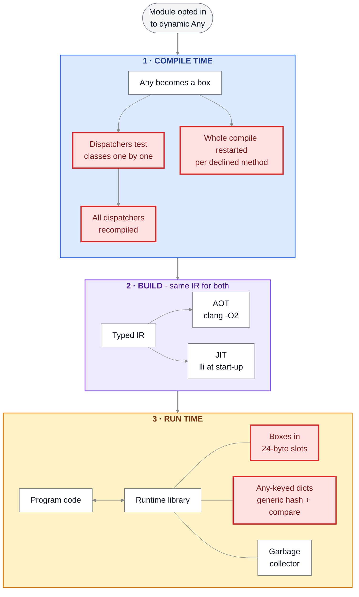
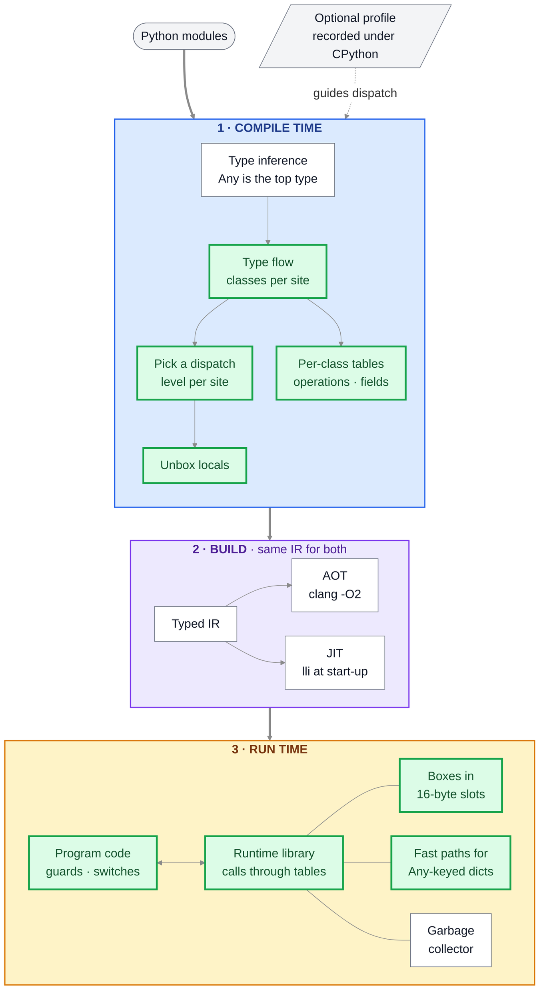
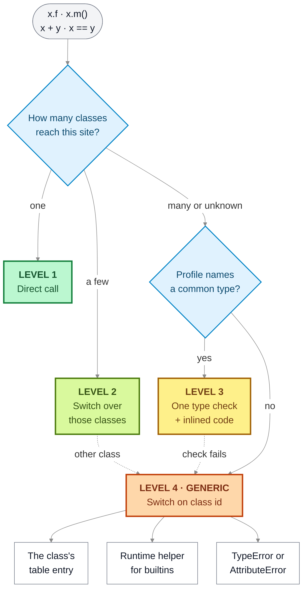
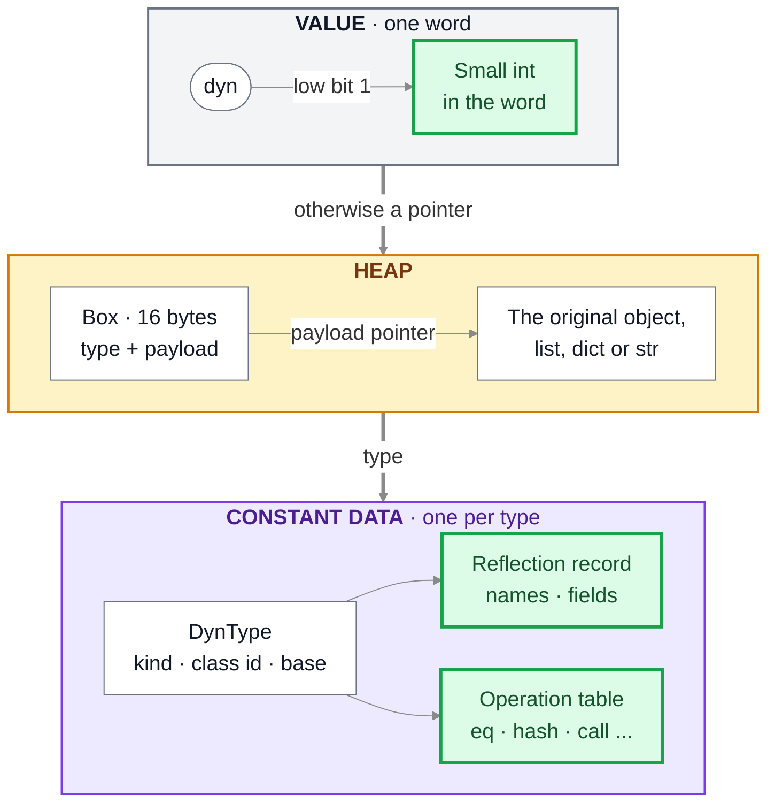

# Dynamic `Any`: a proposal to make it robust and make it scale (2026-10-21)

A proposal, with the measurements behind it, for the dynamic `Any` that #761 merged, #790
extended and #795 now ships `tomllib` with. It maps the reference systems (Julia, V8, Dart, PyPy,
CPython, Truffle, .NET, Go, mypyc, gradual typing research) onto Pystachy's actual architecture
and orders the work by what was measured. Nothing here changes the compiler, the runtime or
`lib/`: the two patches in `patches/` are measurement experiments, not proposed code.

Measured at main **`1cf6a676`** (the merge of #795), built with `make PY=/usr/bin/python3.13`
(fixed points: 635,685 lines of compiler IR, 18,709 of runtime IR), CPython 3.13.16, clang/LLVM
18.1.3, on a shared 4-vCPU Linux container. The same measurements at `3d48ce8c` (the merge of
#790), before #794 and #795, gave the same instruction counts, IR sizes and findings. Instruction
counts come from callgrind and do not depend on the host's load; timings are medians of
interleaved, core-pinned processes, and on this host differences under about 20% are noise.
Measurements cited from issues keep their own revisions.

**Revised after review (2026-10-21).** A review of `81527522` corrected these points, now in the
text: the no-deoptimization claim is scoped to local specializations that re-check what they
assume; inline caches are deferred, not ruled out; A1's containment oracle is `y is x or y == x`,
and its hash and ordering laws hold only for generated classes that obey them; #797's identity fix
is separate from tagging; A4 drops checked views, which #487 forbids; A2 specifies operation
semantics before a slot ABI; and the order of work (section 5) is the review's.

## Summary

1. **Pystachy is a closed world whose classes never change.** Both `build` and `run` compile the
   whole program before it runs (`run` hands it to `lli`; there is no tiering, profiling or code
   loading, #707/#704/#104), and a class's fields and methods are fixed. So a test of a box's
   `DynType` settles the receiver's class, layout and methods for good: unlike V8's maps or
   CPython's type version tags, nothing invalidates those facts. It settles nothing else: a
   callable field, a global, a container's contents or its storage can change across any call.
   Local specializations therefore need no frame deoptimization or online compilation, provided
   each re-checks what it assumes, falls back to the generic path before any effect without
   replaying one, and still captures a callable before evaluating its arguments, as the compiler
   does today and #108 requires.
2. **Which references transfer.** Julia (inference, union splitting, unboxed representations)
   and Dart's AOT (closed-world type flow analysis, a global dispatch table, call-site state kept
   as data) transfer directly. PyPy's storage strategies transfer to `list[Any]` and
   `dict[Any, Any]`. CPython supplies type slots, a "str keys only" dict mode and PEP 659's
   cheap-guard-plus-fallback shape. V8 transfers only as *offline* feedback (profiles, as
   `tools/re_specialize.py` already does for regexes) and as its small-integer tagging; its
   hidden classes are already Pystachy's fixed class layouts. Inline caches are deferred, not
   ruled out: fixed layouts do not tell which receiver dominates a site, and Dart's AOT uses
   switchable calls for dynamic receivers. Switches (C1) are the first experiment.
3. **Order the work by the measurements, not by the references.** On the dynamic-heavy pipeline
   of #780, `Any`-keyed dict lookups and hashing take about half of the instructions, box
   allocation and collection a quarter, dispatchers and boxing a tenth. So: a semantics harness
   and two bug fixes first, then the data path (`Any`-keyed dicts, exact box slots) beside a small
   dispatch change, then compile-time passes, JSON storage and operation tables; tagging, storage
   strategies and speculation only once those are measured, under #392's reopen criteria.
4. **Near-term steps with measured or well-bounded payoff**, none yet shown to speed up a whole
   application:
   - a bounded differential and metamorphic harness for `Any` operations with a corrected
     oracle, #784's opt-in sweep as a CI check, and focused fixes of #797 and #798;
   - the `Any`-keyed dict fast paths of #780, plus constant boxes for literal keys;
   - dispatchers that `switch` on the dense class id every `DynType` already holds, instead of a
     chain of pointer comparisons: in a synthetic probe, reading a field of the chain's last
     class at 128 boxed classes drops from 493 to 108 instructions;
   - exact 16-byte box slots from a dedicated allocator: today each 16-byte box takes a 24-byte
     slot, and the experiment's 15-byte requests built a million boxed values 26% to 43% faster
     and cut `generic`'s heap peak from 55.2 to 39.1 MiB (a construction microbenchmark);
   - one compile pass for all declined comparison methods, and #804's class aliases, which are
     independent of the rest.
5. **Diagrams:** today's pipeline is in section 1; the proposed pipeline across the compiler, both
   build modes and the runtime, the four dispatch levels of an operation on an `Any` value and the
   layout of a `dyn` value are under [Design at a
   glance](#design-at-a-glance-compiler-runtime-aot-and-jit).
6. **Against CPython 3.13:** typed loops run 4 to 71 times as fast as CPython, and most single
   operations through `Any` still run faster (a field read 21×, a method call 4×, an int sum 3.5×);
   `tomllib` parses 2.7× as fast. CPython wins where an `Any` loop hashes and compares keys parsed
   from data and boxes new numbers: it processes #780's record pipeline 1.57× as fast, although
   Pystachy's faster decoding makes a whole run of the prebuilt AOT executable 1.24× as fast (the
   build itself not counted). Peak RSS is 2.0 to 2.6 times CPython's. See [Against
   CPython](#against-cpython).
7. **Library reach is not what dynamic `Any` buys today:** with the comment in every stdlib module,
   150 of 457 modules import instead of 149: outside `Any` annotations and displays of mixed items,
   the comment leaves unannotated code as it was. That measures today's opt-in behavior, not what
   dynamic typing may do for libraries later; stdlib compatibility and dynamic-`Any` optimization
   stay separate workstreams. C modules (220 modules, #491) and the class model (#7) block far
   more. 32 modules stop first at three lines that use a class as a value: two aliases
   (`Charset = _charset.Charset`), which a loader change admits with no `Any` at all (#804), and
   `copyreg`'s table keyed by types, which needs canonical class values (#805). Those counts are
   first blockers removed, not working imports. See [Library reach](#library-reach) and group E.

## 1. Where dynamic `Any` stands at `1cf6a676`

**Representation.** An `Any` value is a pointer to an immutable 16-byte box
`{DynType *t, payload}` ([runtime.c#L3204-L3256][rt-dyn]). The `DynType` holds the kind, the
payload's layout descriptor, `type(x).__name__`, the class's dense id (`cls`, the `O<id>` of
descriptors; -1 for builtin and function types), its base and flags. `None`, `True`, `False` and
the ints from -5 to 256 are constant boxes; other numbers allocate. Containers of `Any` values
hold boxes (`LA`, `DAA`, `VA`). Typed mutable containers never become `Any` values (#777).

**Dispatch.** Operations on the program's classes go through dispatchers, one function per
operation key (`get.<a>`, `set.<a>`, `call.<m>.<n>`, `has.<m>.<n>`, `callv.<n>`, `op<k>`, ...),
that the compiler writes once the boxed classes are known and recompiles, all of them, while
compiling them boxes more classes ([dynamic.py#L1403-L1418][dispatchers],
[program.py#L1126-L1128][fixpoint]). Each tests the box's `DynType` against every boxed class
that supports the operation, one pointer comparison after another
([dynamic.py#L1085-L1128][body]), then falls back to `runtime.c`'s generic helpers. The runtime
reaches the program's own `__eq__`, ordering, hash, `repr` and #790's cross-type comparison
helpers through `pys_obj_eq`/`pys_obj_cmp`/`pys_obj_repr`, whose class-id argument also encodes
the operation (`-1 - id`, op codes 1 to 6). So a dynamic operation's semantics live in four
places: the compiler's dispatchers, the runtime's generic helpers, the program's `@o.*` helpers
and the descriptor walks of containers.

**The pipeline today.** Every program goes through the three numbered regions: compile time
(blue), the build (purple) and run time (amber). Both build modes take the same typed IR:
`pystachy build` links in the runtime's bitcode and optimizes across it with clang -O2, and
`pystachy run` hands the whole program to `lli` at start-up, inlining only under 20,000 IR lines.
Red boxes are today's measured costs: dispatchers test boxed classes one by one (M1, M5) and are
all compiled again whenever more classes get boxed, growing with classes × attributes (M2); each
declined comparison method restarts the whole compilation (M4); boxes take 24-byte slots (M3); and
`Any`-keyed dicts hash and compare keys through generic helpers (#780). The proposed design is
under [Design at a glance](#design-at-a-glance-compiler-runtime-aot-and-jit).



**Measured costs** (method under [Reproduce](#reproduce)):

| # | Measurement | Result | Issue |
|---|---|---|---|
| M1 | Instructions per `obj.f0` read through `Any` (the sum it feeds allocates a box each time), receiver of the last class in the chain | 106 with 2 boxed classes, 155 with 16, **493 with 128**: about 3 more per class ahead of it in the chain | #799 |
| M2 | Dispatcher IR, 64 classes × 32 shared field names | 34 dispatchers, **29,240 of the program's 53,179 IR lines** (about 14 per class and attribute). At 32 × 32 they are 14,904 of 27,035 lines: the other 12,131 alone stay under `PYSTACHY_JIT_INLINE`'s 20,000, so the dispatchers make `run` skip inlining for the whole program ([driver.py#L741-L751][inline]) | #799 |
| M3 | Heap slot of a box | 24 bytes for 16 of payload, for `Any` boxes and closed-union boxes (`pys_ubox`) alike: the collector adds one byte of slack to every request ([runtime.c#L193][cls], [#L396-L402][alloc]) | #800 |
| M4 | Compile time with K comparison methods whose body does not compile for an `Any` operand (300 other functions; `pystachy ir`, best of 5) | K = 0, 1, 4, 16: **65, 104, 234, 824 ms**; each declined method costs one more whole-program pass ([driver.py#L71-L103][passes]) | #801 |
| M5 | `x.m(f(i))` through `Any` | two class dispatches, `dyn.has.m.1` then `dyn.call.m.1` (or `dyn.callv.1` for a field), per call ([dynamic.py#L1448-L1479][method]) | #799 |
| M6 | `a: Any = 1000`, `b: Any = int("1000")`, `print(a is b, id(a) == id(b))` | Pystachy `True False` in JIT and AOT; CPython `False False`. `is` compares ints by value ([dynamic.py#L936-L952][ident]) while `id()` gives the box's address ([runtime.c#L3659][id]) | #797 |
| M7 | Seeded differential fuzz, 3 × 150 expressions over 37 values, 21 binary operators and 11 unary operators and builtins, JIT | one undocumented mismatch class: a `**` `TypeError` says `for **:` where CPython says `for ** or pow():` ([runtime.c#L3385-L3388][dops]); the rest are documented (`%` of an `Any` str, 64-bit overflow) or not comparable (str hashes, which CPython randomizes) | #798 |
| M8 | In-place operators on `Any` values that do not support them (`probes/opmsg.py`), JIT and AOT | every one names the binary operator: `for +:` where CPython says `for +=:`, `for **:` for `**=`. `pys_dyn_inplace` falls back to `pys_dyn_binop`, whose message knows only the binary symbol ([runtime.c#L3454-L3470][inplace]) | #798 |

**Robustness record.** #772 (silent wrong comparisons through `Any`) and #781 (compile time
doubling with display depth) were found by probes after #761 merged, not by its tests, and fixed
in #790; 5 of #782's 15 opt-in regressions remain, and #790 notes compile time still grows faster
than linearly with display depth. M6, M7 and M8 are three more findings of the same kind.

### Against CPython

`1cf6a676` against CPython 3.13.16 on the host above (an Intel Xeon at 2.10 GHz): medians of 7
interleaved processes pinned to one core, every checksum and output equal to CPython's
([`results/cpython-comparison.txt`](results/cpython-comparison.txt) has the commands and the raw
output). Typed code runs 4 to 71 times as fast as CPython on these loops (`str.split()` aside).
Through `Any`, most single operations are still faster; CPython wins where a loop hashes and
compares keys parsed from data and boxes new numbers:

| Workload | CPython | Pystachy | Result |
|---|---:|---:|---|
| #780's record pipeline, 100,000 mixed JSONL events: processing, the `Any`-heavy loop | 102 ms | 160 ms | CPython 1.57× as fast (#780: 101 against 165 ms) |
| the same: decoding (`json.loads()` and the copy into `Any` storage) | 599 ms | 363 ms | AOT 1.65× as fast |
| the same: one pass end to end with process start-up: the prebuilt AOT executable (its build not counted), and the JIT with its compilation | 755 ms | 607 ms (AOT), 957 ms (JIT) | AOT 1.24× as fast, JIT 0.79× |
| the same: peak RSS | 136 MiB | 269 MiB (AOT), 329 MiB (JIT) | 2.0× and 2.4× CPython's |
| `tomllib.loads()` of #784's 526 KB document | 187 ms | 70 ms | AOT 2.66× as fast (#784: 2.0×), at 41 against 16 MiB peak RSS |
| `tools/dynany_bench.py graph`: 2,000 object graphs deep-copied and checked through `Any` | 147 ms | 27 ms | AOT 5.5× as fast |
| `tools/dynany_bench.py generic`: 1,000,000 ints in a `list[Any]` summed into an `Any` | 25.1 ms | 16.7 ms | AOT 1.5× as fast |

One operation, in nanoseconds (`probes/hot.py`, AOT; the JIT's times for the `Any` loops are within
8% of these):

| Through `Any` | CPython | Pystachy | Result | The same loop typed |
|---|---:|---:|---|---:|
| field read `x.v`, 4 classes | 60.4 | 2.8 | 21× as fast | 1.1 |
| method call `x.m(i)` | 115.4 | 28.3 | 4.1× as fast | 1.8 |
| `acc = acc + x`, ints | 26.2 | 7.6 | 3.5× as fast | 0.37 |
| two reads of a record dict and a compare, the stored keys being the lookups' literals | 87.1 | 60.9 | 1.4× as fast | 11.1 |
| the same, keys built at run time, as parsed keys are | 92.2 | 96.8 | 0.95× | |
| `counts[w] = counts.get(w, 0) + 1` | 59.7 | 53.1 | 1.1× as fast | 14.6 |
| `acc = acc * 0.5 + x`, floats | 21.2 | 24.4 | 0.87× | 2.5 |
| `len(s.split())` | 186.7 | 223.9 | 0.83× | 163.3 |

The pipeline loses where the kernels win because its keys and numbers come from data. Its
processing runs 7,912 instructions per event (#780: 7,870; callgrind, 6 rounds less 1 over 10,000
events): 45% in `Any`-keyed dict lookups and key comparison, 14% in hashing, about 18% in
allocation and collection and 6% in `str.split()` and slicing; the handlers, dispatchers and boxing
take the rest. A key parsed from JSON is another str than the literal that looks it up, so a hit
compares two boxes through `dfindc`, `eqv`, `dkeyeq`, `pys_dyn_eq` and `memcmp`, where a CPython
dict whose keys are all strs compares them in one specialized loop (the kernel above drops from 1.4×
to 0.95× with such keys). Every count above 256, token sum and float stored into `Any` storage takes
a new box, and each collection scans the live heap: 11 collections took 154 ms of one pass with
135 MiB live (`PYSTACHY_GC=stats`), while the kernels' 25 took 3.2 ms. CPython frees short-lived
numbers by reference count. B2 and B1 address the first two, and B3 the boxes once A6 settles
identity; the dispatchers that C1 and C2 change are a tenth of this workload.

### Library reach

The comment makes `Any` annotations dynamic, turns a display whose items have no one type into a
container of `Any` values, and widens storage that later receives an `Any` value
([docs/dynamic-any.md][dynstorage]). Other unannotated code keeps its static types and per-call
templates, and making `Any` the default for it is a non-goal (section 6). The standard library is
unannotated, so opting all of it in moves little: at `1cf6a676`, `tools/import_sweep.py` compiles
`import M` for 149 of the 457 stdlib modules it tries (62 more are `lib/`'s own) and for 150 with
the comment as every module's first line, as #784 found at `ad19255e` (149 and 150 of 461, before
`lib/` took over `tomllib`'s 4 modules). The one module is `xml.etree.ElementPath`, whose dict
display of different functions becomes a dict of `Any` values. First blockers without the comment
([`results/stdlib-optin-sweep.txt`](results/stdlib-optin-sweep.txt) lists the modules):

| First blocker | Modules | Tracked in | What dynamic `Any` could do |
|---|---:|---|---|
| a module that CPython builds in from C: `_warnings` (56), `_socket` (44), `_signal` (27), ... | 220 | #491, #128 | nothing |
| a class used as a value: two module-level aliases, `Charset = _charset.Charset` (`email/header.py:21`, 15 modules) and `_LockType = _thread.LockType` (`threading.py:38`, 9) | 24 | #804, #7 | nothing needed: an alias through a module attribute, as `X = C` after a from-import already is (E1) |
| a dict keyed by builtin functions or types: `copyreg`'s `dispatch_table[ob_type] = pickle_function`, which `copy`, `pickle`, `shelve` and `xml.dom.minidom` import | 8 | #805, #774 | classes as `Any` values, in an opted-in overlay (E1) |
| a class feature: enum bases, generic inheritance, other bases | 22 | #7, #610 | nothing |
| another feature: module attributes, redefinitions, `None` where an `int` was inferred, ... | 34 | | E4, for the 4 that are inference failures |

#784's nine JSON and data packages also stopped at the same place with and without the comment
(at `ad19255e`), and none at an `Any` gap: `inspect` (`_warnings`), `copy` (`copyreg`, above),
`six`, a namedtuple field given `None`, and `types.MappingProxyType`, which #794 has added since.
Dynamic `Any` pays off for library code written around it: `tomllib` (#795) and #784's 34 of 60
everyday idioms.

## 2. What transfers, and what does not

| Reference | Idea | Fit for Pystachy | Item |
|---|---|---|---|
| Julia | inference through bodies; specialization per argument types | templates already specialize unannotated functions; `dyn` is Julia's `Any`. Missing: refining `dyn` at sites (union splitting) and unboxed results of dispatch | C4 |
| Julia | inline unions, unboxing ([isbits unions][julia-unions], [union splitting][julia-split]) | closed unions exist; #742's `unionslots` splits numeric-union locals into tag and payload slots | B3 |
| Dart AOT | closed-world type flow analysis, a global dispatch table indexed by class id and selector offset ([generator][dart-table]), switchable calls whose state, a stub and its cache, the runtime updates ([Dart VM][dart-vm]) | the closest architecture: Pystachy is a closed world too | C1-C4, D2 |
| PyPy | [storage strategies][pypy-strategies]: homogeneous unboxed storage that changes representation in place on the first foreign store | only code whose static type is `list[Any]` or `dict[Any, Any]` reads these containers, so code for other types is untouched | B5 |
| CPython | type slots; [PEP 659][pep659] specialization with a cheap guard and a generic fallback; dicts with only str keys; small-int cache | slots give one definition per operation (A2); the str-keys mode is B2; the small-int cache is already copied (-5 to 256) | A2, B2, D1 |
| Truffle | [DSL specializations][truffle-dsl] with guards and a generic fallback | a declarative table of each operation's cases drives the fuzzer's coverage and the compiler's fast paths; partial evaluation does not apply | A1, A2 |
| V8 | hidden classes and transitions | already Pystachy's fixed class layouts: nothing to add | non-goal |
| V8 | inline caches, feedback, speculation, deoptimization | no online compilation: offline profiles and diamonds (D1); caches deferred, not ruled out, since fixed layouts do not tell which receiver dominates a site (D2) | D1, D2 |
| V8, mypyc, OCaml | small integers tagged in the pointer ([mypyc][mypyc-int]) | fits the conservative, non-moving collector; V8's pointer compression does not (the C runtime and every container slot hold full 64-bit pointers) | B4 |
| .NET, HotSpot | [guarded devirtualization][dotnet-gdv]: a profile's dominant type tested, its target inlined, the virtual call as fallback | exactly D1's shape | D1 |
| Go | interface values `{itab, data}`; escape analysis keeps conversions off the heap | #488's tables; B3 | A2, B3 |
| Gradual typing | proxies, transient checks, [monotonic references][monotonic] for typed mutable data seen through a dynamic type | the typed-container crossing of #777 and #487's item 6 is this problem; checked writes are out, since #487 forbids store errors introduced by annotations | A4 |
| LuaJIT, SBCL, Chez | a tracing JIT and NaN-boxing (LuaJIT), compilation at run time (SBCL, Chez) | need code generation at run time; NaN-boxing cannot hold 64-bit ints unboxed | non-goal |

Where this proposal departs from the general advice in the research it builds on:

- **"Start with small inline caches."** For a selector known at compile time, a `switch` on a dense
  class id (C1) is the first experiment: no mutable state, no miss handler, and the measured
  dispatch share is about a tenth. Fixed layouts remove shape transitions but not the question of
  which receiver dominates a site, so a small cache may still help a constant-name call on skewed
  receivers (Dart's AOT uses switchable calls for dynamic receivers), besides run-time selectors
  such as `getattr(o, name)`. Caches are deferred, not ruled out (D2).
- **"Before full frame deoptimization."** Not needed for the specializations proposed here: each
  checks its assumptions locally and falls back to the generic path before any effect, without
  replaying one. A `DynType` check covers the receiver's class, layout and methods; what a call
  can change (callable fields, globals, container contents, storage strategies) is read after
  the check or checked again. Frame deoptimization becomes relevant only with online speculative
  compilation, which #392 parks.
- **"LLVM supplies GC integration and stack maps."** Those serve precise or moving collectors.
  Pystachy's collector is conservative and non-moving by design, so box elimination (B3) and
  tagging (B4) need no stack maps; each still needs proof, under GC stress with a negative
  control, that every live reference stays a recognizable root across allocations.
- **"GC is workload-dependent."** For `Any`, the lever is fewer and smaller allocations (B1-B5).
  A generational mode with sticky mark bits (compatible with conservative roots) is the GC-side
  option only if allocation still dominates afterwards.

## 3. Principles

- **Never reject or change a program that compiles today** (#409): a program without the comment
  keeps its IR (`make irsame`), and opting in rejects nothing that compiles without it (A1's sweep).
- **Local guards, generic fallbacks.** Every fast path tests what it assumes (the receiver's
  `DynType` or class id, and again anything a call can change) and falls back to the generic path
  before any effect; a callable is captured before its arguments are evaluated, as today. No
  analysis result is ever a reason to reject a program.
- **Observable identity is kept** (#487): no box is removed or re-made where `is` or `id()` could
  tell, and #797's rule is settled before any box elimination.
- **One definition per (type, operation), many entry points** (A2): typed code, dispatchers,
  container searches and dict lookups must reach the same per-class code.
- **Python type identity is not layout** (#487): `type(x)` identity (the reflection record) and the
  payload's layout (the descriptor) are separate words of a `DynType`.
- **Pay only where used:** records, tables and slots only for classes whose values reach `Any`
  storage, as reflection records are emitted today ([internals.md#reflection][refl]).
- **Evidence before speculation:** deterministic counters (instructions, boxes, dispatches) as
  guards, as `make re-probe` and `make eqprobe` do, then paired timings.

## Design at a glance: compiler, runtime, AOT and JIT

The same three regions with the proposal applied; green boxes are what it adds, and the labels in
the notes below (A2, B1, ...) name the items of section 4. `pystachy build` and `pystachy run`
share everything up to the typed IR, and the whole runtime: they differ only in how LLVM IR becomes
machine code, so every item applies to both.



- **Inputs.** Modules that opt in and modules that do not, and optionally a profile of the
  `DynType`s seen at each site, recorded under CPython with `sys.monitoring` as
  `tools/re_specialize.py` records regexes (D1).
- **1 · Compile time.** Inference keeps `Any` as `dyn`, the top of the lattice and never a reason
  to reject a program. Type flow over the closed world finds the `DynType`s that can reach each
  site (C4), and each site gets the cheapest dispatch level of the next diagram (C1, D1). Locals
  keep `DynType` and payload in two slots and box only where a value leaves (B3). Each boxed class
  gets a `DynType` with an operation table (A2), a field table (C2) and one boxed entry per
  callable (A3).
- **2 · Build.** Unchanged: in `pystachy build`, clang -O2 inlines guards and switch arms across
  the runtime boundary; in `pystachy run`, `lli` compiles the same IR at start-up, with no tiering
  and no deoptimization.
- **3 · Run time.** The program's code runs the guards and switches; `runtime.c`'s generic helpers
  call through the operation tables (A2); `Any`-keyed dicts get fast paths (B2); boxes take exact
  16-byte slots (B1). The collector stays conservative and non-moving: split slots and tagged ints
  need no stack maps, provided each keeps every live reference recognizable (B3, B4).

**One operation on an `Any` value.** Blue diamonds are choices the compiler makes per site; the
colored boxes are the code it emits, from the cheapest (level 1) to the generic path (level 4),
which the others fall back to at run time (dotted arrows). Level 1 is a direct field load or call
and level 2 a switch over the classes type flow found, each arm typed and inlinable (C4); level 3
checks the box's `DynType` against the type a profile names and inlines that class's code (D1);
level 4 switches on the class id (C1) or indexes a selector table (C2, C3), and a class's table
entry is the same code the runtime calls (A2). A check of the receiver's `DynType` or class id
settles its class, layout and methods; what a call can change (a callable field, a global, a
container's contents) is read after the check, never assumed. A failed check takes the generic
path before any effect, with no frame deoptimization.



**A `dyn` value.** One word (grey) points to a box on the heap (amber), which points to its type's
constant data (purple); green is new. The payload holds an int's, float's or bool's bits, or the
original pointer of a str, list, dict, tuple or object, never a copy. Proposed: a 63-bit int tagged
in the word itself, with no allocation and identity by value (B4, optional; today the ints from -5
to 256 are constant boxes and others allocate); boxes in exact 16-byte slots (B1); constant boxes
for str literals used as `Any` values (B2); and behind each `DynType`, a reflection record with the
type's names and field table (C2) and an operation table: eq, ne, cmp, hash, repr, str, format,
truth, len, iter, next, getitem, setitem, delitem, contains and call (A2).



## 4. Proposal

### A. Robustness: make the semantics hard to break

**A1. A conformance harness for `Any`** (#802).
- A seeded differential fuzzer (`make dyn-fuzz`, as `make re-fuzz` is for `lib/re`) over a value
  pool (int boundaries, `-0.0`, NaN, inf, bool, None, str, list, dict, tuple, objects whose
  dunders are defined, missing, reflected, inherited, or mutate the container mid-operation, #554)
  and every operation `docs/dynamic-any.md` lists, with CPython as oracle. `probes/gen_fuzz.py`
  is a 38-line seed of it.
- A **metamorphic** oracle that needs no CPython: the same expression compiled with concrete
  annotations and through `Any` must agree. #772's bugs were exactly typed and dynamic paths
  disagreeing.
- Cross-operation invariants, each only where CPython guarantees it: `a is b` iff
  `id(a) == id(b)` while both live (M6 fails it); `x in [y]` iff `y is x or y == x`, since
  CPython's `list_contains()` compares the stored element with the probe after an identity check
  ([listobject.c][list-contains]), which asymmetric `__eq__` tells apart from `x == y` (with an
  `__eq__` always true on `Yes` and always false on `No`, `Yes() in [No()]` is `False`); `a == b`
  implies `hash(a) == hash(b)`, and `sorted()` agrees with `<`, only for builtin values and
  generated classes written to obey those contracts, never for arbitrary stateful dunders; JIT
  and AOT agree.
- #784's opt-in corpus sweep (`tools/optin_sweep.py`, `optin_recheck.py`) as a CI check with a
  documented exception list, as #782's acceptance asks.

Gate: the harness is a bounded `make verify` group, deterministic for its fixed seed budget, as
`re-fuzz` is; known bugs fail it when reintroduced (#772, #797, #798); each documented deviation
is excluded by a narrow pattern, and the sweep's exception list only shrinks.

**A2. One definition per operation: slots in the `DynType`** (#803). Give each boxed class's `DynType`
a constant slot table (CPython's `tp_*`, Go's itab, #488's tables): `eq`, `ne`, `cmp`, `hash`,
`repr`, `str`, `format`, `truth`, `len`, `iter`, `next`, `getitem`, `setitem`, `delitem`,
`contains`, `call`, each an entry compiled once per class, or null for "not defined".
`pys_dyn_eq`, the container searches, dict lookups and sorting call through the slot; the
compiler's dispatchers keep direct (inlinable) calls to the same entries. This retires the
`-1 - id` operation encoding for `Any` values and the shared runtime library's stand-ins for those
paths, since the pointers are the program's data. Converge the `DynType` with the class's
reflection record (`@pys.refl.c.<Class>`), as internals' extension path already plans: one
per-class table format for #487, #488, #489 and `Any`.

Semantics come before the slot ABI. One table does not make one meaning: specify for each
operation what "not defined" does (the reflected operand, then CPython's `TypeError`), how
`NotImplemented` will be told from a result once #499 adds it, that an exception propagates as it
is, reflected and subclass precedence for binary operators and comparisons, inheritance of
entries, and explicit unhashability (`__hash__ = None`). Share one semantic implementation per
(class, operation) through typed and boxed adapters: typed callers keep their direct calls, and
`hash`, `len` and `truth` return machine integers, never a box. Stage the change; don't freeze the
whole table at once.

Gate: `make irsame` unchanged without the comment; every `dynany_*` test, also under
`PYSTACHY_GC_STRESS_PROGRAM=1`; `make eqprobe`'s comparison counts unchanged.

**A3. One generic boxed calling convention** (#108's "one generic boxed entry"). Per function,
method, bound method, class and builtin that can become an `Any` value, one entry taking the
callee, an argument vector of boxes and keyword names, binding them by the callee's signature
(defaults, keyword-only, `*args`, `**kwargs`) and calling the typed body, unboxing per annotation
(CPython's [vectorcall][pep590] is the model). `callv.<n>`, `call.<m>.<n>` and `has.<m>.<n>`
become a lookup, still made before the arguments are evaluated as today, plus this call: one
class dispatch per method call instead of two (M5), keyword arguments and builtins as values
(#774), and CPython's arity messages from one binder instead of `gen_dyn_arity`'s copy of
`arity`'s wording.

**A4. Typed containers that cross into `Any`** (#777, #487 item 6). The gradual-typing literature
names the three choices: guarded proxies, transient checks, and monotonic references, where a
heap cell keeps its precise type and dynamic writes are checked against it. Checked writes are not
in this plan: a store through `Any` that raises where CPython stores is a store error introduced by
annotations, which #487 forbids. So, for now:
1. *Allocation-site selection* (#487's option b): give `list[Any]`/`dict[Any, Any]` storage to an
   allocation whose value flows into `Any` storage and that no annotation types (displays held in
   locals, `cont[k] = {}`, empty displays an `Any` parameter receives). Within one function this is
   the recompilation `gen_dyn_widen` already performs for scalars.
2. *Empty-container inference* for those allocations, so an empty display takes the layout its
   later `Any` stores need.

The mutation contract for typed and dynamic aliases of one container stays #487's and #108's to
settle; until then such crossings stay compile-time errors. Here `isinstance(x, list)` proves a
list, not `list[Any]`'s layout.

**A5. Compile time that stays linear** (declined methods: #801).
- Find the comparison methods whose bodies do not compile for an `Any` operand in one pass, not
  one whole-program pass each (M4). After the first such failure the pass's output is discarded
  anyway, so it can catch the error at the `@o.x.<class>` helper, record the method, restore the
  current function as `gen_dry` restores it, and go on compiling the other helpers; any later error
  of that doomed pass ends it too (a real error recurs in the next pass and is reported there).
  The restart then declines every recorded method at once.
- Dispatchers as data (C2, C3) need no recompiling when another class is boxed; until then, recompile
  only the dispatchers whose class set changed.
- The superlinear residue of #781 that #790 records (a 199-deep dict display: 442 ms).

**A6. One identity rule for numbers** (#797). `is` compares ints by value while `id()` gives the box's
address (M6). Fix the disagreement now, separately from any representation change. The preferred
immediate rule is box identity for ints outside the small-int cache, as `id()` already has:
`int("1000") is int("1000")` is then `False`, as in CPython. Test it across typed/`Any` boundaries,
where one typed int boxed at two crossings becomes two boxes (`a: Any = n`, `b: Any = n`, then
`a is b` is `False`; CPython `True`), a deviation to document. Value-derived int identity (`id()`
the odd number `2v + 1`) is a separate compatibility policy, not the fix: it must keep identities
stable and aliases intact, and making `is` and `id()` agree does not justify re-making observable
float or int boxes. B3 and B4 then keep whatever identity the rule makes observable (#487: no box
elimination where identity is observable).

### B. The data path: the measured three quarters

**B1. Boxes in exact 16-byte slots** (#800). Allocate boxes from a 16-byte size class without the slack
byte (a `pys_alloc_box`). The slack byte keeps an object alive through a pointer one past its end,
which loops over arrays form; a box is immutable and read only at offsets 0 and 8, so no code forms
one. The same holds for closed-union boxes (`pys_ubox`, 16 bytes of `{tag, payload}`).
`patches/box-16-byte-slots.diff` approximates this by requesting 15 bytes for both, an experiment
that stays one; the change is the dedicated allocator. These construction microbenchmarks show the
slot's cost, not an application-wide speedup:

| Benchmark and mode | construction, 24 → 16-byte slots | processing | heap peak (one stats run) |
|---|---:|---:|---:|
| `dynany_bench.py generic 1000000` | 24.9 → 18.4 ms | 17.1 → 16.2 ms | 55.2 → 39.1 MiB |
| `dynany_bench.py dyn 1000000` | 26.5 → 17.6 ms | 2.4 → 1.8 ms | 34.1 → 33.1 MiB (no collection) |
| `dynany_bench.py union 1000000` | 28.8 → 17.3 ms | 2.2 → 1.7 ms | 34.1 → 33.1 MiB (no collection) |
| `dynany_bench.py graph 2000` | 6.2 → 5.6 ms | 26.8 → 22.6 ms | 34.2 → 34.2 MiB (no collection) |
| `union_values_bench.py boxed 1000000` | 28.6 → 16.2 ms | 1.6 → 1.3 ms | 33.1 → 33.1 MiB (no collection) |

Medians of 7 interleaved process pairs pinned to one core; every checksum matched. (At `3d48ce8c`,
with `Any` boxes only, the first run gave 21.5 → 15.3, 20.8 → 15.0 and 5.3 → 4.9 ms of
construction.) For 2,000,000 boxed ints (`probes/boxes.py`) the peak fell from 63.2 to 56.1 MiB,
with one collection instead of two. Gate: GC stress on every `dynany_*` and union case, UBSan, a
test that keeps only a box's interior pointer alive across a collection with a negative control,
scanned and atomic boxes each allocated correctly, full `make verify`, and `PYSTACHY_GC=stats`
counts in the measurements doc.

**B2. `Any`-keyed dicts** (#780). In order of #780's profile:
- kind-specialized comparison and hashing in `dlook` for two boxed strs or ints (for strs, 16% of
  the pipeline's instructions in #780's experiment) and a one-call hash of a boxed str, instead of
  `hkey` → `hval` → `hcls` → `hitem` → `pys_dyn_hash` ([runtime.c#L2885-L2905][dlook],
  [#L3371-L3382][dynhash]);
- a "keys are all boxed strs" flag on `dict[Any, Any]`, set at creation and cleared by the first
  other key, after which a str probe compares str bytes only, as CPython's dicts with only str keys
  do;
- constant boxes for str literals used as `Any` keys and values (`e["type"]` boxes its literal
  anew at every evaluation today): emitted once, never allocated, and equal by pointer to a key
  stored from the same literal;
- shared key boxes from `json.loads()` once #779 builds `Any` storage (CPython's decoder memoizes
  keys per call).

Gate: #780's acceptance (`1`, `1.0` and `True` one key; NaN keys; objects with `__eq__` and
`__hash__`; a key whose `__eq__` mutates the dict), plus an instruction-count guard on a
pipeline-shaped benchmark.

**B3. Boxes eliminated in locals.** Extend #742's `unionslots` to `dyn` locals: split a local
into its `DynType` and payload slots where its address goes only to its loads and stores, and
make a box only where a value leaves (a call, a return, a heap store), with #742's rule that a
pass never makes more boxes than it removes. Payload pointers stay in stack slots and registers,
which the conservative collector scans; each step must still prove under GC stress, with a
negative control, that every live reference stays a recognizable root across allocations. First
targets: numeric accumulators and `t.calls += 1`-style field updates. Requires A6's rule first, and
keeps observable identity: no box is re-made where `is` or `id()` could tell.

**B4. Tagged small ints, as a measured prototype** if B1-B3 leave allocation dominant. A `dyn`
word with its low bit set holds a 63-bit int; everything else is a box pointer. `dyn.type` and
`dyn.payload` lower to a select, every `pys_dyn_*` reads the type through one accessor, and ints
outside 63 bits stay boxed. The collector already treats any word that points into an object as a
reference, so a tagged int can at worst retain a block it happens to point into: a cost, never a
safety problem. Deferred until B1-B3 are measured: a tagged int has no box, so tagging presupposes
the value-identity policy that A6 leaves as a separate decision.

**B5. Storage strategies for `list[Any]` and `dict[Any, Any]`** (PyPy). Homogeneous int, float or
str storage, converted in place to boxes on the first store of another type, so a container keeps
its identity and every alias sees the change. Every operation on these two types, in any module
(templates instantiated for them included), then goes through strategy-aware entry points; code
for other types is unchanged. Worth it only after B1-B3, on a workload like #780's.

### C. Dispatch that scales with program size

**C1. `switch` on the class id.** Each `DynType` already holds the class's dense id (word 3; -1 for
builtin and function types). `patches/dispatch-switch-prototype.diff` replaces the chain of
pointer comparisons with one `switch` on it, which LLVM can lower to a jump table:

| Boxed classes | Chain, receiver last | `switch`, receiver last |
|---:|---:|---:|
| 2 | 106 | 104 |
| 16 | 155 | 107 |
| 128 | 493 | 108 |

(instructions per field read; the probes' outputs are identical). Arms are exact-type tests, so
their order never mattered and the change is semantics-preserving. Built natively in its own
worktree from `afd0ba79` (this branch's merge of main `1cf6a676`, whose compiler and runtime it
keeps) plus the patch, the prototype reached the compiler and runtime fixed points, and the 74 `dynany_*` and `tomllib` cases passed (138 checks, JIT and AOT, 0 failed), as on
main. The probe times the chain's last class, a synthetic case: it shows the linear cost removed,
not an application-wide speedup. Gate: the receiver as the first and the last class, mixed and
skewed receivers, fallback correctness (classes without the operation, builtin values, `None`),
the dispatchers' IR tests and `dynany_*` cases, JIT and AOT (#799).

**C2. Fields through tables** (#799). For `get.<a>`/`set.<a>`, look up the receiver's class id in a
per-selector table of field entries (byte offset, assigned-flag offset, descriptor), taken from
the reflection records' field tables ([internals.md#reflection][refl]), then load and box by the
descriptor (`dyn_of` already boxes a slot by its descriptor, [runtime.c#L3560-L3576][dynof]; it
needs `O<id>` for objects). Code becomes constant per selector and data linear in the
(class, field) pairs that reach a site, instead of about 14 IR lines per pair (M2). Properties and
methods keep per-class arms or A2's entries.

**C3. A global dispatch table** when selectors and classes are both many: Dart AOT's single table
indexed by `class id + selector offset`, packed by row displacement, with the entry's selector
checked because an `Any` receiver may lack the selector. Boxing another class adds rows, so no
dispatcher is recompiled.

**C4. Type flow for `Any`** (Dart's type flow analysis, Julia's inference). Compute, over the
closed world, the set of `DynType`s that can reach each `Any` storage location and site. Use it to
prune dispatch to reachable classes, call a singleton directly, split small sets inline (Julia's
union splitting), type a dispatcher's result where every reachable arm agrees (`get.name` returning
`str` unboxed), and emit records and tables only for classes that reach a site. Proven paths also
get precise effects instead of "every effect", which lets the existing list and dict optimizations
work around `Any` code. `dyn` stays the top of the lattice: the analysis never rejects a program.

### D. Speculation, only with evidence (#392)

**D1. Guarded fast paths from profiles.** Record per-site `DynType` histograms under CPython with
`sys.monitoring`, as `tools/re_specialize.py record` does, or from an instrumented build; then
emit `if box.t == dominant: <inlined arm> else: <generic>` (.NET's guarded devirtualization;
profile-guided AOT as GraalVM Native Image does it). No deoptimization and no invalidation are
needed. Reopen criteria are
#392's: a workload, an optimization ordinary AOT cannot economically obtain, paired measurements
including compilation, start-up and memory, and guard/GC/fallback tests.

**D2. Inline caches, deferred, not ruled out.** Fixed layouts remove shape transitions but do not
tell which receiver dominates a site: a small per-site cache may still help a constant-name
`o.method()` on skewed receivers in AOT code, as Dart's switchable calls do for dynamic receivers.
It is also the natural shape for run-time selectors, `getattr(o, name)`, `setattr` and
`__dict__`-style access (#489): a per-site cache of `{DynType, interned name}` to a field-table
entry is V8's keyed load cache, with no code generation. C1's switches come first; measure a
cache only where a skewed site's cost stays visible after them.

**D3. Not on this roadmap:** tiered compilation with on-stack replacement or deoptimization (it
needs in-process code loading, #707/#704, and a code cache, #104), NaN-boxing, a moving collector,
hidden-class transitions, and an interpreter tier (#108's candidate B) unless start-up
measurements call for one.

### E. Library reach: what dynamic `Any` would need to carry library code

The sweep under [Library reach](#library-reach) puts C modules (#491) and the class model (#7) ahead
of `Any` as what keeps the standard library out. Group E is dynamic `Any`'s share, and the
measurement that keeps it honest.

**E1. Class values: aliases first, canonical class objects where code keys or stores them.** The 32
stdlib modules that stop at a class or builtin used as a value stop at three lines. Two are
module-level aliases through a module attribute (`Charset = _charset.Charset`, `_LockType =
_thread.LockType`, 24 modules), which the loader can treat as it treats `X = C` after `from m import
C`: no opt-in, no run-time value, only programs rejected today change (#804). The third is
`copyreg`'s table keyed by types whose values are different functions, the idiom of `copy`'s and
`pickle`'s dispatch tables too (8 modules, #805). It needs both canonical class values and
registration of different functions. A class or builtin type read as a value becomes its canonical
class object, as merged #721 made exception classes' (one object per class, equal and hashed by
address, the object `type(x)` gives, callable): a value of its own type, never sharing a `DynType`
with the class's instances, since `C` and `C()` must stay distinguishable. Storage given different
functions widens to `Any` as storage given an `Any` value does. Since CPython's modules do not carry
the comment, a prototype needs an opted-in `lib/` overlay of `copyreg`, and need not wait for the
rest of #7's general class values. #804 is the best immediate, independent PR. The 24 and 8 modules
are first blockers removed, not working imports; what blocks them next is not measured.

**E2. The gaps that library-style code meets in a module that opts in**, all filed: calls through
`Any` with keywords, `*` unpacking or builtin functions (#774); builtins and `math` given `Any`
arguments, and sets, bytes and exceptions as `Any` values (#775); `object` and bare `Mapping`
annotations and `isinstance()` with `collections.abc` classes (#778); typed containers crossing
into `Any` (#777, A4); and `json.loads()` building `Any` storage itself (#779), which would also
remove the pipeline's copy.

**E3. Library reach as a measured gate.** Run the opt-in stdlib sweep (`probes/optin_stdlib.py`,
`tools/import_sweep.py`, `probes/sweep_blockers.py`, 22 s each) and #784's package probes with A1's
corpus sweep, and record the modules and packages each E item moves.

**E4. An open question, not a proposal:** in a module that opts in, should a name whose type
inference cannot settle become `dyn` instead of a compile-time error? It would admit unannotated
library code that needs annotations today, but it is section 6's non-goal in a narrower form, and
it would make slow paths silent. Its stdlib payoff today is bounded by the 4 modules whose first
blocker is such a failure. Deferred until the steps of section 5 are measured.

## 5. Order of work

The review's order: each step is its own PR with its own evidence, and the micro-measurements
above justify trying a step, not a promised application speedup. #797 to #805 were filed from this
record; the other numbers are existing issues.

| Step | Work | Acceptance evidence | Issues |
|---|---|---|---|
| 1 | Correct this roadmap; a bounded, deterministic A1 harness with the corrected oracle; focused fixes of the identity rule and the messages (A6, M7, M8) | CPython comparisons, typed/`Any` parity and evaluation-order checks under JIT, AOT and GC stress; known bugs fail it when reintroduced; documented deviations narrowly identified | #802, #797, #798 |
| 2, in parallel | #804's module-qualified class aliases | calls, annotations, aliases, rebinding and import cycles tested; the modules that newly import, and their next blockers, reported | #804 |
| 2, in parallel | B2's str-key dict fast paths; C1's `switch` | the pipeline's instructions per event; first, last, mixed and skewed receivers; fallback correctness | #780, #799 |
| 3 | B1's dedicated exact-slot allocator | interior-root survival with a negative control, scanned and atomic allocation correct, UBSan and full `make verify` | #800 |
| 4 | A5's batched declines | deterministic restart counts; genuine errors reported unchanged | #801 |
| 5 | #779's JSON into `Any` storage; A4's allocation-site selection and empty-container inference | JSON → mixed processing → JSON with no whole-document conversion copy; fewer instructions and allocations on the full pipeline | #779, #777 |
| 6 | A2's semantics, then staged tables; A3's call binding | one semantic implementation per operation, callable capture preserved, keywords and error order as CPython's; consumers simpler, with no new aliasing or annotation-driven behavior | #803, #774, #108 |
| 7 | #805's bounded type-keyed registration experiment | register different reducers, retrieve them by `type(x)`, call them correctly, then measure the next blockers | #805, #7 |
| Later, if measured | B3 box elimination (after A6, with identity and root proofs); C2 field tables; C4 type flow | each step's own measurement | #742, #799 |
| Deferred | E4's fallback, B4 tagging, B5 strategies, C3 global table packing, D1 profile-guided guards, D2 caches | until the steps above are measured; C-module support (#491) continues independently | #392 |

## 6. Risks and non-goals

- **Semantics.** Every fast path must keep CPython's evaluation order and first error, including
  user `__eq__`/`__hash__` mutating the container being searched (#554, #473), and must capture a
  callable before evaluating its arguments, as the compiler does today. B2's fast paths
  apply only to builtin kinds; objects keep the generic path.
- **GC.** B1 relies on no live pointer one past a box's end; B3 and B4 rely on conservative
  scanning of stack slots and registers; B5 changes a container's backing store between atomic and
  scanned memory. Each needs GC stress and a negative control.
- **Identity.** A6's rule comes first. B3 and B4 must keep observable identity (#487), and value
  identity for ints is a policy decision of its own.
- **Mutation.** No checked views or other store errors introduced by annotations (#487); the
  contract for typed and dynamic aliases stays #487's and #108's.
- **New `Gen` state.** C4's per-site sets and A5's batched declines are state that `dry()`, `Rejoin`
  and `Frame` must handle; per AGENTS.md, state what speculative compilation may retain.
- **Code size.** D1 duplicates arms; tables and slots keep methods alive. Emit them only for classes
  that reach `Any` storage, and record AOT binary sizes.
- **Non-goals:** changing programs that do not opt in; making `Any` the default for unannotated
  code (E4 asks about a narrower form); online compilation.

## Reproduce

From the repository root after `make PY=/usr/bin/python3.13`, with `D=research/dynamic-any-roadmap`
and a scratch directory `$T`:

```sh
# M1: instructions per Any field read
for C in 2 16 128; do python3 $D/probes/gen_chain.py $C last > $T/chain_$C.py; ./pystachy build $T/chain_$C.py -o $T/chain_$C; done
valgrind --tool=callgrind --callgrind-out-file=/dev/null $T/chain_128 100000   # and 200000: difference / 100000
# C1: copy src/, pystachy.py, runtime.c, runtime.py, pyext.c, pyembed.c and VERSION to $T/proto, link
# lib/ and ryu/, apply patches/dispatch-switch-prototype.diff there, and build with the hosted compiler
python3.13 $T/proto/pystachy.py build $T/chain_128.py -o $T/switch_128
# M5: the two dispatches of a method call whose argument may run code
./pystachy ir $D/probes/mcall.py -o $T/m.ll && grep 'call ptr @dyn\.' $T/m.ll
# M2: dispatcher IR lines
python3 $D/probes/gen_classes.py 64 32 > $T/c64a32.py && ./pystachy ir $T/c64a32.py -o $T/c.ll
awk '/^define internal .*@dyn\./{d=1} d{n++} /^}/{d=0} END{print n}' $T/c.ll
# M3 and B1: copy runtime.c, runtime.py, pyext.c, pyembed.c and VERSION to $T/rt16, link lib/ and ryu/,
# apply patches/box-16-byte-slots.diff there, then (likewise for tools/union_values_bench.py boxed)
./pystachy build tools/dynany_bench.py -o $T/bench24
PYSTACHY_HOME=$T/rt16 ./pystachy build tools/dynany_bench.py -o $T/bench16
python3 $D/probes/interleave.py 7 generic 1000000 $T/bench24 $T/bench16
PYSTACHY_GC=stats $T/bench16 generic 1000000
# M4: one compile pass per declined comparison method (best of 5)
python3 $D/probes/gen_decline.py 16 300 > $T/decline_16.py && time ./pystachy ir $T/decline_16.py -o /dev/null
# M6, M7 and M8
python3.13 $D/probes/ident.py; ./pystachy run $D/probes/ident.py
python3 $D/probes/gen_fuzz.py 1 150 > $T/fuzz1.py && python3.13 $T/fuzz1.py > $T/c.txt; ./pystachy run $T/fuzz1.py > $T/p.txt; diff $T/c.txt $T/p.txt
python3.13 $D/probes/opmsg.py; ./pystachy run $D/probes/opmsg.py
# Against CPython: hot paths and tools/dynany_bench.py
./pystachy build $D/probes/hot.py -o $T/hot
python3 $D/probes/runhot.py 7 4 "aot=$T/hot" "jit=./pystachy run $D/probes/hot.py" "cpython=python3.13 -I $D/probes/hot.py"
./pystachy build tools/dynany_bench.py -o $T/dynb && python3.13 $D/probes/rundyn.py 7 $T/dynb tools/dynany_bench.py
# Against CPython: #780's pipeline and #784's tomllib benchmark, from that study's branch
for f in pipeline/pipeline.py pipeline/gen_events.py pipeline/controller2.py bench/bench_tomllib.py bench/gen_records.py bench/controller.py; do
  git show 4d61e4ce:research/dynamic-any/$f > $T/$(basename $f); done
(cd $T && python3.13 gen_events.py 100000 > big.jsonl && python3.13 gen_records.py)
./pystachy build $T/pipeline.py -o $T/pipeline && ./pystachy build $T/bench_tomllib.py -o $T/tomllib
python3.13 $T/controller2.py 7 "$T/big.jsonl 3" "aot=$T/pipeline" "cpython=python3.13 -I $T/pipeline.py"
python3 $D/probes/e2e.py 5 "jit=./pystachy run $T/pipeline.py $T/big.jsonl 1" "aot=$T/pipeline $T/big.jsonl 1" "cpython=python3.13 -I $T/pipeline.py $T/big.jsonl 1"
PYSTACHY_GC=stats $T/pipeline $T/big.jsonl 1
python3.13 $T/controller.py 7 "$T/records.toml 5" "aot=$T/tomllib" "cpython=python3.13 -I $T/bench_tomllib.py"
# Library reach: the stdlib sweep without and with the comment in every module
python3.13 tools/import_sweep.py -j 3 ./pystachy /usr/lib/python3.13 $T/base.json
python3 $D/probes/optin_stdlib.py /usr/lib/python3.13 $T/stdlib-dyn
python3.13 tools/import_sweep.py -j 3 ./pystachy $T/stdlib-dyn $T/dyn.json
python3 $D/probes/sweep_blockers.py $T/base.json $T/dyn.json $T/stdlib-dyn
```

## References

- Pystachy: #7 (class values), #108 (dynamic-mode contract), #128 and #491 (modules CPython builds
  in), #392 (specialization evidence), #487 (boxes and the mutation contract), #488 (interface
  tables), #489 (run-time attribute names), #742 (union slots), #761 and #790 (dynamic `Any`),
  #772, #774, #775, #777-#782 (gaps), #784 (study records, with [the pipeline][pipeline] and
  [the `tomllib` benchmark][tomlbench]), #804 and #805 (class values among the stdlib's first
  blockers).
- Julia: [isbits union optimizations][julia-unions]; [union-splitting][julia-split].
- Dart: [AOT dispatch table generator][dart-table]; [Introduction to Dart VM][dart-vm] (switchable
  calls in AOT).
- C. F. Bolz, L. Diekmann, L. Tratt, [Storage strategies for collections in dynamically typed
  languages][pypy-strategies], OOPSLA 2013.
- [PEP 659][pep659] (specializing adaptive interpreter); [PEP 590][pep590] (vectorcall).
- C. Humer et al., [A domain-specific language for building self-optimizing AST
  interpreters][truffle-dsl], GPCE 2014.
- [.NET guarded devirtualization][dotnet-gdv]; [mypyc object representation][mypyc-int].
- J. Siek et al., [Monotonic references for efficient gradual typing][monotonic], ESOP 2015.

[rt-dyn]: https://github.com/den-run-ai/pystachy/blob/1cf6a676633a5d3e703648d26e3fe328d884b726/runtime.c#L3204-L3256
[cls]: https://github.com/den-run-ai/pystachy/blob/1cf6a676633a5d3e703648d26e3fe328d884b726/runtime.c#L193
[alloc]: https://github.com/den-run-ai/pystachy/blob/1cf6a676633a5d3e703648d26e3fe328d884b726/runtime.c#L396-L402
[dlook]: https://github.com/den-run-ai/pystachy/blob/1cf6a676633a5d3e703648d26e3fe328d884b726/runtime.c#L2885-L2905
[dynhash]: https://github.com/den-run-ai/pystachy/blob/1cf6a676633a5d3e703648d26e3fe328d884b726/runtime.c#L3371-L3382
[dops]: https://github.com/den-run-ai/pystachy/blob/1cf6a676633a5d3e703648d26e3fe328d884b726/runtime.c#L3385-L3388
[dynof]: https://github.com/den-run-ai/pystachy/blob/1cf6a676633a5d3e703648d26e3fe328d884b726/runtime.c#L3560-L3576
[inplace]: https://github.com/den-run-ai/pystachy/blob/1cf6a676633a5d3e703648d26e3fe328d884b726/runtime.c#L3454-L3470
[id]: https://github.com/den-run-ai/pystachy/blob/1cf6a676633a5d3e703648d26e3fe328d884b726/runtime.c#L3659
[ident]: https://github.com/den-run-ai/pystachy/blob/1cf6a676633a5d3e703648d26e3fe328d884b726/src/pystachy_compiler/dynamic.py#L936-L952
[body]: https://github.com/den-run-ai/pystachy/blob/1cf6a676633a5d3e703648d26e3fe328d884b726/src/pystachy_compiler/dynamic.py#L1085-L1128
[dispatchers]: https://github.com/den-run-ai/pystachy/blob/1cf6a676633a5d3e703648d26e3fe328d884b726/src/pystachy_compiler/dynamic.py#L1403-L1418
[method]: https://github.com/den-run-ai/pystachy/blob/1cf6a676633a5d3e703648d26e3fe328d884b726/src/pystachy_compiler/dynamic.py#L1448-L1479
[fixpoint]: https://github.com/den-run-ai/pystachy/blob/1cf6a676633a5d3e703648d26e3fe328d884b726/src/pystachy_compiler/program.py#L1126-L1128
[passes]: https://github.com/den-run-ai/pystachy/blob/1cf6a676633a5d3e703648d26e3fe328d884b726/src/pystachy_compiler/driver.py#L71-L103
[inline]: https://github.com/den-run-ai/pystachy/blob/1cf6a676633a5d3e703648d26e3fe328d884b726/src/pystachy_compiler/driver.py#L741-L751
[refl]: https://github.com/den-run-ai/pystachy/blob/1cf6a676633a5d3e703648d26e3fe328d884b726/docs/internals.md#reflection
[dynstorage]: https://github.com/den-run-ai/pystachy/blob/1cf6a676633a5d3e703648d26e3fe328d884b726/docs/dynamic-any.md#selecting-dynamic-storage
[list-contains]: https://github.com/python/cpython/blob/v3.13.16/Objects/listobject.c
[pipeline]: https://github.com/den-run-ai/pystachy/tree/4d61e4ce2824ae2f2a0046bfb66cf1ef2d9db868/research/dynamic-any/pipeline
[tomlbench]: https://github.com/den-run-ai/pystachy/tree/4d61e4ce2824ae2f2a0046bfb66cf1ef2d9db868/research/dynamic-any/bench
[julia-unions]: https://docs.julialang.org/en/v1/devdocs/isbitsunionarrays/
[julia-split]: https://julialang.org/blog/2018/08/union-splitting/
[dart-table]: https://dart.googlesource.com/sdk/+/stable/runtime/vm/compiler/aot/dispatch_table_generator.h
[dart-vm]: https://mrale.ph/dartvm/
[pypy-strategies]: https://tratt.net/laurie/research/pubs/html/bolz_diekmann_tratt__storage_strategies_for_collections_in_dynamically_typed_languages/
[pep659]: https://peps.python.org/pep-0659/
[pep590]: https://peps.python.org/pep-0590/
[truffle-dsl]: https://lafo.ssw.uni-linz.ac.at/pub/papers/2014_GPCE_TruffleDSL.pdf
[dotnet-gdv]: https://github.com/dotnet/runtime/blob/main/docs/design/coreclr/jit/GuardedDevirtualization.md
[mypyc-int]: https://github.com/python/mypy/blob/master/mypyc/doc/dev-intro.md
[monotonic]: https://conf.researchr.org/details/esop-2015/esop-2015-papers/26/Monotonic-References-for-Efficient-Gradual-Typing
