# Pystachy speed vs surface

Performance against the amount of unmodified Python that Pystachy runs, across 34 commits of `main` from the project's first day (Oct 8) to Nov 11 2026; dates are UTC. Measured 12 November 2026. Scripts and raw data: `research/speed-vs-surface-2026-11-12` on the branch `claude/peaceful-faraday-2yr9q6`.

## Summary

- **Python surface stalled after v0.1.0-alpha.2.** CPython test methods passing went from 15 on the first day to 371 at v0.1.0-alpha.2 (Oct 20), then 26 more in the following 23 days, while the compiler grew by 20,417 lines. Language and builtins tests: 14 → 211 → 218 of 2,445.
- **The remaining blockers are mostly the design.** At the latest commit, static-typing (635) and dynamic-model (1,060) first errors are 76% of the 2,220 rejections in the language and builtins tests. Since alpha.2, 0 methods blocked by the dynamic model and 7 blocked by typing started to pass.
- **Neither escape hatch helps unmodified code.** Adding CPython's own pure-Python standard library makes 0 of the 2,429 library-blocked methods pass; opting every test in to dynamic `Any` leaves 397 passing.
- **Speed did not pay for the features.** The six day-one microbenchmarks ran 18.1× CPython 3.13 on the first day and 18.0× at the latest commit. The 16-port pyperformance core set went from 7.4× (Oct 15) to 11.9×, mostly from regex-library work on Oct 19.
- **Two bisected regressions:** `words` +31% time at #667 (Unicode code-point strings) and `float` +33% at #1268 (listguard bounds-check hoisting with Lean checks, in alpha.5).
- **The cost landed in compile time.** `pystachy build` of the day-one nbody: 0.31 s → 1.13 s; compiler IR at the bootstrap fixed point 52,488 → 906,887 lines. JIT end to end on the small programs went from 0.12 s to 0.09 s.

## Speed against Python surface

One point per sampled commit, joined in time order. Across: extracted CPython test methods it runs with CPython's output. Up: geometric-mean AOT speedup over CPython 3.13 on the same sources (log scale).

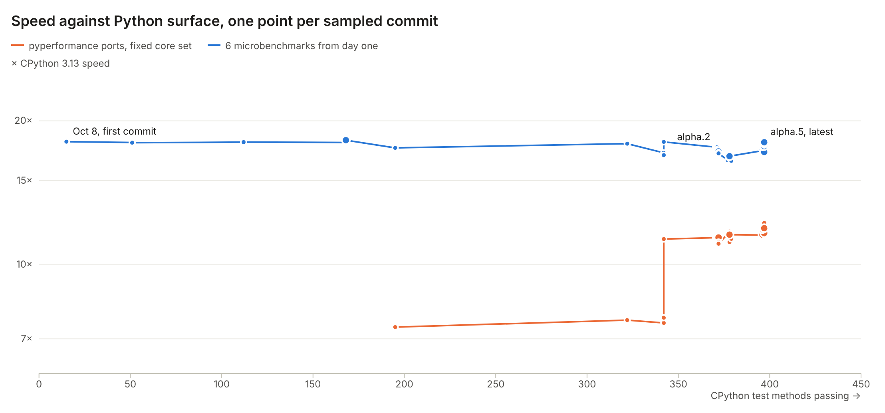

The same against language and builtins tests only, and against unmodified upstream pyperformance files that compile:

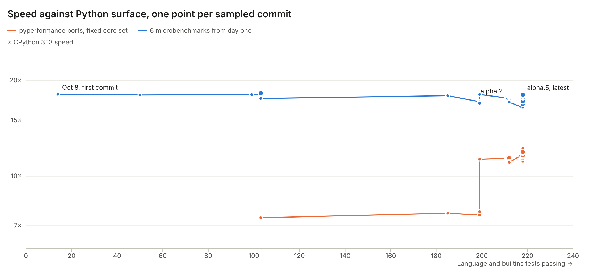

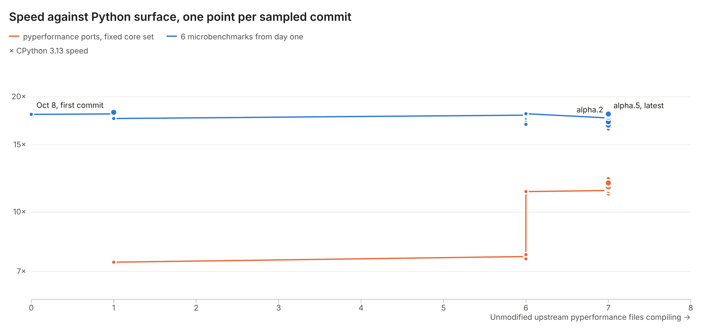

## Surface and speed over time

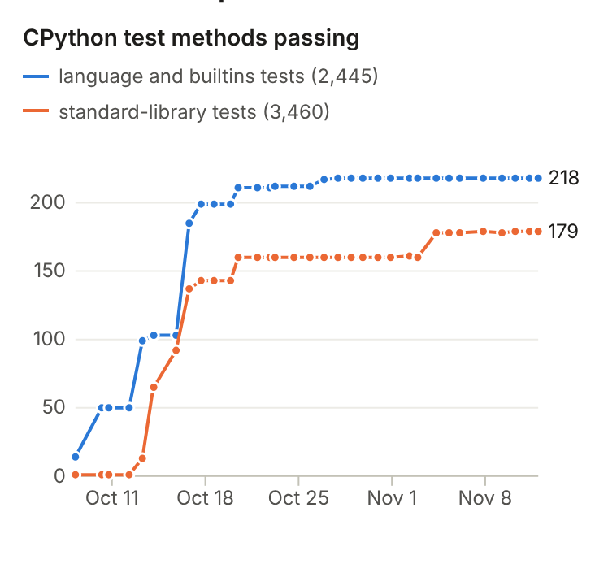

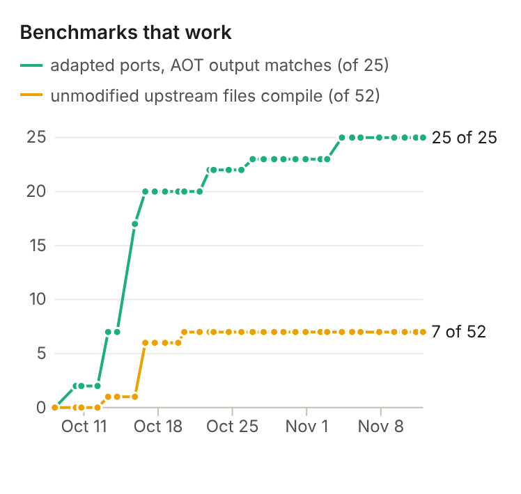

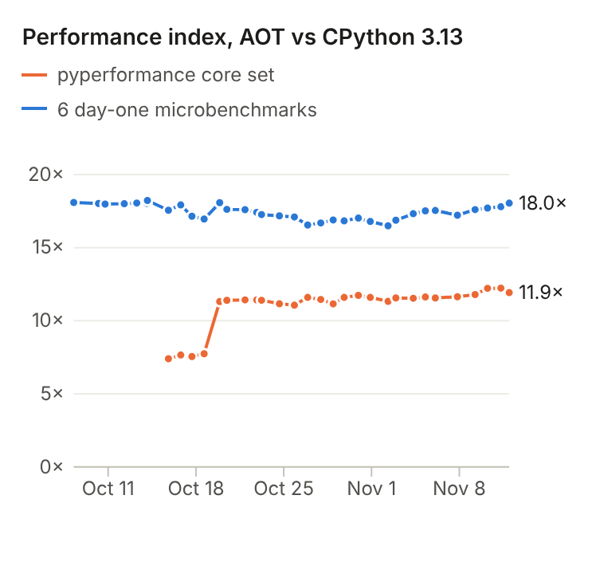

| Date | Release | Methods passing | Language tests | Library tests | Ports working | Upstream files | Micro index | Core index |
|---|---|---:|---:|---:|---:|---:|---:|---:|
| Oct 8 | — | 15 | 14 | 1 | 0 | 0 | 18.1× | — |
| Oct 14 | v0.1.0-alpha.1 | 168 | 103 | 65 | 7 | 1 | 18.2× | — |
| Oct 20 | v0.1.0-alpha.2 | 371 | 211 | 160 | 20 | 7 | 17.6× | 11.4× |
| Oct 23 | v0.1.0-alpha.3 | 372 | 212 | 160 | 22 | 7 | 17.3× | 11.4× |
| Nov 2 | v0.1.0-alpha.4 | 378 | 218 | 160 | 23 | 7 | 16.9× | 11.6× |
| Nov 6 | v0.2.0 | 396 | 218 | 178 | 25 | 7 | 17.5× | 11.6× |
| Nov 7 | v0.3.0 | 397 | 218 | 179 | 25 | 7 | 17.2× | 11.6× |
| Nov 10 | v0.4.0-alpha.2 | 397 | 218 | 179 | 25 | 7 | 17.7× | 12.2× |
| Nov 11 | v0.4.0-alpha.5 | 397 | 218 | 179 | 25 | 7 | 18.0× | 11.9× |

## What stops the remaining CPython tests

The first compiler error of every method that does not compile, grouped by cause. Library and syntax gaps are unbuilt work. Typing and dynamic-model errors come from the typed, interpreter-free design: values whose single static type cannot be inferred, and classes, modules or code used as runtime values. Imports come first in a program, so a missing module hides any later error.

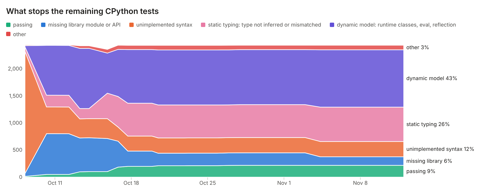

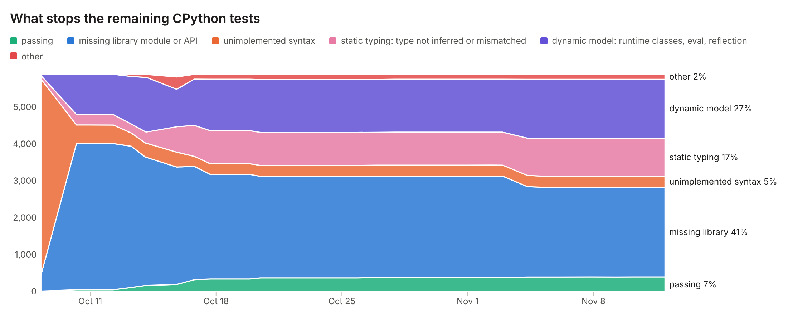

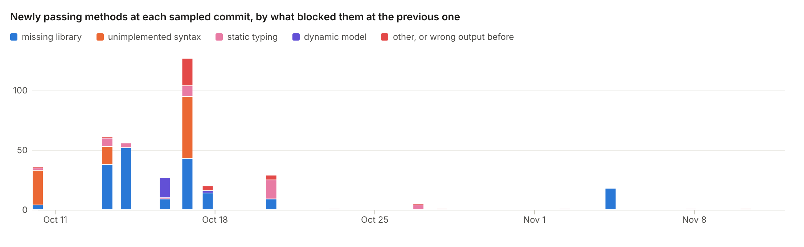

### Most common first errors at the latest commit

| # | First compiler error | Cause | Methods |
|---:|---|---|---:|
| 1 | `cannot import name 'member' from 'enum'` | library | 724 |
| 2 | `a class inside a function is not supported` | dynamic | 365 |
| 3 | `module 'configparser' is not supported: it is not a builtin module` | library | 288 |
| 4 | `cannot infer the type of field 'set'; annotate it (self.set: T = ...)` | typing | 253 |
| 5 | `module 'pickle' is not supported: it is not a builtin module` | dynamic | 238 |
| 6 | `module 'decimal' is not supported: it is not a builtin module` | library | 233 |
| 7 | `'match' statements are not supported` | syntax | 216 |
| 8 | `unsupported base class: single inheritance requires a previously declared ordinary class or a supported exception class` | dynamic | 177 |
| 9 | `cannot import name 'verify' from 'enum'` | library | 151 |
| 10 | `module 'gc' is not supported: it is not a builtin module` | dynamic | 141 |
| 11 | `module '_pyio' is not supported: it is not a builtin module` | library | 134 |
| 12 | `module 'locale' is not supported: it is not a builtin module` | library | 127 |
| 13 | `module 'pprint' is not supported: it is not a builtin module` | library | 95 |
| 14 | `inheritance with generic class templates is not supported: annotate __init__ parameters with concrete types (not Any or object)` | dynamic | 87 |
| 15 | `cannot import name 'TemporaryFile' from 'tempfile'` | library | 87 |

### With CPython's own standard library added (latest commit)

CPython 3.13.16's pure-Python standard library on the import path (`tools/import_sweep.py --overlay`, which leaves out the modules Pystachy ships): 0 of the 2,429 methods blocked by a missing library piece pass. Their next errors:

| Where the method now stops | Cause | Methods |
|---|---|---:|
| now rejected inside CPython's library code | a module or name still missing | 708 |
| now rejected inside CPython's library code | dynamic model (generic bases, redefinitions, class-body statements) | 219 |
| now rejected inside CPython's library code | static typing (type not inferred) | 2 |
| still rejected in the test itself | a module or name still missing | 1,323 |
| still rejected in the test itself | dynamic model (generic bases, redefinitions, class-body statements) | 141 |
| still rejected in the test itself | static typing (type not inferred) | 21 |
| still rejected in the test itself | unimplemented syntax | 8 |
| still rejected in the test itself | other | 7 |

## Speed by benchmark and commit

AOT speed relative to CPython 3.13 on the same source. Blue is faster than CPython, red is slower; an empty cell means that commit could not build the benchmark or printed different output.

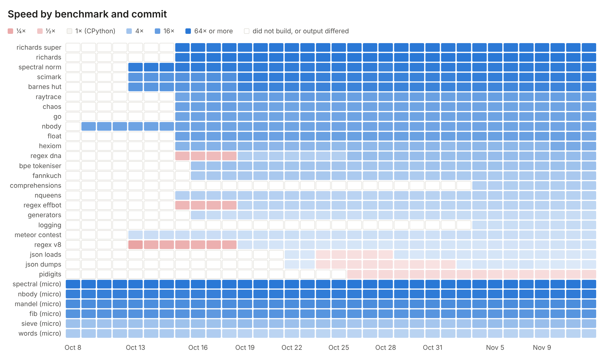

### Largest speed changes and their causes

| Benchmark | From | To | ms before | ms after | Change | Evidence |
|---|---|---|---:|---:|---|---|
| regex_dna | 2026-10-18 | 2026-10-19 | 1,506.2 | 196.0 | Faster: lib/re matcher work (#676, #680, #682, #683, #685) | interval of 32 merges, Oct 18 to 19; not bisected |
| regex_effbot | 2026-10-18 | 2026-10-19 | 1,032.1 | 168.3 | Faster: same lib/re work | same interval; not bisected |
| regex_v8 | 2026-10-18 | 2026-10-19 | 1,046.9 | 235.4 | Faster: same lib/re work | same interval; not bisected |
| scimark | 2026-10-18 | 2026-10-19 | 19.2 | 10.1 | Faster: likely field TBAA (#724) or tuple returns by value (#727) | same interval; not bisected |
| barnes_hut | 2026-10-18 | 2026-10-19 | 24.9 | 13.4 | Faster: likely field TBAA (#724) or tuple returns by value (#727) | same interval; not bisected |
| micro_words | 2026-10-17 | 2026-10-18 | 59.3 | 77.7 | Slower: Unicode code-point strings, stage 1 (#667) | bisected over 15 merges to a355c83f |
| float | 2026-11-11 | 2026-11-11 | 32.7 | 43.5 | Slower: listguard bounds-check hoisting with Lean checks (#1268) | bisected over 7 merges to b40ee875 |

### Each benchmark: first sampled commit where it worked, and the latest

| Benchmark | Works since | Speed then | Speed now | Change |
|---|---|---:|---:|---:|
| barnes_hut | Oct 13 | 21.72× | 41.06× | +89% |
| bpe_tokeniser | Oct 16 | 4.17× | 4.71× | +13% |
| chaos | Oct 15 | 14.42× | 13.48× | -7% |
| comprehensions | Nov 4 | 2.65× | 2.97× | +12% |
| fannkuch | Oct 16 | 3.30× | 3.46× | +5% |
| float | Oct 15 | 13.90× | 11.54× | -17% |
| generators | Oct 16 | 2.05× | 1.75× | -15% |
| go | Oct 15 | 13.06× | 13.39× | +3% |
| hexiom | Oct 15 | 7.37× | 9.66× | +31% |
| json_dumps | Oct 22 | 1.10× | 1.14× | +4% |
| json_loads | Oct 22 | 1.21× | 1.22× | +1% |
| logging | Nov 4 | 1.55× | 1.74× | +13% |
| meteor_contest | Oct 13 | 1.58× | 1.57× | -1% |
| micro_fib | Oct 8 | 23.81× | 21.93× | -8% |
| micro_mandel | Oct 8 | 29.67× | 30.03× | +1% |
| micro_nbody | Oct 8 | 48.26× | 57.02× | +18% |
| micro_sieve | Oct 8 | 4.56× | 5.23× | +15% |
| micro_spectral | Oct 8 | 69.30× | 71.12× | +3% |
| micro_words | Oct 8 | 3.25× | 2.47× | -24% |
| nbody | Oct 10 | 13.45× | 12.46× | -7% |
| nqueens | Oct 15 | 2.67× | 2.55× | -5% |
| pidigits | Oct 26 | 0.82× | 0.84× | +2% |
| raytrace | Oct 15 | 12.60× | 15.70× | +25% |
| regex_dna | Oct 15 | 0.37× | 5.38× | +1348% |
| regex_effbot | Oct 15 | 0.34× | 2.14× | +526% |
| regex_v8 | Oct 13 | 0.22× | 1.44× | +567% |
| richards | Oct 15 | 59.90× | 70.63× | +18% |
| richards_super | Oct 15 | 83.59× | 77.13× | -8% |
| scimark | Oct 13 | 21.59× | 51.08× | +137% |
| spectral_norm | Oct 13 | 55.42× | 55.83× | +1% |

### The 52 unmodified upstream pyperformance files

| Benchmark | Compiles unmodified | First sampled commit that compiled it | First error at the latest commit |
|---|---|---|---|
| fannkuch | yes | Oct 16 | — |
| generators | yes | Oct 16 | — |
| nbody | yes | Oct 16 | — |
| nqueens | yes | Oct 16 | — |
| regex_v8 | yes | Oct 13 | — |
| spectral_norm | yes | Oct 20 | — |
| unpack_sequence | yes | Oct 16 | — |
| 2to3 | no | — | `module 'subprocess' is not supported: it is not a builtin module` |
| argparse | no | — | `unsupported type annotation` |
| async_generators | no | — | `async functions are not supported` |
| async_tree | no | — | `module 'asyncio' is not supported: it is not a builtin module` |
| asyncio_tcp | no | — | `module 'asyncio' is not supported: it is not a builtin module` |
| barnes_hut | no | — | `cannot infer the type of field 'particles'; annotate it (self.particles: T = ...)` |
| base64 | no | — | `module 'base64' is not supported: it is not a builtin module` |
| bpe_tokeniser | no | — | `cannot infer the type of field '_decoder'; annotate it (self._decoder: T = ...)` |
| chaos | no | — | `cannot infer the type of class attribute '__rmul__'; annotate it (__rmul__: T = ...)` |
| comprehensions | no | — | `cannot infer the type of 'widgets', an empty list so far: annotate it (widgets: list[T] = [])` |
| concurrent_imap | no | — | `module 'multiprocessing' is not supported: it is not a builtin module` |
| coroutines | no | — | `async functions are not supported` |
| crypto_pyaes | no | — | `module 'pyaes' is not supported: it is not a builtin module` |
| decimal_factorial | no | — | `module 'decimal' is not supported: it is not a builtin module` |
| decimal_pi | no | — | `module 'decimal' is not supported: it is not a builtin module` |
| deepcopy | no | — | `unsupported type annotation` |
| deltablue | no | — | `unsupported base class: single inheritance requires a previously declared ordinary class or a supported exception class` |
| float | no | — | `cannot infer the type of field 'x'; annotate it (self.x: T = ...)` |
| gc_collect | no | — | `module 'gc' is not supported: it is not a builtin module` |
| gc_traversal | no | — | `module 'gc' is not supported: it is not a builtin module` |
| go | no | — | `cannot infer the type of field 'pos_child'; annotate it (self.pos_child: T = ...)` |
| hexiom | no | — | `class attribute 'HIGHEST_VALUE_STRATEGY' of 'Done' used in a class-body default is not supported` |
| json_dumps | no | — | `cannot infer the type of an empty dict; add a type annotation (d: dict[K, V] = {}, or -> dict[K, V] on a function returning the dict)` |
| json_loads | no | — | `expected int, got str` |
| logging | no | — | `expected <function bench_silent>, got <function bench_simple_output> (each function is a type of its own: a variable, a list's items or a ` |
| mdp | no | — | `module 'fractions' is not supported: it is not a builtin module` |
| meteor_contest | no | — | `expected int, got float` |
| pathlib | no | — | `'pathlib.PosixPath' object has no method 'stat'` |
| pickle | no | — | `module 'pickle' is not supported: it is not a builtin module` |
| pidigits | no | — | `map() is supported as the argument of list(), tuple() (with scalar or optional scalar items), bytes(), sorted(), sum(), min(), max(), any` |
| pprint | no | — | `module 'pprint' is not supported: it is not a builtin module` |
| pyflate | no | — | `module 'hashlib' is not supported: it is not a builtin module` |
| python_startup | no | — | `module 'subprocess' is not supported: it is not a builtin module` |
| raytrace | no | — | `module 'array' is not supported: it is not a builtin module` |
| regex_compile | no | — | `cannot infer the type of 'regexes', which capture_compile() reads, where it is defined: annotate it (regexes: T = ...)` |
| regex_dna | no | — | `unsupported call bytearray()` |
| regex_effbot | no | — | `type <function bench_regex_effbot> has no attribute 'data'` |
| richards | no | — | `inheritance with generic class templates is not supported: annotate __init__ parameters with concrete types (not Any or object)` |
| richards_super | no | — | `inheritance with generic class templates is not supported: annotate __init__ parameters with concrete types (not Any or object)` |
| scimark | no | — | `module 'array' is not supported: it is not a builtin module` |
| sqlite_synth | no | — | `module 'sqlite3' is not supported: it is not a builtin module` |
| telco | no | — | `module 'decimal' is not supported: it is not a builtin module` |
| tomli_loads | no | — | `module 'tomli' is not supported: it is not a builtin module` |
| typing_runtime_protocols | no | — | `unsupported base class: single inheritance requires a previously declared ordinary class or a supported exception class` |
| xml_etree | no | — | `module 'xml' is not supported: it is not a builtin module` |

## What the surface cost

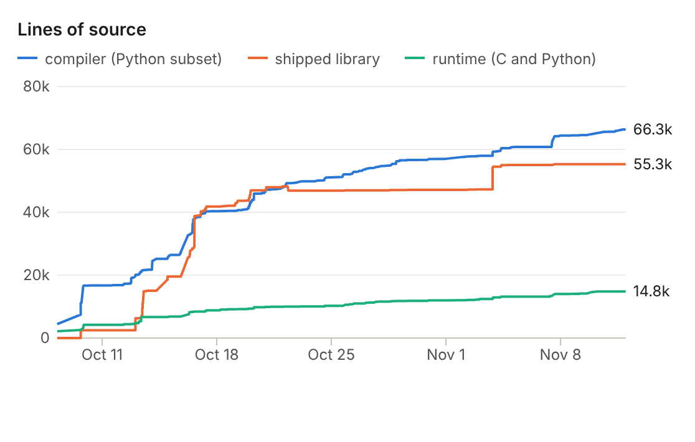

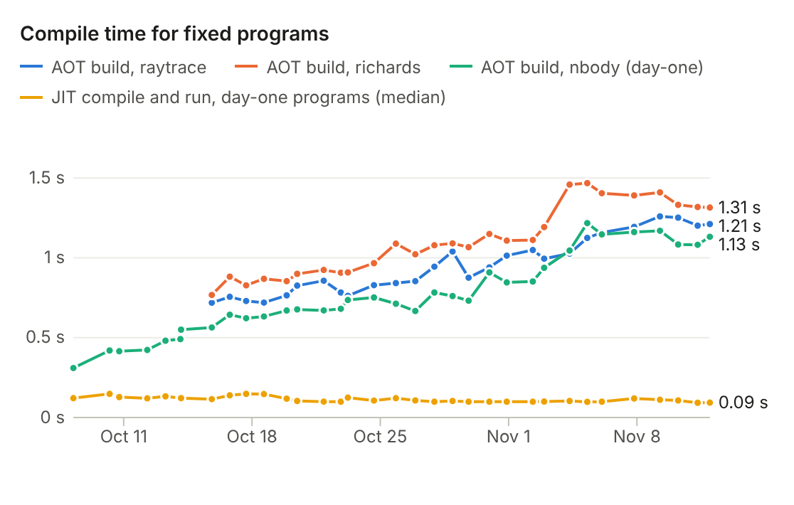

| Date | Release | Compiler lines | Library lines | Runtime lines | Compiler IR lines | AOT build nbody | AOT build richards | AOT build raytrace | JIT small programs |
|---|---|---:|---:|---:|---:|---:|---:|---:|---:|
| Oct 8 | — | 4,423 | 0 | 2,154 | 52,488 | 0.31 s | — | — | 0.12 s |
| Oct 14 | v0.1.0-alpha.1 | 24,648 | 15,040 | 6,685 | 360,753 | 0.55 s | — | — | 0.12 s |
| Oct 20 | v0.1.0-alpha.2 | 45,928 | 46,979 | 9,804 | 707,289 | 0.68 s | 0.90 s | 0.83 s | 0.10 s |
| Oct 23 | v0.1.0-alpha.3 | 49,848 | 46,865 | 10,043 | 675,209 | 0.74 s | 0.91 s | 0.76 s | 0.12 s |
| Nov 2 | v0.1.0-alpha.4 | 57,902 | 47,277 | 12,204 | 792,790 | 0.94 s | 1.19 s | 0.99 s | 0.10 s |
| Nov 6 | v0.2.0 | 60,772 | 55,036 | 13,189 | 832,277 | 1.15 s | 1.41 s | 1.16 s | 0.10 s |
| Nov 7 | v0.3.0 | 64,218 | 55,282 | 13,997 | 875,344 | 1.16 s | 1.39 s | 1.19 s | 0.12 s |
| Nov 10 | v0.4.0-alpha.2 | 65,199 | 55,293 | 14,798 | 887,322 | 1.08 s | 1.33 s | 1.25 s | 0.11 s |
| Nov 11 | v0.4.0-alpha.5 | 66,345 | 55,294 | 14,800 | 906,887 | 1.13 s | 1.31 s | 1.21 s | 0.09 s |

## How this was measured

- Commits: an end-of-day commit on `main` for most days and eight of the fifteen release tags from 7 October to 11 November 2026, each built with its own `make` bootstrap (CPython 3.13 hosting stage 1, LLVM 18.1.3) in a separate worktree and checked at its own fixed point.
- CPython test methods: today's `tools/cpython_test_methods.py` extracted 9,855 unittest methods from the 144 pinned CPython 3.13.16 test files of `tests/upstream/core-methods.sha256` (hashes verified); 5,905 complete under CPython 3.13.18 and form the denominator. A method passes when the commit's JIT prints CPython's stdout and stderr and exits the same way, including on a retry with promoting ints. The latest commit gives 397, against the repository's own census of 398 (of 6,015) on an older tree.
- Language and builtins tests are the 60 files that test syntax, builtins and core types (`test_set`, `test_patma`, `test_builtin`, `test_exceptions` and the like); the rest test standard-library modules.
- Performance: today's 25 adapted pyperformance ports and the six original microbenchmarks, built AOT by each commit and run pinned to one CPU on an otherwise idle 4-vCPU x86-64 VM, every commit interleaved in each repetition with CPython 3.13.18. Ports report pyperf's timed region; microbenchmarks report process wall time. Every run's output must equal CPython's. `unpack_sequence` is left out because AOT removes its timed loop.
- Repetitions: five per port and seven per microbenchmark at every commit, medians reported. Between a benchmark's second-fastest and second-slowest run the spread was typically 1–10% (up to about 25% for the shortest programs), so index changes under about 5% are within noise.
- The core set is the 16 ports whose output matched at every sampled commit since the first one with ten working ports (15 October): barnes_hut, chaos, float, go, hexiom, meteor_contest, nbody, nqueens, raytrace, regex_dna, regex_effbot, regex_v8, richards, richards_super, scimark, spectral_norm.
- Compile time: `pystachy build` of nbody (day-one), richards and raytrace, two runs each pinned to one CPU; JIT end-to-end runs of the six day-one programs with the program cache off and a warm runtime cache.
- Causes are assigned from the text of the first compiler error. A method needs every blocker removed, and only the first is visible, so the categories show what is in front, not everything that remains.
- Bisection: `float` over the 7 first-parent merges between the last two samples, and `words` over the 15 between Oct 17 and Oct 18, timing each probe 9 times pinned to one CPU.

## Data

Every chart and table above comes from these files in `data/` (JSON as charted, CSV for spreadsheets):

| File | What it holds |
|---|---|
| `samples` | **Sampled commits.** One row per sampled commit on main from 7 October to 11 November 2026: CPython test methods passing, first-error causes, benchmarks that work, source size and compiler size. |
| `speedups` | **AOT speed per benchmark and commit.** Median AOT time of each benchmark at each sampled commit and of CPython 3.13.18 on the same source, measured pinned to one core on an idle 4-vCPU VM; speedup is CPython's time over the commit's. |
| `history` | **Source size at every commit on main.** Lines of compiler, shipped library and runtime source, and differential test counts, at each of the 660 first-parent commits on main. |
| `blockers_head` | **Most common first errors, latest commit.** The 15 most frequent first compiler errors among the CPython test methods v0.4.0-alpha.5 rejects, with the cause each was assigned. |
| `unlocks` | **Newly passing methods per sampled commit.** Methods that pass at a sampled commit but not at the previous one, by the cause of their first error at the previous one. |
| `census` | **Unmodified upstream pyperformance files.** Whether each of the 52 pyperformance 1.14.0 benchmark files compiles with only pyperf's runner replaced, the first sampled commit that compiled it, and its first error at the latest commit. |
| `changes` | **Largest speed changes and their causes.** The biggest AOT time changes between consecutive sampled commits, with the merge that caused each where a bisection over the first-parent merges in between found it, or the merges the interval contains. |
| `overlay_head` | **Latest commit with CPython's standard library added.** Where the methods blocked by a missing library piece stop when CPython 3.13.16's pure-Python standard library is on the import path, at v0.4.0-alpha.5. |
| `perf_index` | **Performance index per commit (calculated).** Geometric mean of the per-benchmark AOT speedups over CPython 3.13 at each sampled commit: over the 16-port pyperformance core set where all 16 were measured, and over the six day-one microbenchmarks. |
| `findings` | **Findings since v0.1.0-alpha.2 (calculated).** Methods passing at v0.1.0-alpha.2 and gained since, compiler lines added since, the share of typing and dynamic-model first errors in language tests at the latest commit, and methods unlocked from each since the release. |
| `perf_index` | **Performance index per commit.** The core and micro indices above, computed from `speedups` (CSV only). |

## Appendix: every sampled commit

| Date | Release | Commit | Methods | Language | Library | Differs | Ports | Upstream | Micro | Core | Blocked: library | syntax | typing | dynamic | other |
|---|---|---|---:|---:|---:|---:|---:|---:|---:|---:|---:|---:|---:|---:|---:|
| Oct 8 | — | `4f7d51c5d6` | 15 | 14 | 1 | 0 | 0 | 0 | 18.1× | — | 430 | 5321 | 96 | 26 | 17 |
| Oct 10 | — | `caf100d84f` | 51 | 50 | 1 | 0 | 2 | 0 | 18.0× | — | 3964 | 503 | 282 | 1094 | 11 |
| Oct 10 | — | `3542d631c3` | 51 | 50 | 1 | 0 | 2 | 0 | 18.0× | — | 3964 | 503 | 282 | 1094 | 11 |
| Oct 12 | — | `bd56b3742b` | 51 | 50 | 1 | 1 | 2 | 0 | 18.0× | — | 3963 | 503 | 282 | 1094 | 11 |
| Oct 13 | — | `535a6f14fd` | 112 | 99 | 13 | 18 | 7 | 1 | 18.1× | — | 3829 | 358 | 246 | 1289 | 53 |
| Oct 14 | — | `438565eb16` | 168 | 103 | 65 | 18 | 7 | 1 | 18.0× | — | 3470 | 382 | 308 | 1481 | 78 |
| Oct 14 | v0.1.0-alpha.1 | `aad4f1c21c` | 168 | 103 | 65 | 18 | 7 | 1 | 18.2× | — | 3470 | 382 | 308 | 1481 | 78 |
| Oct 15 | — | `bdc20a24c7` | 195 | 103 | 92 | 85 | 17 | 1 | 17.6× | 7.4× | 3182 | 404 | 689 | 1016 | 334 |
| Oct 16 | — | `237915902d` | 322 | 185 | 137 | 15 | 20 | 6 | 17.9× | 7.7× | 3074 | 271 | 841 | 1254 | 128 |
| Oct 17 | — | `6397781363` | 342 | 199 | 143 | 18 | 20 | 6 | 17.1× | 7.6× | 2834 | 289 | 898 | 1396 | 128 |
| Oct 18 | — | `bb5ac4ab43` | 342 | 199 | 143 | 18 | 20 | 6 | 17.0× | 7.7× | 2834 | 289 | 898 | 1396 | 128 |
| Oct 19 | — | `b040f45ebf` | 342 | 199 | 143 | 18 | 20 | 6 | 18.1× | 11.3× | 2834 | 289 | 898 | 1396 | 128 |
| Oct 20 | v0.1.0-alpha.2 | `afb59cd3c3` | 371 | 211 | 160 | 18 | 20 | 7 | 17.6× | 11.4× | 2753 | 298 | 896 | 1432 | 137 |
| Oct 21 | — | `11722f0c05` | 371 | 211 | 160 | 18 | 20 | 7 | 17.6× | 11.4× | 2753 | 298 | 896 | 1432 | 137 |
| Oct 22 | — | `7514bef719` | 371 | 211 | 160 | 18 | 22 | 7 | 17.4× | 11.4× | 2753 | 298 | 896 | 1432 | 137 |
| Oct 23 | v0.1.0-alpha.3 | `f5a09d4223` | 372 | 212 | 160 | 18 | 22 | 7 | 17.3× | 11.4× | 2753 | 298 | 895 | 1432 | 137 |
| Oct 24 | — | `6f5b169bc2` | 372 | 212 | 160 | 18 | 22 | 7 | 17.2× | 11.2× | 2753 | 298 | 895 | 1432 | 137 |
| Oct 25 | — | `de65c6fbfe` | 372 | 212 | 160 | 18 | 22 | 7 | 17.1× | 11.1× | 2753 | 298 | 895 | 1432 | 137 |
| Oct 26 | — | `368b12a560` | 377 | 217 | 160 | 17 | 23 | 7 | 16.5× | 11.6× | 2753 | 298 | 891 | 1432 | 137 |
| Oct 27 | — | `48b28bb13f` | 378 | 218 | 160 | 16 | 23 | 7 | 16.7× | 11.5× | 2753 | 298 | 895 | 1436 | 129 |
| Oct 28 | — | `5e553e1064` | 378 | 218 | 160 | 16 | 23 | 7 | 16.9× | 11.2× | 2753 | 298 | 895 | 1436 | 129 |
| Oct 29 | — | `d9de6b186b` | 378 | 218 | 160 | 16 | 23 | 7 | 16.8× | 11.6× | 2753 | 298 | 895 | 1436 | 129 |
| Oct 30 | — | `06e3ad5d08` | 378 | 218 | 160 | 16 | 23 | 7 | 17.0× | 11.7× | 2753 | 298 | 895 | 1436 | 129 |
| Oct 31 | — | `07b26e0242` | 378 | 218 | 160 | 16 | 23 | 7 | 16.8× | 11.6× | 2753 | 298 | 895 | 1436 | 129 |
| Nov 2 | — | `14d4eb15cb` | 379 | 218 | 161 | 16 | 23 | 7 | 16.5× | 11.3× | 2753 | 298 | 894 | 1436 | 129 |
| Nov 2 | v0.1.0-alpha.4 | `9c8bc74648` | 378 | 218 | 160 | 16 | 23 | 7 | 16.9× | 11.6× | 2753 | 298 | 895 | 1436 | 129 |
| Nov 4 | — | `a1436c85fa` | 396 | 218 | 178 | 16 | 25 | 7 | 17.3× | 11.5× | 2449 | 303 | 1011 | 1598 | 132 |
| Nov 5 | — | `d81279361d` | 396 | 218 | 178 | 16 | 25 | 7 | 17.5× | 11.6× | 2429 | 303 | 1031 | 1598 | 132 |
| Nov 6 | v0.2.0 | `e7513fd5b7` | 396 | 218 | 178 | 16 | 25 | 7 | 17.5× | 11.6× | 2429 | 303 | 1031 | 1598 | 132 |
| Nov 7 | v0.3.0 | `c5b8b4fceb` | 397 | 218 | 179 | 16 | 25 | 7 | 17.2× | 11.6× | 2429 | 303 | 1030 | 1598 | 132 |
| Nov 9 | — | `d6b9b3f18b` | 396 | 218 | 178 | 16 | 25 | 7 | 17.6× | 11.8× | 2429 | 303 | 1031 | 1598 | 132 |
| Nov 10 | v0.4.0-alpha.2 | `070c8137ed` | 397 | 218 | 179 | 16 | 25 | 7 | 17.7× | 12.2× | 2429 | 303 | 1031 | 1598 | 131 |
| Nov 11 | — | `d02995cb7b` | 397 | 218 | 179 | 16 | 25 | 7 | 17.8× | 12.2× | 2429 | 303 | 1031 | 1598 | 131 |
| Nov 11 | v0.4.0-alpha.5 | `b2182a4f01` | 397 | 218 | 179 | 16 | 25 | 7 | 18.0× | 11.9× | 2429 | 303 | 1031 | 1598 | 131 |
