# Pystachy speed vs surface

Performance against the amount of unmodified Python that Pystachy runs, across 48 commits of `main` from the project's first day (Oct 8) to Nov 17 2026; dates are UTC. Second edition, 18 November 2026: the first edition (12 November) measured 35 of these commits, and all of them were timed again together. Scripts and raw data: `research/speed-vs-surface-2026-11-18` on the branch `claude/peaceful-faraday-2yr9q6`.

## Summary

- **Surface grew in two phases and two steps.** CPython test methods passing went from 15 on the first day to 371 at v0.1.0-alpha.2 (Oct 20) and 397 at v0.4.0-alpha.5 (Nov 11). Bounded `match` (#1272) raised it to 492 on Nov 12, and v0.6.0-alpha.1 to 638 (10.8% of 5,905). Language and builtins tests: 14 → 211 → 218 → 310 → 454 of 2,445.
- **Most of the latest gain came from two pull requests.** Fields typed from `set()` calls (#1374) made 100 `test_set` methods pass and starred sequence patterns (#1345) 38 `test_patma` methods, both in #1522 on 17 November. No method that passed on 12 November fails.
- **The remaining blockers are mostly class-model and inference features.** At the latest commit, static-typing (533) and dynamic-model (1,076) first errors are 81% of the 1,975 rejections in the language and builtins tests; classes defined inside functions (#1304) and three names missing from `enum` are the largest groups without an open pull request.
- **Neither escape hatch helps unmodified code.** Adding CPython's own pure-Python standard library makes 0 of the 2,400 library-blocked methods pass; opting every test in to dynamic `Any` leaves 638 passing.
- **Speed held.** The six day-one microbenchmarks ran 17.9× CPython 3.13 on the first day and 17.8× at the latest commit. The 16-port pyperformance core set went from 7.5× (Oct 15) to 12.2×, mostly from regex-library work on Oct 19.
- **One regression fixed, one partly.** `float` (+30% at #1268) recovered in v0.4.0-rc.1 through #1336; `words` (+30% at #667) improved slightly through #1332 but keeps the larger heap of #667 (#1301).
- **AOT builds got cheaper; the bootstrap did not.** `pystachy build` of the day-one nbody took 0.34 s on the first day and 1.14 s at v0.5.0-alpha.1; the precompiled runtime (#1377) cut it to 0.21 s at v0.5.0-alpha.2 (0.21 s now). Compiler IR at the bootstrap fixed point grew from 52,488 to 981,589 lines. JIT end to end on the small programs went from 0.11 s to 0.09 s.

## Since the first edition (12 November)

Main took 474 commits and 11 release tags between 8434a911 and 3cf23d20. Every tag was measured, with the untagged RC.2 fixes (`bf699eb5`) and `71e14a88`, which separates #1519 from #1522.

| Date | Release | Commit | Methods | Language | Library | Micro index | Core index | nbody build |
|---|---|---|---:|---:|---:|---:|---:|---:|
| Nov 12 | — | `8434a911` | 492 | 310 | 182 | 17.9× | 12.0× | 0.98 s |
| Nov 12 | v0.4.0-alpha.6 | `0b13a212` | 492 | 310 | 182 | 18.1× | 11.9× | 1.03 s |
| Nov 12 | v0.4.0-rc.1 | `30822255` | 492 | 310 | 182 | 18.3× | 12.2× | 1.12 s |
| Nov 13 | — | `bf699eb5` | 492 | 310 | 182 | 18.4× | 12.2× | 1.14 s |
| Nov 13 | v0.4.0 | `5f81cc25` | 492 | 310 | 182 | 18.3× | 12.2× | 1.14 s |
| Nov 14 | v0.5.0-alpha.1 | `a73c56c9` | 494 | 310 | 184 | 18.4× | 12.2× | 1.14 s |
| Nov 14 | v0.5.0-alpha.2 | `80490143` | 494 | 310 | 184 | 17.8× | 12.2× | 0.21 s |
| Nov 15 | v0.5.0-alpha.3 | `49a149ad` | 500 | 316 | 184 | 18.1× | 12.3× | 0.21 s |
| Nov 15 | v0.5.0-alpha.4 | `3da553ee` | 500 | 316 | 184 | 18.1× | 12.1× | 0.20 s |
| Nov 16 | v0.5.0-alpha.5 | `9f147230` | 500 | 316 | 184 | 18.1× | 12.3× | 0.21 s |
| Nov 17 | v0.5.0-rc.1 | `9cb9cc72` | 500 | 316 | 184 | 18.0× | 12.2× | 0.21 s |
| Nov 17 | v0.5.0 | `d58034c1` | 500 | 316 | 184 | 18.0× | 12.2× | 0.21 s |
| Nov 17 | — | `71e14a88` | 500 | 316 | 184 | 18.1× | 12.2× | 0.21 s |
| Nov 17 | v0.6.0-alpha.1 | `3cf23d20` | 638 | 454 | 184 | 17.8× | 12.2× | 0.21 s |

| Change | Pull request | Release | Methods that now pass |
|---|---|---|---:|
| Fields typed from `set()` and `frozenset()` calls | #1374 in #1522 | v0.6.0-alpha.1 | 100 (`test_set`) |
| Starred sequence patterns and list subjects in `match` | #1345 in #1522 | v0.6.0-alpha.1 | 38 (`test_patma`) |
| `complex` numbers | #1408 in #1494 | v0.5.0-alpha.3 | 5 |
| `None` as a set element | #1412 in #1494 | v0.5.0-alpha.3 | 1 |
| `csv.DictWriter.writerow` called through its class | in #1481 | v0.5.0-alpha.1 | 2 |

Issues the first edition filed: #1300 (`float`) closed, fixed by #1336; #1301 (`words`) open after #1332; #1302 (weekly timing) closed by the weekly workflow #1339; #1303 (per-release triage) open with one manual comparison; #1304 (classes inside functions) open with no pull request; #1305 (`match` patterns) open after #1345; #1306 closed as a duplicate. #706 (AOT build cost) closed by #1377.

## Speed against Python surface

One point per sampled commit, joined in time order. Across: extracted CPython test methods it runs with CPython's output. Up: geometric-mean AOT speedup over CPython 3.13 on the same sources (log scale).

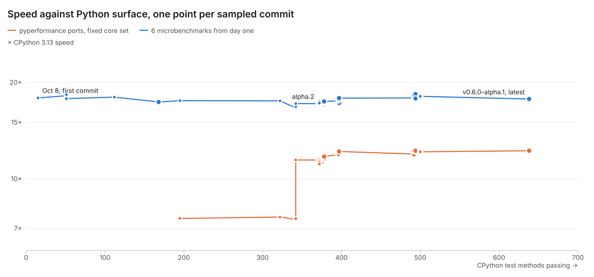

The same against language and builtins tests only, and against unmodified upstream pyperformance files that compile:

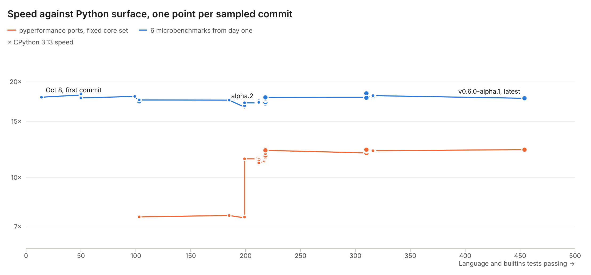

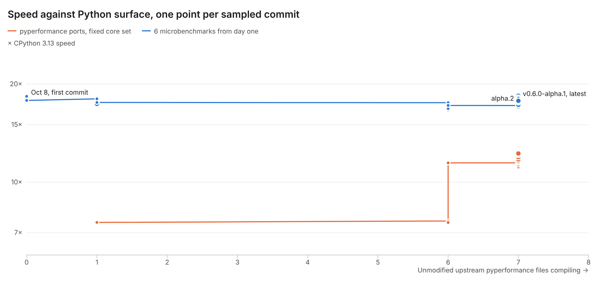

## Surface and speed over time

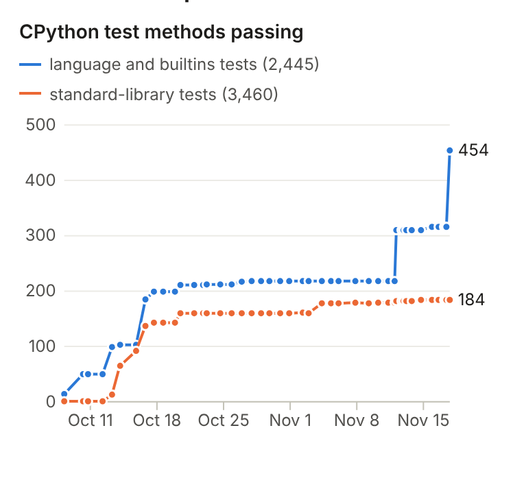

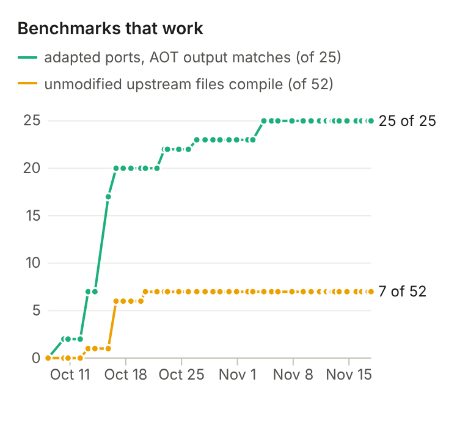

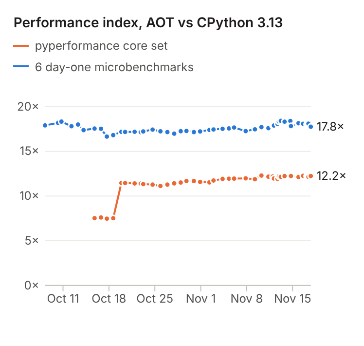

| Date | Release | Methods passing | Language tests | Library tests | Ports working | Upstream files | Micro index | Core index |
|---|---|---:|---:|---:|---:|---:|---:|---:|
| Oct 8 | — | 15 | 14 | 1 | 0 | 0 | 17.9× | — |
| Oct 14 | v0.1.0-alpha.1 | 168 | 103 | 65 | 7 | 1 | 17.4× | — |
| Oct 20 | v0.1.0-alpha.2 | 371 | 211 | 160 | 20 | 7 | 17.2× | 11.5× |
| Oct 23 | v0.1.0-alpha.3 | 372 | 212 | 160 | 22 | 7 | 17.2× | 11.3× |
| Nov 2 | v0.1.0-alpha.4 | 378 | 218 | 160 | 23 | 7 | 17.5× | 11.7× |
| Nov 6 | v0.2.0 | 396 | 218 | 178 | 25 | 7 | 17.7× | 12.0× |
| Nov 7 | v0.3.0 | 397 | 218 | 179 | 25 | 7 | 17.3× | 12.0× |
| Nov 10 | v0.4.0-alpha.2 | 397 | 218 | 179 | 25 | 7 | 17.7× | 12.3× |
| Nov 11 | v0.4.0-alpha.5 | 397 | 218 | 179 | 25 | 7 | 17.9× | 12.2× |
| Nov 12 | v0.4.0-alpha.6 | 492 | 310 | 182 | 25 | 7 | 18.1× | 11.9× |
| Nov 12 | v0.4.0-rc.1 | 492 | 310 | 182 | 25 | 7 | 18.3× | 12.2× |
| Nov 13 | v0.4.0 | 492 | 310 | 182 | 25 | 7 | 18.3× | 12.2× |
| Nov 14 | v0.5.0-alpha.1 | 494 | 310 | 184 | 25 | 7 | 18.4× | 12.2× |
| Nov 14 | v0.5.0-alpha.2 | 494 | 310 | 184 | 25 | 7 | 17.8× | 12.2× |
| Nov 15 | v0.5.0-alpha.3 | 500 | 316 | 184 | 25 | 7 | 18.1× | 12.3× |
| Nov 15 | v0.5.0-alpha.4 | 500 | 316 | 184 | 25 | 7 | 18.1× | 12.1× |
| Nov 16 | v0.5.0-alpha.5 | 500 | 316 | 184 | 25 | 7 | 18.1× | 12.3× |
| Nov 17 | v0.5.0-rc.1 | 500 | 316 | 184 | 25 | 7 | 18.0× | 12.2× |
| Nov 17 | v0.5.0 | 500 | 316 | 184 | 25 | 7 | 18.0× | 12.2× |
| Nov 17 | v0.6.0-alpha.1 | 638 | 454 | 184 | 25 | 7 | 17.8× | 12.2× |

## What stops the remaining CPython tests

The first compiler error of every method that does not compile, grouped by cause. Library and syntax gaps are unbuilt work. Typing and dynamic-model errors come from the typed, interpreter-free design: values whose single static type cannot be inferred, and classes, modules or code used as runtime values. Imports come first in a program, so a missing module hides any later error.

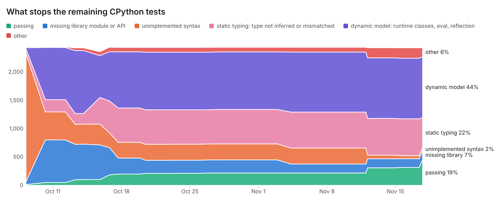

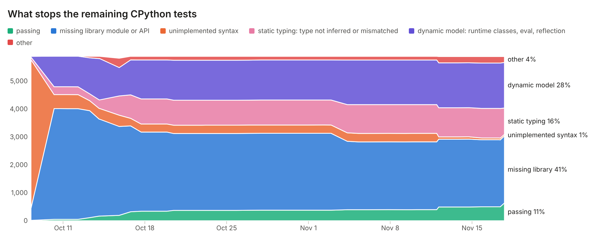

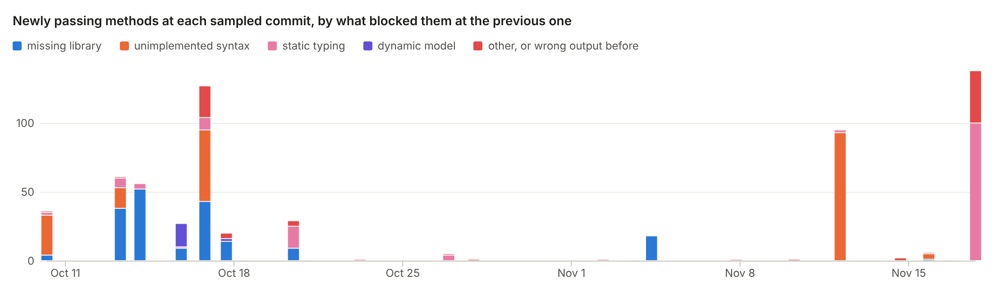

### Most common first errors at the latest commit

| # | First compiler error | Cause | Methods |
|---:|---|---|---:|
| 1 | `cannot import name 'member' from 'enum'` | library | 724 |
| 2 | `a class inside a function is not supported` | dynamic | 368 |
| 3 | `module 'configparser' is not supported: it is not a builtin module` | library | 288 |
| 4 | `module 'pickle' is not supported: it is not a builtin module` | dynamic | 238 |
| 5 | `module 'fractions' is not supported: it is not a builtin module` | library | 218 |
| 6 | `unsupported base class: single inheritance requires a previously declared ordinary class or a supported exception class` | dynamic | 178 |
| 7 | `cannot import name 'verify' from 'enum'` | library | 151 |
| 8 | `module 'gc' is not supported: it is not a builtin module` | dynamic | 141 |
| 9 | `module '_pyio' is not supported: it is not a builtin module` | library | 134 |
| 10 | `module 'locale' is not supported: it is not a builtin module` | library | 127 |
| 11 | `module 'pprint' is not supported: it is not a builtin module` | library | 95 |
| 12 | `inheritance with generic class templates is not supported: annotate __init__ parameters with concrete types (not Any or object)` | dynamic | 87 |
| 13 | `cannot import name 'TemporaryFile' from 'tempfile'` | library | 87 |
| 14 | `module 'array' is not supported: it is not a builtin module` | library | 83 |
| 15 | `cannot infer the type of field 's'; annotate it (self.s: T = ...)` | typing | 75 |

### With CPython's own standard library added (latest commit)

CPython 3.13.16's pure-Python standard library on the import path (`tools/import_sweep.py --overlay`, which leaves out the modules Pystachy ships): 0 of the 2,400 methods blocked by a missing library piece pass. Their next errors:

| Where the method now stops | Cause | Methods |
|---|---|---:|
| now rejected inside CPython's library code | a module or name still missing | 160 |
| now rejected inside CPython's library code | dynamic model (generic bases, redefinitions, class-body statements) | 220 |
| now rejected inside CPython's library code | other | 332 |
| still rejected in the test itself | a module or name still missing | 1,327 |
| still rejected in the test itself | dynamic model (generic bases, redefinitions, class-body statements) | 323 |
| still rejected in the test itself | static typing (type not inferred) | 21 |
| still rejected in the test itself | unimplemented syntax | 7 |
| still rejected in the test itself | other | 10 |

## Speed by benchmark and commit

AOT speed relative to CPython 3.13 on the same source. Blue is faster than CPython, red is slower; an empty cell means that commit could not build the benchmark or printed different output.

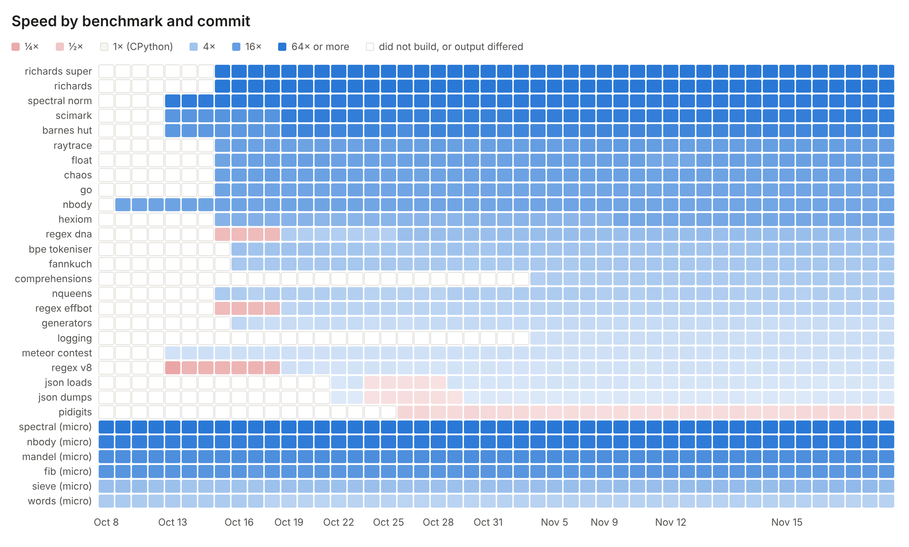

### Largest speed changes and their causes

| Benchmark | From | To | ms before | ms after | Change | Evidence |
|---|---|---|---:|---:|---|---|
| micro_words | 2026-10-17 | 2026-10-18 | 56.2 | 73.1 | Slower: Unicode code-point strings, stage 1 (#667) | bisected to a355c83f |
| regex_dna | 2026-10-18 | 2026-10-19 | 1,511.1 | 187.6 | Faster: lib/re matcher work (#676, #680, #682, #683, #685) | 32 merges; not bisected |
| regex_effbot | 2026-10-18 | 2026-10-19 | 978.7 | 168.1 | Faster: same lib/re work | same interval |
| regex_v8 | 2026-10-18 | 2026-10-19 | 972.5 | 218.5 | Faster: same lib/re work | same interval |
| scimark | 2026-10-18 | 2026-10-19 | 21.1 | 9.6 | Faster: likely field TBAA (#724) or tuple returns by value (#727) | same interval |
| barnes_hut | 2026-10-18 | 2026-10-19 | 28.1 | 14.1 | Faster: likely the same two changes | same interval |
| float | 2026-11-11 | 2026-11-11 | 33.8 | 43.8 | Slower: listguard bounds-check hoisting with Lean checks (#1268) | bisected to b40ee875 |
| float | 2026-11-12 | 2026-11-12 | 44.3 | 35.3 | Faster: listguard keeps sole calls inlinable in loop copies (#1336) | #1389, v0.4.0-rc.1; closes #1300 |

### Each benchmark: first sampled commit where it worked, and the latest

| Benchmark | Works since | Speed then | Speed now | Change |
|---|---|---:|---:|---:|
| barnes_hut | Oct 13 | 20.28× | 37.70× | +86% |
| bpe_tokeniser | Oct 16 | 4.50× | 4.31× | -4% |
| chaos | Oct 15 | 14.18× | 13.99× | -1% |
| comprehensions | Nov 4 | 2.69× | 3.07× | +14% |
| fannkuch | Oct 16 | 3.52× | 3.70× | +5% |
| float | Oct 15 | 13.11× | 15.13× | +15% |
| generators | Oct 16 | 2.08× | 1.65× | -21% |
| go | Oct 15 | 12.92× | 12.50× | -3% |
| hexiom | Oct 15 | 7.80× | 11.66× | +50% |
| json_dumps | Oct 22 | 1.08× | 1.17× | +8% |
| json_loads | Oct 22 | 1.17× | 1.17× | +1% |
| logging | Nov 4 | 1.41× | 1.62× | +15% |
| meteor_contest | Oct 13 | 1.39× | 1.51× | +9% |
| micro_fib | Oct 8 | 22.73× | 20.56× | -10% |
| micro_mandel | Oct 8 | 28.65× | 28.97× | +1% |
| micro_nbody | Oct 8 | 48.91× | 56.42× | +15% |
| micro_sieve | Oct 8 | 4.79× | 5.28× | +10% |
| micro_spectral | Oct 8 | 66.61× | 72.01× | +8% |
| micro_words | Oct 8 | 3.24× | 2.46× | -24% |
| nbody | Oct 10 | 12.94× | 12.29× | -5% |
| nqueens | Oct 15 | 3.35× | 3.03× | -10% |
| pidigits | Oct 26 | 0.76× | 0.82× | +9% |
| raytrace | Oct 15 | 13.42× | 15.41× | +15% |
| regex_dna | Oct 15 | 0.38× | 5.07× | +1242% |
| regex_effbot | Oct 15 | 0.38× | 2.31× | +515% |
| regex_v8 | Oct 13 | 0.22× | 1.39× | +520% |
| richards | Oct 15 | 73.55× | 69.89× | -5% |
| richards_super | Oct 15 | 73.89× | 75.85× | +3% |
| scimark | Oct 13 | 21.24× | 51.56× | +143% |
| spectral_norm | Oct 13 | 56.04× | 57.03× | +2% |

### The 52 unmodified upstream pyperformance files

| Benchmark | Compiles unmodified | First sampled commit that compiled it | First error at the latest commit |
|---|---|---|---|
| fannkuch | yes | Oct 16 | — |
| generators | yes | Oct 16 | — |
| nbody | yes | Oct 16 | — |
| nqueens | yes | Oct 16 | — |
| regex_v8 | yes | Oct 13 | — |
| spectral_norm | yes | Oct 20 | — |
| unpack_sequence | yes | Oct 16 | — |
| 2to3 | no | — | `module 'subprocess' is not supported: it is not a builtin module` |
| argparse | no | — | `unsupported type annotation` |
| async_generators | no | — | `async functions are not supported` |
| async_tree | no | — | `module 'asyncio' is not supported: it is not a builtin module` |
| asyncio_tcp | no | — | `module 'asyncio' is not supported: it is not a builtin module` |
| barnes_hut | no | — | `cannot infer the type of field 'particles'; annotate it (self.particles: T = ...)` |
| base64 | no | — | `'int' has no method 'to_bytes'` |
| bpe_tokeniser | no | — | `cannot infer the type of field '_decoder'; annotate it (self._decoder: T = ...)` |
| chaos | no | — | `cannot infer the type of class attribute '__rmul__'; annotate it (__rmul__: T = ...)` |
| comprehensions | no | — | `cannot infer the type of 'widgets', an empty list so far: annotate it (widgets: list[T] = [])` |
| concurrent_imap | no | — | `module 'multiprocessing' is not supported: it is not a builtin module` |
| coroutines | no | — | `async functions are not supported` |
| crypto_pyaes | no | — | `module 'pyaes' is not supported: it is not a builtin module` |
| decimal_factorial | no | — | `cannot infer what factorial() returns: it calls itself before a return statement does; annotate its return type` |
| decimal_pi | no | — | `class 'decimal.Decimal' cannot be used as a value (classes are not values: call it, or read an attribute, C.x)` |
| deepcopy | no | — | `unsupported type annotation` |
| deltablue | no | — | `unsupported base class: single inheritance requires a previously declared ordinary class or a supported exception class` |
| float | no | — | `cannot infer the type of field 'x'; annotate it (self.x: T = ...)` |
| gc_collect | no | — | `module 'gc' is not supported: it is not a builtin module` |
| gc_traversal | no | — | `module 'gc' is not supported: it is not a builtin module` |
| go | no | — | `cannot infer the type of field 'pos_child'; annotate it (self.pos_child: T = ...)` |
| hexiom | no | — | `cannot infer the type of field 'nodes_by_id'; annotate it (self.nodes_by_id: T = ...)` |
| json_dumps | no | — | `cannot infer the type of an empty dict; add a type annotation (d: dict[K, V] = {}, or -> dict[K, V] on a function returning the dict)` |
| json_loads | no | — | `expected int, got str` |
| logging | no | — | `expected <function bench_silent>, got <function bench_simple_output> (each function is a type of its own: a variable, a list's items or a ` |
| mdp | no | — | `module 'fractions' is not supported: it is not a builtin module` |
| meteor_contest | no | — | `expected int, got float` |
| pathlib | no | — | `'pathlib.PosixPath' object has no method 'stat'` |
| pickle | no | — | `module 'pickle' is not supported: it is not a builtin module` |
| pidigits | no | — | `map() is supported as the argument of list(), tuple() (with scalar or optional scalar items), bytes(), sorted(), sum(), min(), max(), any` |
| pprint | no | — | `module 'pprint' is not supported: it is not a builtin module` |
| pyflate | no | — | `inheritance with generic class templates is not supported: annotate __init__ parameters with concrete types (not Any or object)` |
| python_startup | no | — | `module 'subprocess' is not supported: it is not a builtin module` |
| raytrace | no | — | `module 'array' is not supported: it is not a builtin module` |
| regex_compile | no | — | `cannot infer the type of 'regexes', which capture_compile() reads, where it is defined: annotate it (regexes: T = ...)` |
| regex_dna | no | — | `unsupported call bytearray()` |
| regex_effbot | no | — | `type <function bench_regex_effbot> has no attribute 'data'` |
| richards | no | — | `inheritance with generic class templates is not supported: annotate __init__ parameters with concrete types (not Any or object)` |
| richards_super | no | — | `inheritance with generic class templates is not supported: annotate __init__ parameters with concrete types (not Any or object)` |
| scimark | no | — | `module 'array' is not supported: it is not a builtin module` |
| sqlite_synth | no | — | `module 'sqlite3' is not supported: it is not a builtin module` |
| telco | no | — | `class 'decimal.Decimal' cannot be used as a value (classes are not values: call it, or read an attribute, C.x)` |
| tomli_loads | no | — | `module 'tomli' is not supported: it is not a builtin module` |
| typing_runtime_protocols | no | — | `unsupported base class: single inheritance requires a previously declared ordinary class or a supported exception class` |
| xml_etree | no | — | `module 'xml' is not supported: it is not a builtin module` |

## What the surface cost

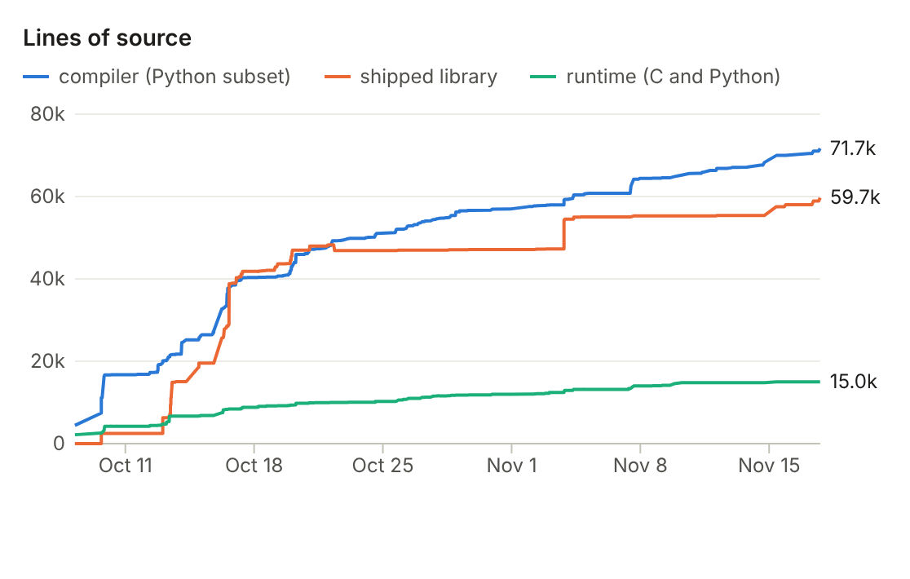

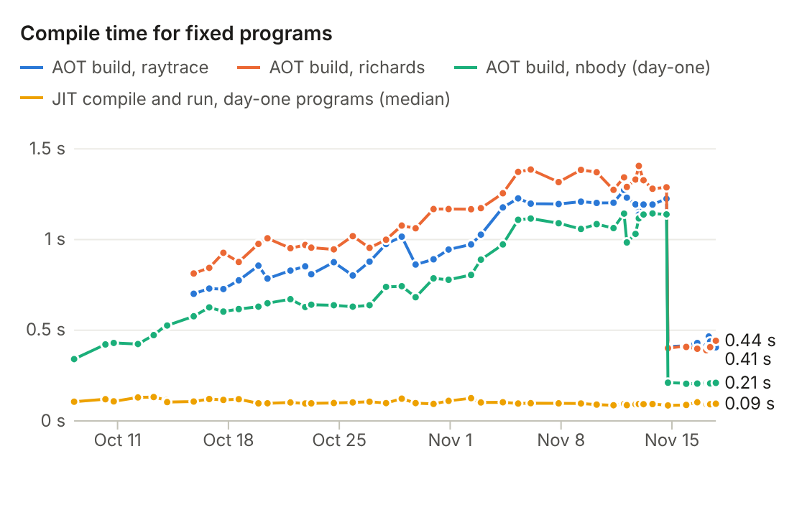

| Date | Release | Compiler lines | Library lines | Runtime lines | Compiler IR lines | AOT build nbody | AOT build richards | AOT build raytrace | JIT small programs |
|---|---|---:|---:|---:|---:|---:|---:|---:|---:|
| Oct 8 | — | 4,423 | 0 | 2,154 | 52,488 | 0.34 s | — | — | 0.11 s |
| Oct 14 | v0.1.0-alpha.1 | 24,648 | 15,040 | 6,685 | 360,753 | 0.53 s | — | — | 0.10 s |
| Oct 20 | v0.1.0-alpha.2 | 45,928 | 46,979 | 9,804 | 707,289 | 0.65 s | 1.01 s | 0.79 s | 0.10 s |
| Oct 23 | v0.1.0-alpha.3 | 49,848 | 46,865 | 10,043 | 675,209 | 0.64 s | 0.95 s | 0.81 s | 0.10 s |
| Nov 2 | v0.1.0-alpha.4 | 57,902 | 47,277 | 12,204 | 792,790 | 0.89 s | 1.17 s | 1.03 s | 0.10 s |
| Nov 6 | v0.2.0 | 60,772 | 55,036 | 13,189 | 832,277 | 1.12 s | 1.39 s | 1.20 s | 0.10 s |
| Nov 7 | v0.3.0 | 64,218 | 55,282 | 13,997 | 875,344 | 1.09 s | 1.32 s | 1.20 s | 0.10 s |
| Nov 10 | v0.4.0-alpha.2 | 65,199 | 55,293 | 14,798 | 887,322 | 1.08 s | 1.37 s | 1.20 s | 0.09 s |
| Nov 11 | v0.4.0-alpha.5 | 66,345 | 55,294 | 14,800 | 906,887 | 1.14 s | 1.34 s | 1.27 s | 0.09 s |
| Nov 12 | v0.4.0-alpha.6 | 66,847 | 55,378 | 14,800 | 912,869 | 1.03 s | 1.33 s | 1.19 s | 0.09 s |
| Nov 12 | v0.4.0-rc.1 | 66,955 | 55,390 | 14,800 | 914,514 | 1.12 s | 1.41 s | 1.14 s | 0.09 s |
| Nov 13 | v0.4.0 | 67,134 | 55,390 | 14,810 | 916,715 | 1.14 s | 1.28 s | 1.19 s | 0.09 s |
| Nov 14 | v0.5.0-alpha.1 | 67,642 | 55,414 | 14,810 | 923,418 | 1.14 s | 1.29 s | 1.23 s | 0.09 s |
| Nov 14 | v0.5.0-alpha.2 | 68,290 | 55,414 | 14,811 | 932,028 | 0.21 s | 0.40 s | 0.41 s | 0.09 s |
| Nov 15 | v0.5.0-alpha.3 | 69,979 | 57,546 | 15,010 | 959,093 | 0.21 s | 0.41 s | 0.41 s | 0.09 s |
| Nov 15 | v0.5.0-alpha.4 | 69,993 | 58,030 | 15,012 | 959,245 | 0.20 s | 0.41 s | 0.42 s | 0.09 s |
| Nov 16 | v0.5.0-alpha.5 | 70,225 | 58,030 | 15,012 | 961,586 | 0.21 s | 0.40 s | 0.43 s | 0.10 s |
| Nov 17 | v0.5.0-rc.1 | 70,431 | 58,030 | 15,012 | 963,719 | 0.21 s | 0.39 s | 0.41 s | 0.09 s |
| Nov 17 | v0.5.0 | 70,431 | 58,030 | 15,012 | 963,719 | 0.21 s | 0.41 s | 0.47 s | 0.10 s |
| Nov 17 | v0.6.0-alpha.1 | 71,678 | 59,716 | 15,018 | 981,589 | 0.21 s | 0.44 s | 0.41 s | 0.09 s |

## How this was measured

- Commits: 48 points on `main` from 7 October to 17 November 2026: an end-of-day commit for most days, 19 of the 26 release tags (every tag after 11 November) and `71e14a88`, which separates #1519 from #1522. Each was built with its own `make` bootstrap (CPython 3.13 hosting stage 1, LLVM 18.1.3) in a separate worktree and checked at its own fixed point: the first 35 on 12 November, the rest on 18 November.
- CPython test methods: today's `tools/cpython_test_methods.py` extracted 9,855 unittest methods from the 144 pinned CPython 3.13.16 test files of `tests/upstream/core-methods.sha256` (hashes verified); 5,905 complete under CPython 3.13.18 and form the denominator. A method passes when the commit's JIT prints CPython's stdout and stderr and exits the same way, including on a retry with promoting ints. The counts at v0.4.0 and v0.5.0 (492 and 500) equal the manual triage in #1303, which used the same harness.
- Language and builtins tests are the 60 files that test syntax, builtins and core types (`test_set`, `test_patma`, `test_builtin`, `test_exceptions` and the like); the rest test standard-library modules.
- Performance: today's 25 adapted pyperformance ports and the six original microbenchmarks, built AOT by each commit and run pinned to one CPU on an otherwise idle 4-vCPU x86-64 VM, every commit interleaved in each repetition with CPython 3.13.18. Ports report pyperf's timed region; microbenchmarks report process wall time. Every run's output must equal CPython's. `unpack_sequence` is left out because AOT removes its timed loop.
- Repetitions: all 48 commits timed together in one run on 18 November, five runs per port and seven per microbenchmark at every commit, medians reported. Between a benchmark's second-fastest and second-slowest run the spread was typically 1–10% (up to about 25% for the shortest programs), so index changes under about 5% are within noise.
- The core set is the 16 ports whose output matched at every sampled commit since the first one with ten working ports (15 October): barnes_hut, chaos, float, go, hexiom, meteor_contest, nbody, nqueens, raytrace, regex_dna, regex_effbot, regex_v8, richards, richards_super, scimark, spectral_norm.
- Compile time: `pystachy build` of nbody (day-one), richards and raytrace, two runs each pinned to one CPU; JIT end-to-end runs of the six day-one programs with the program cache off and a warm runtime cache.
- Causes are assigned from the text of the first compiler error. A method needs every blocker removed, and only the first is visible, so the categories show what is in front, not everything that remains.
- Bisection (first edition): `float` over the 7 first-parent merges between Nov 10 and alpha.5, and `words` over the 15 between Oct 17 and Oct 18, timing each probe 9 times pinned to one CPU. On 18 November both were re-timed 15 times at the bisected endpoints, the first edition's last commit, the fixes and the latest commit.

## Data

Every chart and table above comes from these files in `data/` (JSON as charted, CSV for spreadsheets):

| File | What it holds |
|---|---|
| `samples` | **Sampled commits.** One row per sampled commit on main from 7 October to 17 November 2026: CPython test methods passing, first-error causes, benchmarks that work, source size and compiler size. |
| `speedups` | **AOT speed per benchmark and commit.** Median AOT time of each benchmark at each sampled commit and of CPython 3.13.18 on the same source, measured pinned to one core on an idle 4-vCPU VM; speedup is CPython's time over the commit's. |
| `history` | **Source size at every commit on main.** Lines of compiler, shipped library and runtime source, and differential test counts, at each of the 684 first-parent commits on main up to 17 November 2026. |
| `blockers_head` | **Most common first errors, latest commit.** The 15 most frequent first compiler errors among the CPython test methods v0.6.0-alpha.1 rejects, with the cause each was assigned. |
| `unlocks` | **Newly passing methods per sampled commit.** Methods that pass at a sampled commit but not at the previous one, by the cause of their first error at the previous one. |
| `census` | **Unmodified upstream pyperformance files.** Whether each of the 52 pyperformance 1.14.0 benchmark files compiles with only pyperf's runner replaced, the first sampled commit that compiled it, and its first error at the latest commit. |
| `changes` | **Largest speed changes and their causes.** The biggest AOT time changes between consecutive sampled commits, with the merge that caused each where a bisection over the first-parent merges in between found it, or the merges the interval contains. |
| `overlay_head` | **Latest commit with CPython's standard library added.** Where the methods blocked by a missing library piece stop when CPython 3.13.16's pure-Python standard library is on the import path, at v0.6.0-alpha.1. |
| `perf_index` | **Performance index per commit (calculated).** Geometric mean of the per-benchmark AOT speedups over CPython 3.13 at each sampled commit: over the 16-port pyperformance core set where all 16 were measured, and over the six day-one microbenchmarks. |
| `findings` | **Findings since v0.1.0-alpha.2 and since the first edition.** Methods passing at v0.1.0-alpha.2 and gained since, compiler lines added since, methods and language tests gained since the first edition (main 8434a911), the share of typing and dynamic-model first errors in language tests at the latest commit, and methods unlocked from each since the release. |
| `perf_index` | **Performance index per commit.** The core and micro indices above, computed from `speedups` (CSV only). |

## Appendix: every sampled commit

| Date | Release | Commit | Methods | Language | Library | Differs | Ports | Upstream | Micro | Core | Blocked: library | syntax | typing | dynamic | other |
|---|---|---|---:|---:|---:|---:|---:|---:|---:|---:|---:|---:|---:|---:|---:|
| Oct 8 | — | `4f7d51c5d6` | 15 | 14 | 1 | 0 | 0 | 0 | 17.9× | — | 430 | 5321 | 96 | 26 | 17 |
| Oct 10 | — | `caf100d84f` | 51 | 50 | 1 | 0 | 2 | 0 | 18.2× | — | 3964 | 503 | 282 | 1094 | 11 |
| Oct 10 | — | `3542d631c3` | 51 | 50 | 1 | 0 | 2 | 0 | 18.3× | — | 3964 | 503 | 282 | 1094 | 11 |
| Oct 12 | — | `bd56b3742b` | 51 | 50 | 1 | 1 | 2 | 0 | 17.8× | — | 3963 | 503 | 282 | 1094 | 11 |
| Oct 13 | — | `535a6f14fd` | 112 | 99 | 13 | 18 | 7 | 1 | 18.0× | — | 3829 | 358 | 246 | 1289 | 53 |
| Oct 14 | — | `438565eb16` | 168 | 103 | 65 | 18 | 7 | 1 | 17.4× | — | 3470 | 382 | 308 | 1481 | 78 |
| Oct 14 | v0.1.0-alpha.1 | `aad4f1c21c` | 168 | 103 | 65 | 18 | 7 | 1 | 17.4× | — | 3470 | 382 | 308 | 1481 | 78 |
| Oct 15 | — | `bdc20a24c7` | 195 | 103 | 92 | 85 | 17 | 1 | 17.6× | 7.5× | 3182 | 404 | 689 | 1016 | 334 |
| Oct 16 | — | `237915902d` | 322 | 185 | 137 | 15 | 20 | 6 | 17.5× | 7.6× | 3074 | 271 | 841 | 1254 | 128 |
| Oct 17 | — | `6397781363` | 342 | 199 | 143 | 18 | 20 | 6 | 16.7× | 7.5× | 2834 | 289 | 898 | 1396 | 128 |
| Oct 18 | — | `bb5ac4ab43` | 342 | 199 | 143 | 18 | 20 | 6 | 16.8× | 7.5× | 2834 | 289 | 898 | 1396 | 128 |
| Oct 19 | — | `b040f45ebf` | 342 | 199 | 143 | 18 | 20 | 6 | 17.2× | 11.5× | 2834 | 289 | 898 | 1396 | 128 |
| Oct 20 | v0.1.0-alpha.2 | `afb59cd3c3` | 371 | 211 | 160 | 18 | 20 | 7 | 17.2× | 11.5× | 2753 | 298 | 896 | 1432 | 137 |
| Oct 21 | — | `11722f0c05` | 371 | 211 | 160 | 18 | 20 | 7 | 17.2× | 11.4× | 2753 | 298 | 896 | 1432 | 137 |
| Oct 22 | — | `7514bef719` | 371 | 211 | 160 | 18 | 22 | 7 | 17.2× | 11.4× | 2753 | 298 | 896 | 1432 | 137 |
| Oct 23 | v0.1.0-alpha.3 | `f5a09d4223` | 372 | 212 | 160 | 18 | 22 | 7 | 17.2× | 11.3× | 2753 | 298 | 895 | 1432 | 137 |
| Oct 24 | — | `6f5b169bc2` | 372 | 212 | 160 | 18 | 22 | 7 | 17.4× | 11.3× | 2753 | 298 | 895 | 1432 | 137 |
| Oct 25 | — | `de65c6fbfe` | 372 | 212 | 160 | 18 | 22 | 7 | 17.2× | 11.1× | 2753 | 298 | 895 | 1432 | 137 |
| Oct 26 | — | `368b12a560` | 377 | 217 | 160 | 17 | 23 | 7 | 17.2× | 11.3× | 2753 | 298 | 891 | 1432 | 137 |
| Oct 27 | — | `48b28bb13f` | 378 | 218 | 160 | 16 | 23 | 7 | 17.0× | 11.4× | 2753 | 298 | 895 | 1436 | 129 |
| Oct 28 | — | `5e553e1064` | 378 | 218 | 160 | 16 | 23 | 7 | 17.3× | 11.5× | 2753 | 298 | 895 | 1436 | 129 |
| Oct 29 | — | `d9de6b186b` | 378 | 218 | 160 | 16 | 23 | 7 | 17.3× | 11.7× | 2753 | 298 | 895 | 1436 | 129 |
| Oct 30 | — | `06e3ad5d08` | 378 | 218 | 160 | 16 | 23 | 7 | 17.2× | 11.7× | 2753 | 298 | 895 | 1436 | 129 |
| Oct 31 | — | `07b26e0242` | 378 | 218 | 160 | 16 | 23 | 7 | 17.2× | 11.6× | 2753 | 298 | 895 | 1436 | 129 |
| Nov 2 | — | `14d4eb15cb` | 379 | 218 | 161 | 16 | 23 | 7 | 17.4× | 11.5× | 2753 | 298 | 894 | 1436 | 129 |
| Nov 2 | v0.1.0-alpha.4 | `9c8bc74648` | 378 | 218 | 160 | 16 | 23 | 7 | 17.5× | 11.7× | 2753 | 298 | 895 | 1436 | 129 |
| Nov 4 | — | `a1436c85fa` | 396 | 218 | 178 | 16 | 25 | 7 | 17.5× | 11.9× | 2449 | 303 | 1011 | 1598 | 132 |
| Nov 5 | — | `d81279361d` | 396 | 218 | 178 | 16 | 25 | 7 | 17.6× | 11.9× | 2429 | 303 | 1031 | 1598 | 132 |
| Nov 6 | v0.2.0 | `e7513fd5b7` | 396 | 218 | 178 | 16 | 25 | 7 | 17.7× | 12.0× | 2429 | 303 | 1031 | 1598 | 132 |
| Nov 7 | v0.3.0 | `c5b8b4fceb` | 397 | 218 | 179 | 16 | 25 | 7 | 17.3× | 12.0× | 2429 | 303 | 1030 | 1598 | 132 |
| Nov 9 | — | `d6b9b3f18b` | 396 | 218 | 178 | 16 | 25 | 7 | 17.5× | 11.9× | 2429 | 303 | 1031 | 1598 | 132 |
| Nov 10 | v0.4.0-alpha.2 | `070c8137ed` | 397 | 218 | 179 | 16 | 25 | 7 | 17.7× | 12.3× | 2429 | 303 | 1031 | 1598 | 131 |
| Nov 11 | — | `d02995cb7b` | 397 | 218 | 179 | 16 | 25 | 7 | 17.6× | 12.2× | 2429 | 303 | 1031 | 1598 | 131 |
| Nov 11 | v0.4.0-alpha.5 | `b2182a4f01` | 397 | 218 | 179 | 16 | 25 | 7 | 17.9× | 12.2× | 2429 | 303 | 1031 | 1598 | 131 |
| Nov 12 | — | `8434a911be` | 492 | 310 | 182 | 24 | 25 | 7 | 17.9× | 12.0× | 2429 | 82 | 1045 | 1608 | 225 |
| Nov 12 | v0.4.0-alpha.6 | `0b13a21210` | 492 | 310 | 182 | 24 | 25 | 7 | 18.1× | 11.9× | 2429 | 82 | 1045 | 1608 | 225 |
| Nov 12 | v0.4.0-rc.1 | `30822255ee` | 492 | 310 | 182 | 24 | 25 | 7 | 18.3× | 12.2× | 2429 | 82 | 1045 | 1608 | 225 |
| Nov 13 | — | `bf699eb5ba` | 492 | 310 | 182 | 24 | 25 | 7 | 18.4× | 12.2× | 2429 | 82 | 1045 | 1608 | 225 |
| Nov 13 | v0.4.0 | `5f81cc2563` | 492 | 310 | 182 | 24 | 25 | 7 | 18.3× | 12.2× | 2429 | 82 | 1045 | 1608 | 225 |
| Nov 14 | v0.5.0-alpha.1 | `a73c56c92f` | 494 | 310 | 184 | 24 | 25 | 7 | 18.4× | 12.2× | 2429 | 82 | 1045 | 1608 | 223 |
| Nov 14 | v0.5.0-alpha.2 | `8049014349` | 494 | 310 | 184 | 24 | 25 | 7 | 17.8× | 12.2× | 2429 | 82 | 1045 | 1608 | 223 |
| Nov 15 | v0.5.0-alpha.3 | `49a149adba` | 500 | 316 | 184 | 25 | 25 | 7 | 18.1× | 12.3× | 2401 | 63 | 1059 | 1624 | 233 |
| Nov 15 | v0.5.0-alpha.4 | `3da553ee56` | 500 | 316 | 184 | 25 | 25 | 7 | 18.1× | 12.1× | 2401 | 63 | 1059 | 1624 | 233 |
| Nov 16 | v0.5.0-alpha.5 | `9f1472309f` | 500 | 316 | 184 | 25 | 25 | 7 | 18.1× | 12.3× | 2401 | 63 | 1059 | 1624 | 233 |
| Nov 17 | v0.5.0-rc.1 | `9cb9cc72dd` | 500 | 316 | 184 | 25 | 25 | 7 | 18.0× | 12.2× | 2401 | 63 | 1059 | 1624 | 233 |
| Nov 17 | v0.5.0 | `d58034c1ca` | 500 | 316 | 184 | 25 | 25 | 7 | 18.0× | 12.2× | 2401 | 63 | 1059 | 1624 | 233 |
| Nov 17 | — | `71e14a88d9` | 500 | 316 | 184 | 25 | 25 | 7 | 18.1× | 12.2× | 2396 | 63 | 1062 | 1626 | 233 |
| Nov 17 | v0.6.0-alpha.1 | `3cf23d2035` | 638 | 454 | 184 | 25 | 25 | 7 | 17.8× | 12.2× | 2400 | 56 | 943 | 1633 | 210 |
