# Pystachy speed vs surface

Performance against the amount of unmodified Python that Pystachy runs, across 56 commits of `main` from the project's first day (Oct 8) to Nov 21 2026; dates are UTC. Third edition, 22 November 2026: the first edition (12 November) measured 35 of these commits and the second (18 November) 48, and all of them were timed again together. Scripts and raw data: `research/speed-vs-surface-2026-11-22` on the branch `claude/peaceful-faraday-2yr9q6`.

## Summary

- **Surface grew in two phases and three steps.** CPython test methods passing went from 15 on the first day to 371 at v0.1.0-alpha.2 (Oct 20) and 397 at v0.4.0-alpha.5 (Nov 11). Bounded `match` (#1272) raised it to 492 on Nov 12, v0.6.0-alpha.1 to 638 and v0.7.0-alpha.2 to 683 (11.6% of 5,905). Language and builtins tests: 14 → 211 → 218 → 310 → 454 → 479 of 2,445.
- **Since the second edition, three pull requests made 40 of 45 new passes.** Classes defined inside functions that run once (#1613, 21 methods), the `gc` module (#1351, 12) and `enum`'s missing names (#1563, 7). No method that passed on 17 November fails.
- **The remaining blockers moved from the library to the compiler.** Rejections fell from 5,242 to 5,196, and first errors naming a missing module or name from 2,400 to 1,421: `test_enum`'s 885 methods got past their import and mostly stop at a class attribute's type now. At the latest commit, static-typing (578) and dynamic-model (955) first errors are 79% of the 1,949 rejections in the language and builtins tests.
- **Neither escape hatch helps unmodified code.** Adding CPython's own pure-Python standard library makes 0 of the 1,421 library-blocked methods pass; opting every test in to dynamic `Any` leaves 686 passing.
- **Speed held.** The six day-one microbenchmarks ran 17.5× CPython 3.13 on the first day, 17.7× on 17 November and 18.1× at the latest commit. The 16-port pyperformance core set went from 7.1× (Oct 15) to 11.5× on 17 November and 11.8× now.
- **One regression fixed, one partly.** `float` (+38% at #1268) recovered in v0.4.0-rc.1 through #1336; `words` (+29% at #667) improved slightly through #1332 and #1518 but keeps the larger heap of #667 (#1301).
- **AOT builds stay cheap; the compiler and its bootstrap grow.** `pystachy build` of the day-one nbody took 0.34 s on the first day and 1.35 s at v0.5.0-alpha.1; the precompiled runtime (#1377) cut it to 0.27 s (0.31 s now). The compiler grew from 71,678 to 83,625 lines in four days and its IR at the bootstrap fixed point from 981,589 to 1,141,334; rebuilt one at a time on the idle machine, the bootstrap took 289 s at v0.6.0-alpha.1 and 415 s at v0.7.0-alpha.2, about half of the growth because three variables in the compiler that hold two types each make its own source compile in three inference passes instead of one. JIT end to end on the small programs went from 0.14 s to 0.10 s.

## Since the second edition (17 November)

Main took 886 commits and eight release tags between 3cf23d20 and 4998521d. Every tag was measured.

| Date | Release | Commit | Methods | Language | Library | Micro index | Core index | nbody build |
|---|---|---|---:|---:|---:|---:|---:|---:|
| Nov 17 | v0.6.0-alpha.1 | `3cf23d20` | 638 | 454 | 184 | 17.7× | 11.5× | 0.27 s |
| Nov 18 | v0.6.0-alpha.2 | `e2b97bb4` | 642 | 457 | 185 | 17.3× | 11.5× | 0.27 s |
| Nov 18 | v0.6.0-alpha.3 | `8259611e` | 655 | 469 | 186 | 18.0× | 11.3× | 0.25 s |
| Nov 19 | v0.6.0-rc.1 | `d35417c9` | 655 | 469 | 186 | 18.0× | 11.5× | 0.23 s |
| Nov 20 | v0.6.0-rc.2 | `299d12ad` | 655 | 469 | 186 | 17.6× | 11.7× | 0.24 s |
| Nov 20 | v0.6.0 | `817c9cd9` | 655 | 469 | 186 | 18.5× | 11.8× | 0.25 s |
| Nov 20 | v0.6.1 | `37512410` | 656 | 469 | 187 | 18.4× | 11.6× | 0.24 s |
| Nov 20 | v0.7.0-alpha.1 | `41dffd36` | 684 | 479 | 205 | 18.7× | 11.6× | 0.28 s |
| Nov 21 | v0.7.0-alpha.2 | `4998521d` | 683 | 479 | 204 | 18.1× | 11.8× | 0.31 s |

| Change | Pull request | Release | Methods that now pass |
|---|---|---|---:|
| Classes defined inside functions that run at most once | #1613 | v0.7.0-alpha.1 | 21 (11 files) |
| The `gc` module | #1351 in #1548 | v0.6.0-alpha.3 | 12 (`test_dict`, `test_tuple`, `test_weakref`) |
| `enum.member` and `enum`'s private helpers | #1563 | v0.7.0-alpha.1 | 7 (`test_enum`) |
| `bytearray` | #1478 | v0.6.0-alpha.3 | 2 |
| Fixes among the 40 pull requests of #1546 | #1546 | v0.6.0-alpha.2 | 3 |

One `test_random` method passes or fails at random at every commit: with promoting integers, `randrange()` overflows 64 bits for most seeds. Set aside, this harness gives the project's own counts: 641 at v0.6.0-alpha.2 (#1560) and 683 at v0.7.0-alpha.1 (draft #1673).

Issues this report filed or relied on: #1300 (`float`) closed, fixed by #1336; #1301 (`words`) open after #1332 and #1518; #1302 (weekly timing) closed, the workflow has run once; #1303 (per-release triage) open, with counts in #1560 and draft #1673; #1304 (classes inside functions) open, partly addressed by #1613; #1305 (`match` patterns) open, mapping and class patterns still rejected; #1306 closed as a duplicate; #706 (AOT build cost) closed by #1377; #1181 (GC-stressed self-compilation) open, at 590 s of its 600 s bound before its collection interval was widened.

## Speed against Python surface

One point per sampled commit, joined in time order. Across: extracted CPython test methods it runs with CPython's output. Up: geometric-mean AOT speedup over CPython 3.13 on the same sources (log scale).

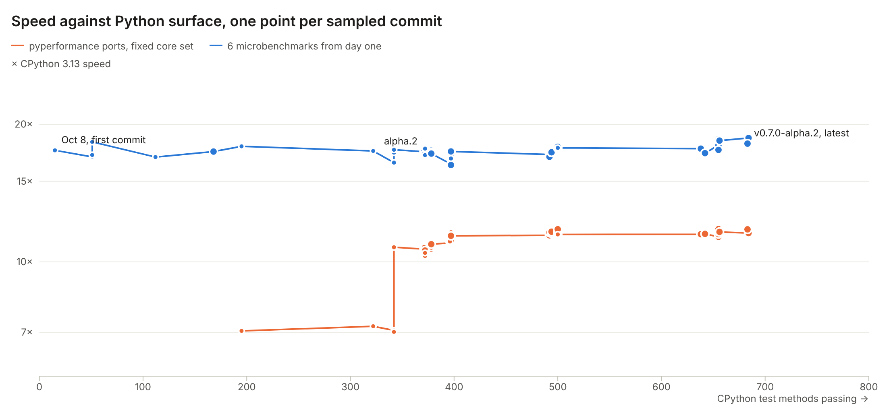

The same against language and builtins tests only, and against unmodified upstream pyperformance files that compile:

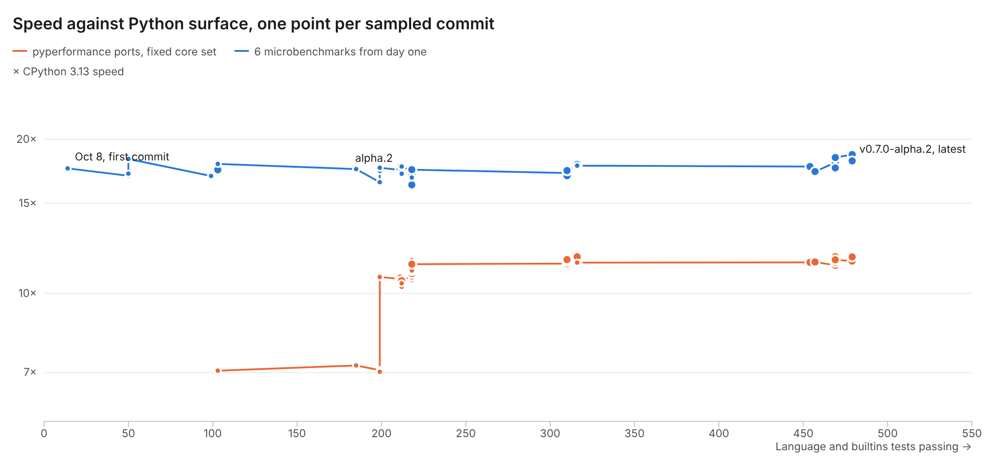

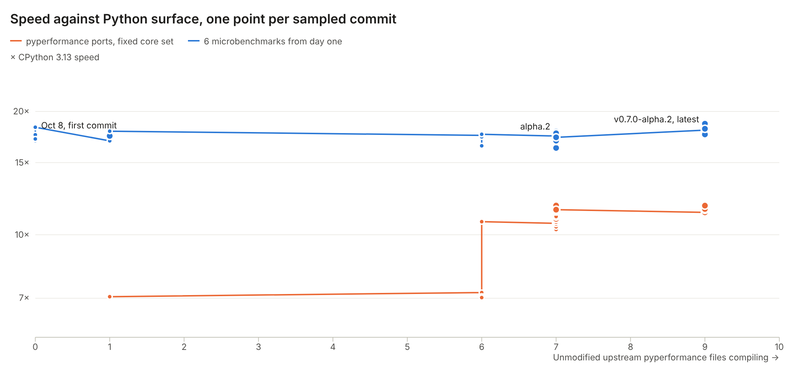

## Surface and speed over time

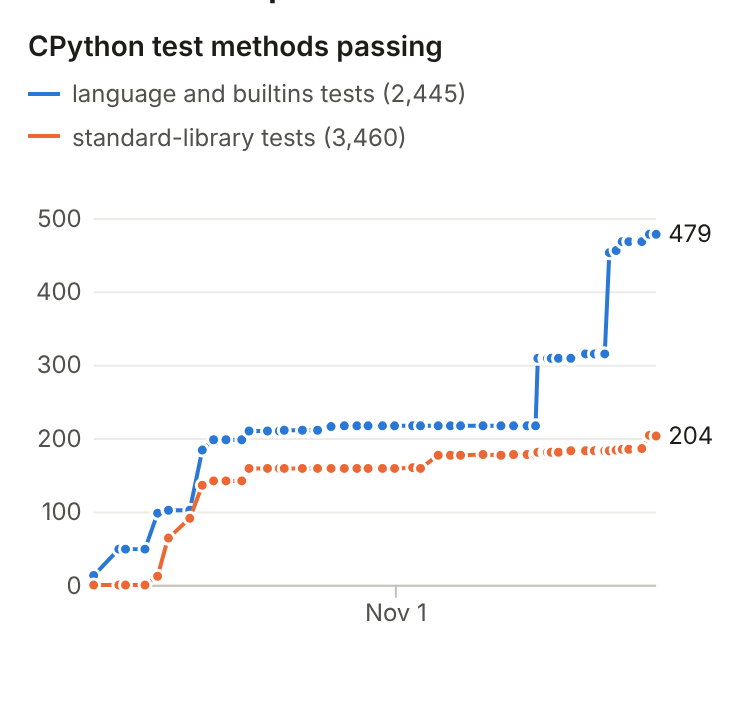

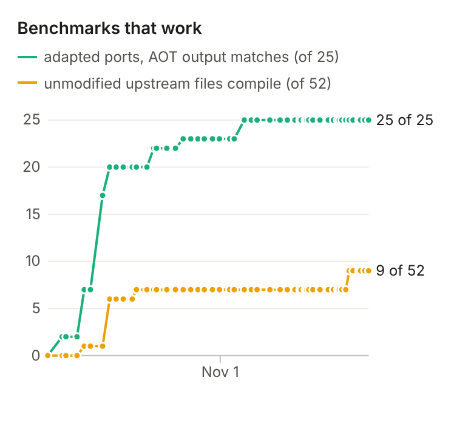

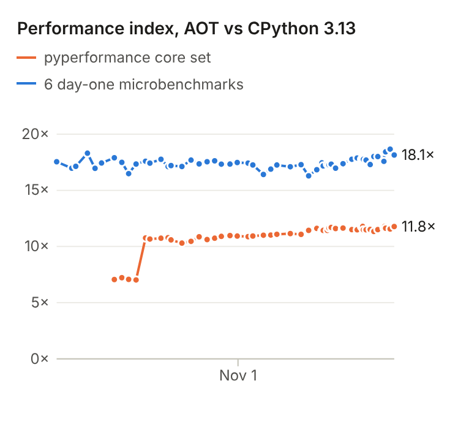

| Date | Release | Methods passing | Language tests | Library tests | Ports working | Upstream files | Micro index | Core index |
|---|---|---:|---:|---:|---:|---:|---:|---:|
| Oct 8 | — | 15 | 14 | 1 | 0 | 0 | 17.5× | — |
| Oct 14 | v0.1.0-alpha.1 | 168 | 103 | 65 | 7 | 1 | 17.4× | — |
| Oct 20 | v0.1.0-alpha.2 | 371 | 211 | 160 | 20 | 7 | 17.4× | 10.7× |
| Oct 23 | v0.1.0-alpha.3 | 372 | 212 | 160 | 22 | 7 | 17.2× | 10.6× |
| Nov 2 | v0.1.0-alpha.4 | 378 | 218 | 160 | 23 | 7 | 17.3× | 10.9× |
| Nov 6 | v0.2.0 | 396 | 218 | 178 | 25 | 7 | 17.2× | 11.1× |
| Nov 7 | v0.3.0 | 397 | 218 | 179 | 25 | 7 | 17.1× | 11.2× |
| Nov 10 | v0.4.0-alpha.2 | 397 | 218 | 179 | 25 | 7 | 16.3× | 11.4× |
| Nov 11 | v0.4.0-alpha.5 | 397 | 218 | 179 | 25 | 7 | 17.4× | 11.4× |
| Nov 12 | v0.4.0-alpha.6 | 492 | 310 | 182 | 25 | 7 | 17.3× | 11.4× |
| Nov 12 | v0.4.0-rc.1 | 492 | 310 | 182 | 25 | 7 | 17.3× | 11.6× |
| Nov 13 | v0.4.0 | 492 | 310 | 182 | 25 | 7 | 17.0× | 11.6× |
| Nov 14 | v0.5.0-alpha.1 | 494 | 310 | 184 | 25 | 7 | 17.4× | 11.5× |
| Nov 14 | v0.5.0-alpha.2 | 494 | 310 | 184 | 25 | 7 | 17.4× | 11.6× |
| Nov 15 | v0.5.0-alpha.3 | 500 | 316 | 184 | 25 | 7 | 17.7× | 11.6× |
| Nov 15 | v0.5.0-alpha.4 | 500 | 316 | 184 | 25 | 7 | 17.8× | 11.5× |
| Nov 16 | v0.5.0-alpha.5 | 500 | 316 | 184 | 25 | 7 | 17.9× | 11.5× |
| Nov 17 | v0.5.0-rc.1 | 500 | 316 | 184 | 25 | 7 | 17.8× | 11.8× |
| Nov 17 | v0.5.0 | 500 | 316 | 184 | 25 | 7 | 17.9× | 11.8× |
| Nov 17 | v0.6.0-alpha.1 | 638 | 454 | 184 | 25 | 7 | 17.7× | 11.5× |
| Nov 18 | v0.6.0-alpha.2 | 642 | 457 | 185 | 25 | 7 | 17.3× | 11.5× |
| Nov 18 | v0.6.0-alpha.3 | 655 | 469 | 186 | 25 | 9 | 18.0× | 11.3× |
| Nov 19 | v0.6.0-rc.1 | 655 | 469 | 186 | 25 | 9 | 18.0× | 11.5× |
| Nov 20 | v0.6.0-rc.2 | 655 | 469 | 186 | 25 | 9 | 17.6× | 11.7× |
| Nov 20 | v0.6.0 | 655 | 469 | 186 | 25 | 9 | 18.5× | 11.8× |
| Nov 20 | v0.6.1 | 656 | 469 | 187 | 25 | 9 | 18.4× | 11.6× |
| Nov 20 | v0.7.0-alpha.1 | 684 | 479 | 205 | 25 | 9 | 18.7× | 11.6× |
| Nov 21 | v0.7.0-alpha.2 | 683 | 479 | 204 | 25 | 9 | 18.1× | 11.8× |

## What stops the remaining CPython tests

The first compiler error of every method that does not compile, grouped by cause. Library and syntax gaps are unbuilt work. Typing and dynamic-model errors come from the typed, interpreter-free design: values whose single static type cannot be inferred, and classes, modules or code used as runtime values. Imports come first in a program, so a missing module hides any later error.

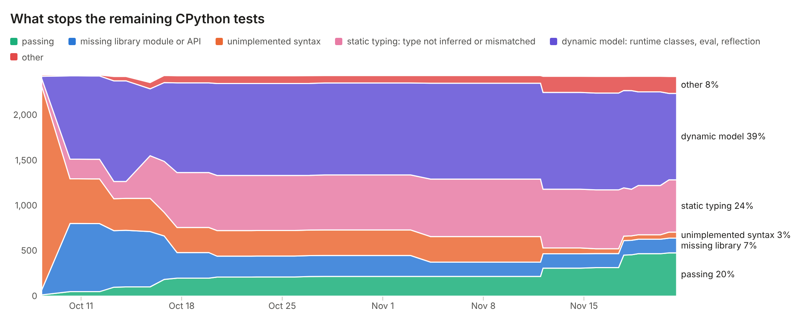

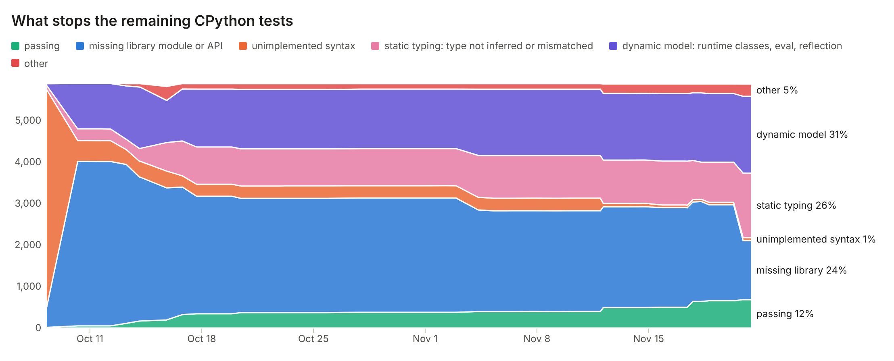

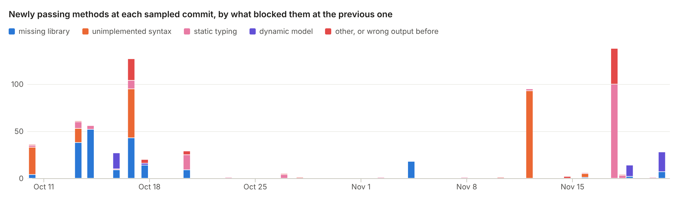

### Most common first errors at the latest commit

| # | First compiler error | Cause | Methods |
|---:|---|---|---:|
| 1 | `cannot infer the type of class attribute 'values'; annotate it (values: T = ...)` | typing | 513 |
| 2 | `module 'configparser' is not supported: it is not a builtin module` | library | 288 |
| 3 | `unsupported base class: single inheritance requires a previously declared ordinary class or a supported exception class` | dynamic | 262 |
| 4 | `module 'fractions' is not supported: it is not a builtin module` | library | 217 |
| 5 | `module 'pickle' is not supported: it is not a builtin module` | dynamic | 179 |
| 6 | `inheritance with generic class templates is not supported: annotate __init__ parameters with concrete types (not Any or object)` | dynamic | 155 |
| 7 | `module '_pyio' is not supported: it is not a builtin module` | library | 134 |
| 8 | `module 'locale' is not supported: it is not a builtin module` | library | 127 |
| 9 | `secondary base methods may not use super() or read or write the instance` | dynamic | 99 |
| 10 | `cannot import name 'TemporaryFile' from 'tempfile'` | library | 87 |
| 11 | `module 'array' is not supported: it is not a builtin module` | library | 83 |
| 12 | `Enum() with members is supported as NAME = Enum('NAME', ...) at the top of a module, of literals: this one makes an enum class as the code r` | dynamic | 77 |
| 13 | `cannot infer the type of field 's'; annotate it (self.s: T = ...)` | typing | 77 |
| 14 | `class BuiltinTest.C_get_vars is not supported after a call in the decorators, bases or body of class BuiltinTest: Pystachy makes a nested cl` | dynamic | 72 |
| 15 | `module 'queue' is not supported: it is not a builtin module` | library | 72 |

### With CPython's own standard library added (latest commit)

CPython 3.13.16's pure-Python standard library on the import path (`tools/import_sweep.py --overlay`, which leaves out the modules Pystachy ships): 0 of the 1,421 methods blocked by a missing library piece pass. Their next errors:

| Where the method now stops | Cause | Methods |
|---|---|---:|
| now rejected inside CPython's library code | a module or name still missing | 161 |
| now rejected inside CPython's library code | dynamic model (generic bases, redefinitions, class-body statements) | 176 |
| now rejected inside CPython's library code | unimplemented syntax | 8 |
| now rejected inside CPython's library code | other | 330 |
| still rejected in the test itself | a module or name still missing | 440 |
| still rejected in the test itself | dynamic model (generic bases, redefinitions, class-body statements) | 175 |
| still rejected in the test itself | static typing (type not inferred) | 21 |
| still rejected in the test itself | unimplemented syntax | 9 |
| still rejected in the test itself | other | 101 |

## Speed by benchmark and commit

AOT speed relative to CPython 3.13 on the same source. Blue is faster than CPython, red is slower; an empty cell means that commit could not build the benchmark or printed different output.

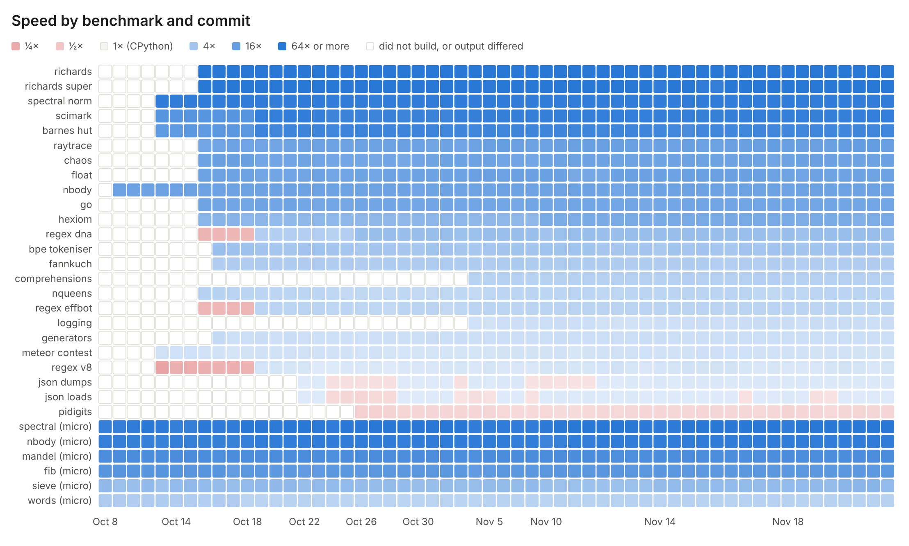

### Largest speed changes and their causes

| Benchmark | From | To | ms before | ms after | Change | Evidence |
|---|---|---|---:|---:|---|---|
| micro_words | 2026-10-17 | 2026-10-18 | 61.4 | 79.6 | Slower: Unicode code-point strings, stage 1 (#667) | bisected to a355c83f |
| regex_dna | 2026-10-18 | 2026-10-19 | 1,628.5 | 206.1 | Faster: lib/re matcher work (#676, #680, #682, #683, #685) | 32 merges; not bisected |
| regex_effbot | 2026-10-18 | 2026-10-19 | 1,127.8 | 170.9 | Faster: same lib/re work | same interval |
| regex_v8 | 2026-10-18 | 2026-10-19 | 1,149.4 | 258.6 | Faster: same lib/re work | same interval |
| scimark | 2026-10-18 | 2026-10-19 | 22.4 | 9.9 | Faster: likely field TBAA (#724) or tuple returns by value (#727) | same interval |
| barnes_hut | 2026-10-18 | 2026-10-19 | 26.8 | 13.7 | Faster: likely the same two changes | same interval |
| float | 2026-11-11 | 2026-11-11 | 37.7 | 51.9 | Slower: listguard bounds-check hoisting with Lean checks (#1268) | bisected to b40ee875 |
| float | 2026-11-12 | 2026-11-12 | 48.9 | 37.8 | Faster: listguard keeps sole calls inlinable in loop copies (#1336) | #1389, v0.4.0-rc.1; closes #1300 |
| chaos | 2026-11-18 | 2026-11-18 | 28.5 | 26.6 | Faster: small ints compared with floats without trunc() (#1437) and other float fast paths | #1548; confirmed by 15 runs |

### Each benchmark: first sampled commit where it worked, and the latest

| Benchmark | Works since | Speed then | Speed now | Change |
|---|---|---:|---:|---:|
| barnes_hut | Oct 13 | 18.99× | 37.59× | +98% |
| bpe_tokeniser | Oct 16 | 4.90× | 4.10× | -16% |
| chaos | Oct 15 | 13.48× | 14.50× | +8% |
| comprehensions | Nov 4 | 2.47× | 2.61× | +6% |
| fannkuch | Oct 16 | 2.96× | 3.00× | +1% |
| float | Oct 15 | 13.40× | 13.78× | +3% |
| generators | Oct 16 | 1.93× | 1.62× | -16% |
| go | Oct 15 | 13.10× | 12.32× | -6% |
| hexiom | Oct 15 | 7.02× | 10.35× | +47% |
| json_dumps | Oct 22 | 1.02× | 1.14× | +11% |
| json_loads | Oct 22 | 1.06× | 1.06× | -0% |
| logging | Nov 4 | 1.44× | 1.64× | +14% |
| meteor_contest | Oct 13 | 1.37× | 1.34× | -2% |
| micro_fib | Oct 8 | 22.81× | 20.22× | -11% |
| micro_mandel | Oct 8 | 29.26× | 29.86× | +2% |
| micro_nbody | Oct 8 | 46.94× | 55.08× | +17% |
| micro_sieve | Oct 8 | 6.11× | 5.86× | -4% |
| micro_spectral | Oct 8 | 49.42× | 73.00× | +48% |
| micro_words | Oct 8 | 3.08× | 2.51× | -19% |
| nbody | Oct 10 | 13.66× | 13.59× | -1% |
| nqueens | Oct 15 | 2.55× | 2.35× | -8% |
| pidigits | Oct 26 | 0.65× | 0.75× | +15% |
| raytrace | Oct 15 | 12.08× | 15.50× | +28% |
| regex_dna | Oct 15 | 0.33× | 5.17× | +1486% |
| regex_effbot | Oct 15 | 0.34× | 2.32× | +574% |
| regex_v8 | Oct 13 | 0.21× | 1.27× | +510% |
| richards | Oct 15 | 67.29× | 70.75× | +5% |
| richards_super | Oct 15 | 77.12× | 70.66× | -8% |
| scimark | Oct 13 | 22.72× | 51.81× | +128% |
| spectral_norm | Oct 13 | 54.78× | 54.68× | -0% |

### The 52 unmodified upstream pyperformance files

| Benchmark | Compiles unmodified | First sampled commit that compiled it | First error at the latest commit |
|---|---|---|---|
| fannkuch | yes | Oct 16 | — |
| gc_collect | yes | Nov 18 | — |
| generators | yes | Oct 16 | — |
| nbody | yes | Oct 16 | — |
| nqueens | yes | Oct 16 | — |
| pprint | yes | Nov 18 | — |
| regex_v8 | yes | Oct 13 | — |
| spectral_norm | yes | Oct 20 | — |
| unpack_sequence | yes | Oct 16 | — |
| 2to3 | no | — | `unsupported module attribute sys.executable` |
| argparse | no | — | `unsupported type annotation` |
| async_generators | no | — | `async functions are not supported` |
| async_tree | no | — | `module 'asyncio' is not supported: it is not a builtin module` |
| asyncio_tcp | no | — | `module 'asyncio' is not supported: it is not a builtin module` |
| barnes_hut | no | — | `cannot infer the type of field 'particles'; annotate it (self.particles: T = ...)` |
| base64 | no | — | `'int' has no method 'to_bytes'` |
| bpe_tokeniser | no | — | `cannot infer the type of field '_decoder'; annotate it (self._decoder: T = ...)` |
| chaos | no | — | `cannot infer the type of class attribute '__rmul__'; annotate it (__rmul__: T = ...)` |
| comprehensions | no | — | `cannot infer the type of 'widgets', an empty list so far: annotate it (widgets: list[T] = [])` |
| concurrent_imap | no | — | `module 'multiprocessing' is not supported: it is not a builtin module` |
| coroutines | no | — | `async functions are not supported` |
| crypto_pyaes | no | — | `module 'pyaes' is not supported: it is not a builtin module` |
| decimal_factorial | no | — | `cannot infer what factorial() returns: it calls itself before a return statement does; annotate its return type` |
| decimal_pi | no | — | `expected int, got Decimal` |
| deepcopy | no | — | `unsupported type annotation` |
| deltablue | no | — | `inheritance with generic class templates is not supported: annotate __init__ parameters with concrete types (not Any or object)` |
| float | no | — | `cannot infer the type of field 'x'; annotate it (self.x: T = ...)` |
| gc_traversal | no | — | `cannot infer the type of 'current_list', an empty list so far: annotate it (current_list: list[T] = [])` |
| go | no | — | `cannot infer the type of field 'pos_child'; annotate it (self.pos_child: T = ...)` |
| hexiom | no | — | `cannot infer the type of field 'nodes_by_id'; annotate it (self.nodes_by_id: T = ...)` |
| json_dumps | no | — | `cannot infer the type of an empty dict; add a type annotation (d: dict[K, V] = {}, or -> dict[K, V] on a function returning the dict)` |
| json_loads | no | — | `expected int, got str (this dict display's values have no one type: annotate the display with a union of their types where one holds th` |
| logging | no | — | `expected <function bench_silent>, got <function bench_simple_output> (each function is a type of its own: a variable, a list's items or a ` |
| mdp | no | — | `module 'fractions' is not supported: it is not a builtin module` |
| meteor_contest | no | — | `expected int, got float` |
| pathlib | no | — | `'pathlib.PosixPath' object has no method 'stat'` |
| pickle | no | — | `module 'pickle' is not supported: it is not a builtin module` |
| pidigits | no | — | `map() is supported as the argument of list(), tuple() (with scalar or optional scalar items), bytes(), sorted(), sum(), min(), max(), any` |
| pyflate | no | — | `inheritance with generic class templates is not supported: annotate __init__ parameters with concrete types (not Any or object)` |
| python_startup | no | — | `unsupported module attribute sys.executable` |
| raytrace | no | — | `module 'array' is not supported: it is not a builtin module` |
| regex_compile | no | — | `cannot infer the type of 'regexes', which capture_compile() reads, where it is defined: annotate it (regexes: T = ...)` |
| regex_dna | no | — | `expected str, got bytes` |
| regex_effbot | no | — | `type <function bench_regex_effbot> has no attribute 'data'` |
| richards | no | — | `inheritance with generic class templates is not supported: annotate __init__ parameters with concrete types (not Any or object)` |
| richards_super | no | — | `inheritance with generic class templates is not supported: annotate __init__ parameters with concrete types (not Any or object)` |
| scimark | no | — | `module 'array' is not supported: it is not a builtin module` |
| sqlite_synth | no | — | `module 'sqlite3' is not supported: it is not a builtin module` |
| telco | no | — | `expected BinaryIO, got BytesIO` |
| tomli_loads | no | — | `module 'tomli' is not supported: it is not a builtin module` |
| typing_runtime_protocols | no | — | `unsupported base class: single inheritance requires a previously declared ordinary class or a supported exception class` |
| xml_etree | no | — | `module 'xml' is not supported: it is not a builtin module` |

## What the surface cost

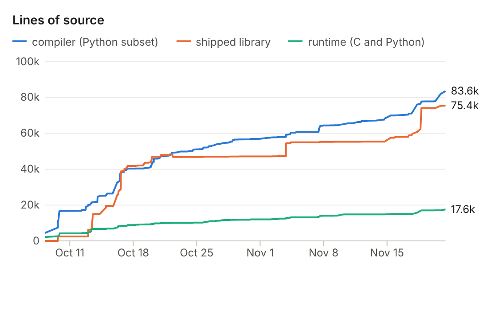

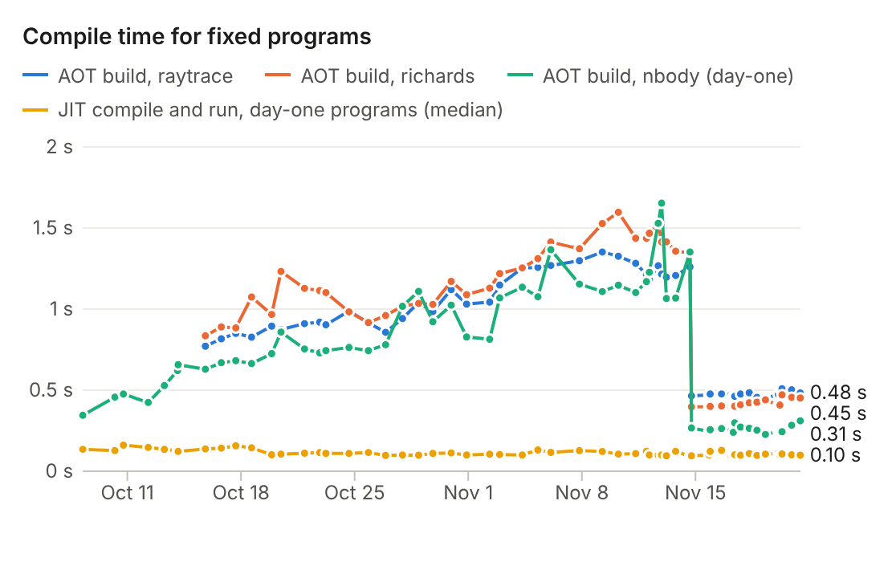

| Date | Release | Compiler lines | Library lines | Runtime lines | Compiler IR lines | AOT build nbody | AOT build richards | AOT build raytrace | JIT small programs |
|---|---|---:|---:|---:|---:|---:|---:|---:|---:|
| Oct 8 | — | 4,423 | 0 | 2,154 | 52,488 | 0.34 s | — | — | 0.14 s |
| Oct 14 | v0.1.0-alpha.1 | 24,648 | 15,040 | 6,685 | 360,753 | 0.66 s | — | — | 0.12 s |
| Oct 20 | v0.1.0-alpha.2 | 45,928 | 46,979 | 9,804 | 707,289 | 0.86 s | 1.23 s | 0.87 s | 0.11 s |
| Oct 23 | v0.1.0-alpha.3 | 49,848 | 46,865 | 10,043 | 675,209 | 0.74 s | 1.10 s | 0.90 s | 0.11 s |
| Nov 2 | v0.1.0-alpha.4 | 57,902 | 47,277 | 12,204 | 792,790 | 1.07 s | 1.22 s | 1.15 s | 0.10 s |
| Nov 6 | v0.2.0 | 60,772 | 55,036 | 13,189 | 832,277 | 1.37 s | 1.41 s | 1.27 s | 0.12 s |
| Nov 7 | v0.3.0 | 64,218 | 55,282 | 13,997 | 875,344 | 1.15 s | 1.37 s | 1.30 s | 0.13 s |
| Nov 10 | v0.4.0-alpha.2 | 65,199 | 55,293 | 14,798 | 887,322 | 1.15 s | 1.60 s | 1.33 s | 0.11 s |
| Nov 11 | v0.4.0-alpha.5 | 66,345 | 55,294 | 14,800 | 906,887 | 1.17 s | 1.44 s | 1.21 s | 0.12 s |
| Nov 12 | v0.4.0-alpha.6 | 66,847 | 55,378 | 14,800 | 912,869 | 1.53 s | 1.52 s | 1.27 s | 0.10 s |
| Nov 12 | v0.4.0-rc.1 | 66,955 | 55,390 | 14,800 | 914,514 | 1.65 s | 1.41 s | 1.22 s | 0.10 s |
| Nov 13 | v0.4.0 | 67,134 | 55,390 | 14,810 | 916,715 | 1.07 s | 1.36 s | 1.21 s | 0.12 s |
| Nov 14 | v0.5.0-alpha.1 | 67,642 | 55,414 | 14,810 | 923,418 | 1.35 s | 1.35 s | 1.26 s | 0.09 s |
| Nov 14 | v0.5.0-alpha.2 | 68,290 | 55,414 | 14,811 | 932,028 | 0.27 s | 0.40 s | 0.47 s | 0.10 s |
| Nov 15 | v0.5.0-alpha.3 | 69,979 | 57,546 | 15,010 | 959,093 | 0.24 s | 0.40 s | 0.47 s | 0.10 s |
| Nov 15 | v0.5.0-alpha.4 | 69,993 | 58,030 | 15,012 | 959,245 | 0.26 s | 0.40 s | 0.48 s | 0.12 s |
| Nov 16 | v0.5.0-alpha.5 | 70,225 | 58,030 | 15,012 | 961,586 | 0.26 s | 0.40 s | 0.48 s | 0.13 s |
| Nov 17 | v0.5.0-rc.1 | 70,431 | 58,030 | 15,012 | 963,719 | 0.25 s | 0.40 s | 0.47 s | 0.10 s |
| Nov 17 | v0.5.0 | 70,431 | 58,030 | 15,012 | 963,719 | 0.24 s | 0.40 s | 0.47 s | 0.10 s |
| Nov 17 | v0.6.0-alpha.1 | 71,678 | 59,716 | 15,018 | 981,589 | 0.27 s | 0.41 s | 0.48 s | 0.10 s |
| Nov 18 | v0.6.0-alpha.2 | 76,046 | 60,771 | 15,738 | 1,042,269 | 0.27 s | 0.42 s | 0.48 s | 0.11 s |
| Nov 18 | v0.6.0-alpha.3 | 77,778 | 74,120 | 17,016 | 1,063,078 | 0.25 s | 0.43 s | 0.46 s | 0.10 s |
| Nov 19 | v0.6.0-rc.1 | 77,860 | 74,120 | 17,016 | 1,064,114 | 0.23 s | 0.44 s | 0.45 s | 0.11 s |
| Nov 20 | v0.6.0-rc.2 | 77,868 | 74,120 | 17,032 | 1,064,204 | 0.24 s | 0.41 s | 0.47 s | 0.11 s |
| Nov 20 | v0.6.0 | 77,868 | 74,120 | 17,032 | 1,064,204 | 0.25 s | 0.41 s | 0.51 s | 0.10 s |
| Nov 20 | v0.6.1 | 77,958 | 74,126 | 17,057 | 1,065,021 | 0.24 s | 0.47 s | 0.51 s | 0.11 s |
| Nov 20 | v0.7.0-alpha.1 | 82,078 | 75,392 | 17,073 | 1,119,428 | 0.28 s | 0.46 s | 0.50 s | 0.10 s |
| Nov 21 | v0.7.0-alpha.2 | 83,625 | 75,411 | 17,557 | 1,141,334 | 0.31 s | 0.45 s | 0.48 s | 0.10 s |

## How this was measured

- Commits: 56 points on `main` from 7 October to 21 November 2026: an end-of-day commit for most days, 27 of the 34 release tags (every tag after 11 November) and `71e14a88`, which separates #1519 from #1522. Each was built with its own `make` bootstrap (CPython 3.13 hosting stage 1, LLVM 18.1.3) in a separate worktree and checked at its own fixed point: the first 35 on 12 November, 13 on 18 November and the last 8 on 22 November.
- CPython test methods: today's `tools/cpython_test_methods.py` extracted 9,855 unittest methods from the 144 pinned CPython 3.13.16 test files of `tests/upstream/core-methods.sha256` (hashes verified); 5,905 complete under CPython 3.13.18 and form the denominator. A method passes when the commit's JIT prints CPython's stdout and stderr and exits the same way, including on a retry with promoting ints. The counts at v0.4.0 and v0.5.0 (492 and 500) equal the manual triage in #1303, and those at v0.6.0-alpha.2 and v0.7.0-alpha.1 (641 and 683) the counts in #1560 and draft #1673, once one `test_random` method that passes at random is set aside.
- Language and builtins tests are the 60 files that test syntax, builtins and core types (`test_set`, `test_patma`, `test_builtin`, `test_exceptions` and the like); the rest test standard-library modules.
- Performance: today's 25 adapted pyperformance ports and the six original microbenchmarks, built AOT by each commit and run pinned to one CPU on an otherwise idle 4-vCPU x86-64 VM, every commit interleaved in each repetition with CPython 3.13.18. Ports report pyperf's timed region; microbenchmarks report process wall time. Every run's output must equal CPython's. `unpack_sequence` is left out because AOT removes its timed loop.
- Repetitions: all 56 commits timed together in one run on 22 November, five runs per port and seven per microbenchmark at every commit, medians reported. Between a benchmark's second-fastest and second-slowest run the spread was typically 1–10% (up to about 25% for the shortest programs), so index changes under about 5% are within noise.
- The core set is the 16 ports whose output matched at every sampled commit since the first one with ten working ports (15 October): barnes_hut, chaos, float, go, hexiom, meteor_contest, nbody, nqueens, raytrace, regex_dna, regex_effbot, regex_v8, richards, richards_super, scimark, spectral_norm.
- Compile time: `pystachy build` of nbody (day-one), richards and raytrace, pinned to one CPU, medians of three runs after one untimed run per commit; JIT end-to-end runs of the six day-one programs with the program cache off and a warm runtime cache, timed the same way. Bootstrap: one `make` per commit beside another commit's test sweep, on three different days; the three editions' latest commits were also rebuilt one at a time on the idle machine on 22 November.
- Causes are assigned from the text of the first compiler error. A method needs every blocker removed, and only the first is visible, so the categories show what is in front, not everything that remains.
- Bisection (first edition): `float` over the 7 first-parent merges between Nov 10 and alpha.5, and `words` over the 15 between Oct 17 and Oct 18, timing each probe 9 times pinned to one CPU. On 22 November both, and `fib`, were re-timed 15 times at the bisected endpoints, the fixes, the first and second editions' last commits, v0.6.0 and the latest commit.

## Data

Every chart and table above comes from these files in `data/` (JSON as charted, CSV for spreadsheets):

| File | What it holds |
|---|---|
| `samples` | **Sampled commits.** One row per sampled commit on main from 7 October to 21 November 2026: CPython test methods passing, first-error causes, benchmarks that work, source size and compiler size. |
| `speedups` | **AOT speed per benchmark and commit.** Median AOT time of each benchmark at each sampled commit and of CPython 3.13.18 on the same source, measured pinned to one core on an idle 4-vCPU VM; speedup is CPython's time over the commit's. |
| `history` | **Source size at every commit on main.** Lines of compiler, shipped library and runtime source, and differential test counts, at each of the 693 first-parent commits on main up to 21 November 2026. |
| `blockers_head` | **Most common first errors, latest commit.** The 15 most frequent first compiler errors among the CPython test methods v0.7.0-alpha.2 rejects, with the cause each was assigned. |
| `unlocks` | **Newly passing methods per sampled commit.** Methods that pass at a sampled commit but not at the previous one, by the cause of their first error at the previous one. |
| `census` | **Unmodified upstream pyperformance files.** Whether each of the 52 pyperformance 1.14.0 benchmark files compiles with only pyperf's runner replaced, the first sampled commit that compiled it, and its first error at the latest commit. |
| `changes` | **Largest speed changes and their causes.** The biggest AOT time changes between consecutive sampled commits, with the merge that caused each where a bisection over the first-parent merges in between found it, or the merges the interval contains. |
| `overlay_head` | **Latest commit with CPython's standard library added.** Where the methods blocked by a missing library piece stop when CPython 3.13.16's pure-Python standard library is on the import path, at v0.7.0-alpha.2. |
| `perf_index` | **Performance index per commit (calculated).** Geometric mean of the per-benchmark AOT speedups over CPython 3.13 at each sampled commit: over the 16-port pyperformance core set where all 16 were measured, and over the six day-one microbenchmarks. |
| `findings` | **Findings since v0.1.0-alpha.2 and since the previous edition.** Methods passing at v0.1.0-alpha.2 and gained since, compiler lines added since, methods and language tests gained since the previous edition (v0.6.0-alpha.1, main 3cf23d20), the share of typing and dynamic-model first errors in language tests at the latest commit, and methods unlocked from each since the release. |
| `perf_index` | **Performance index per commit.** The core and micro indices above, computed from `speedups` (CSV only). |

## Appendix: every sampled commit

| Date | Release | Commit | Methods | Language | Library | Differs | Ports | Upstream | Micro | Core | Blocked: library | syntax | typing | dynamic | other |
|---|---|---|---:|---:|---:|---:|---:|---:|---:|---:|---:|---:|---:|---:|---:|
| Oct 8 | — | `4f7d51c5d6` | 15 | 14 | 1 | 0 | 0 | 0 | 17.5× | — | 430 | 5321 | 96 | 26 | 17 |
| Oct 10 | — | `caf100d84f` | 51 | 50 | 1 | 0 | 2 | 0 | 17.0× | — | 3964 | 503 | 282 | 1094 | 11 |
| Oct 10 | — | `3542d631c3` | 51 | 50 | 1 | 0 | 2 | 0 | 17.1× | — | 3964 | 503 | 282 | 1094 | 11 |
| Oct 12 | — | `bd56b3742b` | 51 | 50 | 1 | 1 | 2 | 0 | 18.3× | — | 3963 | 503 | 282 | 1094 | 11 |
| Oct 13 | — | `535a6f14fd` | 112 | 99 | 13 | 18 | 7 | 1 | 17.0× | — | 3829 | 358 | 246 | 1289 | 53 |
| Oct 14 | — | `438565eb16` | 168 | 103 | 65 | 18 | 7 | 1 | 17.4× | — | 3470 | 382 | 308 | 1481 | 78 |
| Oct 14 | v0.1.0-alpha.1 | `aad4f1c21c` | 168 | 103 | 65 | 18 | 7 | 1 | 17.4× | — | 3470 | 382 | 308 | 1481 | 78 |
| Oct 15 | — | `bdc20a24c7` | 195 | 103 | 92 | 85 | 17 | 1 | 17.9× | 7.1× | 3182 | 404 | 689 | 1016 | 334 |
| Oct 16 | — | `237915902d` | 322 | 185 | 137 | 15 | 20 | 6 | 17.5× | 7.2× | 3074 | 271 | 841 | 1254 | 128 |
| Oct 17 | — | `6397781363` | 342 | 199 | 143 | 18 | 20 | 6 | 16.5× | 7.1× | 2834 | 289 | 898 | 1396 | 128 |
| Oct 18 | — | `bb5ac4ab43` | 342 | 199 | 143 | 18 | 20 | 6 | 17.3× | 7.0× | 2834 | 289 | 898 | 1396 | 128 |
| Oct 19 | — | `b040f45ebf` | 342 | 199 | 143 | 18 | 20 | 6 | 17.6× | 10.8× | 2834 | 289 | 898 | 1396 | 128 |
| Oct 20 | v0.1.0-alpha.2 | `afb59cd3c3` | 371 | 211 | 160 | 18 | 20 | 7 | 17.4× | 10.7× | 2753 | 298 | 896 | 1432 | 137 |
| Oct 21 | — | `11722f0c05` | 371 | 211 | 160 | 18 | 20 | 7 | 17.8× | 10.7× | 2753 | 298 | 896 | 1432 | 137 |
| Oct 22 | — | `7514bef719` | 371 | 211 | 160 | 18 | 22 | 7 | 17.1× | 10.8× | 2753 | 298 | 896 | 1432 | 137 |
| Oct 23 | v0.1.0-alpha.3 | `f5a09d4223` | 372 | 212 | 160 | 18 | 22 | 7 | 17.2× | 10.6× | 2753 | 298 | 895 | 1432 | 137 |
| Oct 24 | — | `6f5b169bc2` | 372 | 212 | 160 | 18 | 22 | 7 | 17.1× | 10.3× | 2753 | 298 | 895 | 1432 | 137 |
| Oct 25 | — | `de65c6fbfe` | 372 | 212 | 160 | 18 | 22 | 7 | 17.7× | 10.5× | 2753 | 298 | 895 | 1432 | 137 |
| Oct 26 | — | `368b12a560` | 377 | 217 | 160 | 17 | 23 | 7 | 17.4× | 10.9× | 2753 | 298 | 891 | 1432 | 137 |
| Oct 27 | — | `48b28bb13f` | 378 | 218 | 160 | 16 | 23 | 7 | 17.5× | 10.6× | 2753 | 298 | 895 | 1436 | 129 |
| Oct 28 | — | `5e553e1064` | 378 | 218 | 160 | 16 | 23 | 7 | 17.6× | 10.7× | 2753 | 298 | 895 | 1436 | 129 |
| Oct 29 | — | `d9de6b186b` | 378 | 218 | 160 | 16 | 23 | 7 | 17.3× | 10.9× | 2753 | 298 | 895 | 1436 | 129 |
| Oct 30 | — | `06e3ad5d08` | 378 | 218 | 160 | 16 | 23 | 7 | 17.3× | 11.0× | 2753 | 298 | 895 | 1436 | 129 |
| Oct 31 | — | `07b26e0242` | 378 | 218 | 160 | 16 | 23 | 7 | 17.5× | 10.9× | 2753 | 298 | 895 | 1436 | 129 |
| Nov 2 | — | `14d4eb15cb` | 379 | 218 | 161 | 16 | 23 | 7 | 17.4× | 10.9× | 2753 | 298 | 894 | 1436 | 129 |
| Nov 2 | v0.1.0-alpha.4 | `9c8bc74648` | 378 | 218 | 160 | 16 | 23 | 7 | 17.3× | 10.9× | 2753 | 298 | 895 | 1436 | 129 |
| Nov 4 | — | `a1436c85fa` | 396 | 218 | 178 | 16 | 25 | 7 | 16.4× | 11.0× | 2449 | 303 | 1011 | 1598 | 132 |
| Nov 5 | — | `d81279361d` | 396 | 218 | 178 | 16 | 25 | 7 | 16.9× | 11.0× | 2429 | 303 | 1031 | 1598 | 132 |
| Nov 6 | v0.2.0 | `e7513fd5b7` | 396 | 218 | 178 | 16 | 25 | 7 | 17.2× | 11.1× | 2429 | 303 | 1031 | 1598 | 132 |
| Nov 7 | v0.3.0 | `c5b8b4fceb` | 397 | 218 | 179 | 16 | 25 | 7 | 17.1× | 11.2× | 2429 | 303 | 1030 | 1598 | 132 |
| Nov 9 | — | `d6b9b3f18b` | 396 | 218 | 178 | 16 | 25 | 7 | 17.3× | 11.1× | 2429 | 303 | 1031 | 1598 | 132 |
| Nov 10 | v0.4.0-alpha.2 | `070c8137ed` | 397 | 218 | 179 | 16 | 25 | 7 | 16.3× | 11.4× | 2429 | 303 | 1031 | 1598 | 131 |
| Nov 11 | — | `d02995cb7b` | 397 | 218 | 179 | 16 | 25 | 7 | 16.8× | 11.6× | 2429 | 303 | 1031 | 1598 | 131 |
| Nov 11 | v0.4.0-alpha.5 | `b2182a4f01` | 397 | 218 | 179 | 16 | 25 | 7 | 17.4× | 11.4× | 2429 | 303 | 1031 | 1598 | 131 |
| Nov 12 | — | `8434a911be` | 492 | 310 | 182 | 24 | 25 | 7 | 17.2× | 11.4× | 2429 | 82 | 1045 | 1608 | 225 |
| Nov 12 | v0.4.0-alpha.6 | `0b13a21210` | 492 | 310 | 182 | 24 | 25 | 7 | 17.3× | 11.4× | 2429 | 82 | 1045 | 1608 | 225 |
| Nov 12 | v0.4.0-rc.1 | `30822255ee` | 492 | 310 | 182 | 24 | 25 | 7 | 17.3× | 11.6× | 2429 | 82 | 1045 | 1608 | 225 |
| Nov 13 | — | `bf699eb5ba` | 492 | 310 | 182 | 24 | 25 | 7 | 17.3× | 11.7× | 2429 | 82 | 1045 | 1608 | 225 |
| Nov 13 | v0.4.0 | `5f81cc2563` | 492 | 310 | 182 | 24 | 25 | 7 | 17.0× | 11.6× | 2429 | 82 | 1045 | 1608 | 225 |
| Nov 14 | v0.5.0-alpha.1 | `a73c56c92f` | 494 | 310 | 184 | 24 | 25 | 7 | 17.4× | 11.5× | 2429 | 82 | 1045 | 1608 | 223 |
| Nov 14 | v0.5.0-alpha.2 | `8049014349` | 494 | 310 | 184 | 24 | 25 | 7 | 17.4× | 11.6× | 2429 | 82 | 1045 | 1608 | 223 |
| Nov 15 | v0.5.0-alpha.3 | `49a149adba` | 500 | 316 | 184 | 25 | 25 | 7 | 17.7× | 11.6× | 2401 | 63 | 1059 | 1624 | 233 |
| Nov 15 | v0.5.0-alpha.4 | `3da553ee56` | 500 | 316 | 184 | 25 | 25 | 7 | 17.8× | 11.5× | 2401 | 63 | 1059 | 1624 | 233 |
| Nov 16 | v0.5.0-alpha.5 | `9f1472309f` | 500 | 316 | 184 | 25 | 25 | 7 | 17.9× | 11.5× | 2401 | 63 | 1059 | 1624 | 233 |
| Nov 17 | v0.5.0-rc.1 | `9cb9cc72dd` | 500 | 316 | 184 | 25 | 25 | 7 | 17.8× | 11.8× | 2401 | 63 | 1059 | 1624 | 233 |
| Nov 17 | v0.5.0 | `d58034c1ca` | 500 | 316 | 184 | 25 | 25 | 7 | 17.9× | 11.8× | 2401 | 63 | 1059 | 1624 | 233 |
| Nov 17 | — | `71e14a88d9` | 500 | 316 | 184 | 25 | 25 | 7 | 17.8× | 11.5× | 2396 | 63 | 1062 | 1626 | 233 |
| Nov 17 | v0.6.0-alpha.1 | `3cf23d2035` | 638 | 454 | 184 | 25 | 25 | 7 | 17.7× | 11.5× | 2400 | 56 | 943 | 1633 | 210 |
| Nov 18 | v0.6.0-alpha.2 | `e2b97bb452` | 642 | 457 | 185 | 24 | 25 | 7 | 17.3× | 11.5× | 2404 | 56 | 894 | 1670 | 215 |
| Nov 18 | v0.6.0-alpha.3 | `8259611ec8` | 655 | 469 | 186 | 24 | 25 | 9 | 18.0× | 11.3× | 2315 | 57 | 970 | 1654 | 230 |
| Nov 19 | v0.6.0-rc.1 | `d35417c967` | 655 | 469 | 186 | 24 | 25 | 9 | 18.0× | 11.5× | 2315 | 57 | 970 | 1654 | 230 |
| Nov 20 | v0.6.0-rc.2 | `299d12ad5b` | 655 | 469 | 186 | 24 | 25 | 9 | 17.6× | 11.7× | 2315 | 57 | 970 | 1654 | 230 |
| Nov 20 | v0.6.0 | `817c9cd9e8` | 655 | 469 | 186 | 24 | 25 | 9 | 18.5× | 11.8× | 2315 | 57 | 970 | 1654 | 230 |
| Nov 20 | v0.6.1 | `37512410e0` | 656 | 469 | 187 | 24 | 25 | 9 | 18.4× | 11.6× | 2315 | 57 | 969 | 1654 | 230 |
| Nov 20 | v0.7.0-alpha.1 | `41dffd3620` | 684 | 479 | 205 | 26 | 25 | 9 | 18.7× | 11.6× | 1421 | 74 | 1553 | 1852 | 295 |
| Nov 21 | v0.7.0-alpha.2 | `4998521d28` | 683 | 479 | 204 | 26 | 25 | 9 | 18.1× | 11.8× | 1421 | 74 | 1554 | 1852 | 295 |
